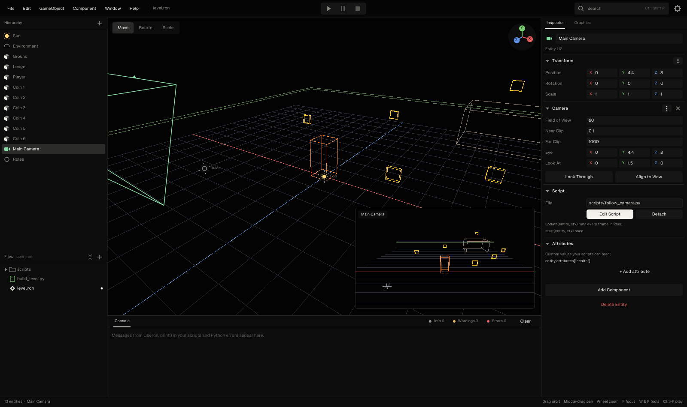

<p align="center">
  
</p>

# AUTOMATA

**A general-purpose 2D & 3D game engine for independent game development.**

- Native core in **Rust**
- Gameplay scripting in **Python** (via PyO3, Phase 5)
- Rendering on **wgpu**, physics via **Rapier**, audio via **Kira**

The full project specification — vision, architecture, roadmap, and
acceptance criteria — lives in [`build.md`](build.md).
Everything still to build, phased and in order, is in
[`ROADMAP.md`](ROADMAP.md); the detailed designs behind some phases are in
[`NEXT_PLANS.md`](NEXT_PLANS.md).

## Status

**Phases 1–6 complete** ✅ — project foundation, windowed/headless runtime,
wgpu rendering, scene/events core, Python bindings, and physics + input.

- Rust workspace: `automata-core` (lifecycle, fixed-timestep loop),
  `automata-scene` (hecs ECS, events, resources), `automata-renderer`
  (wgpu 2D/3D), `automata-input` (keyboard/mouse/gamepad, action mapping),
  `automata-physics` (Rapier 2D/3D, raycasts, character controllers),
  `automata-nav` (navigation meshes, path finding, nav agents),
  `automata-assets` (glTF / OBJ model import), `automata-python` (PyO3
  bindings)
- Python API: decorator, procedural, and OOP (subclassing) styles —
  see [`docs/api.md`](docs/api.md) and [`examples/python/`](examples/python)
- CI enforces fmt, Clippy (`-D warnings`), tests, docs, and the Python
  test suite on every push

## Oberon, the editor



```console
cargo run -p oberon --release [level.ron]
```

You build scenes visually and attach Python behaviour scripts, then press
Play. Oberon also has these:
- a **Graphics** tab for tuning the sun, environment, tone mapping, and
  fog, with one-click test scenes
- **scene cameras** with frustums and a live preview
- a built-in code editor with completion and LSP

Start with the [tutorials](docs/wiki/tutorials/README.md) or the
[Oberon manual](docs/wiki/oberon/README.md). The landing page is in
[`docs/site/index.html`](docs/site/index.html).

## Documentation

The whole manual is also a website: open `docs/site/index.html` (the landing
page) or `docs/site/docs/index.html` (the docs). To browse it locally with
working screenshots, serve the `docs/` folder:

```console
python3 -m http.server -d docs 8000   # then open http://localhost:8000/site/
```

- [Wiki home](docs/wiki/README.md): guides for the Python API and Oberon
- [Tutorials](docs/wiki/tutorials/README.md): first scene, coin collector,
  third-person camera, camera rails, lighting & mood, shipping
- [API reference](docs/wiki/api-reference.md)

## Building

```console
python scripts/build.py            # engine + Python wheel + install
python scripts/build.py --all      # also run gates and tests
```

Requires a Rust toolchain, Python 3.11+, and (on Linux) `patchelf` for
wheel repair.


## Quickstart

```console
$ cargo run -p automata-core            # opens a 1280x720 window (Esc quits)
INFO automata_core: automata initialized title="AUTOMATA" version="0.1.0"
INFO automata_core::app: entering main loop mode=Windowed(...)
INFO automata_renderer: GPU adapter selected ...
INFO automata_renderer: surface configured ...

$ cargo run -p automata-core -- --headless   # no display required
```

Run the test suite:

```console
cargo test --workspace
```

## Try Coin Run

Two builds of the example game Coin Run (`examples/oberon/coin_run`) sit at
the top of the repo:

- **`game.apk`**: install it on an Android phone (arm64) or emulator
  (x86_64). It's signed with CI's debug key, for testing. The Android
  workflow commits it after the APK passed its emulator test.
- **`game.zip`**: the exported game folder the web player runs
  (`automata-cli stage --zip`), exactly what `automata-cli build
  --target web` puts in a web build. Build it for your browser with
  `automata-cli build examples/oberon/coin_run --target web` and play it
  with `automata-cli serve examples/oberon/coin_run`, or package it with
  `web/ci/package.sh game.zip` (see [`web/README.md`](web/README.md)).

## Repository layout

```text
automata/
├── build.md                # Project specification (read this first)
├── crates/
│   ├── automata-core/      # Engine core: lifecycle, time, window runtime
│   ├── automata-scene/     # ECS scene graph, events, resources
│   ├── automata-renderer/  # wgpu device, surface, presentation
│   ├── automata-input/     # Keyboard/mouse/gamepad state, action mapping
│   ├── automata-physics/   # Rapier 2D/3D worlds, raycasts, controllers
│   ├── automata-nav/       # Navmesh baking, path finding, nav agents
│   ├── automata-assets/    # glTF / OBJ model loading and caching
│   └── automata-python/    # PyO3 bindings + the `automata` package
├── docs/                   # Architecture, development, and API documentation
├── examples/python/        # Runnable example games (headless-capable)
├── scripts/                # build.py (one-shot build) and env helpers
├── web/                    # The engine in the browser (Pyodide, WebGL2)
├── game.zip                # Coin Run, exported for the web player (scripts/game_zip.sh)
├── game.apk                # Coin Run for Android, built and emulator-tested by CI
└── tests/                  # (Cross-crate integration tests, when needed)
```

## License

Licensed under either of [Apache License, Version 2.0](LICENSE-APACHE) or
[MIT license](LICENSE-MIT) at your option.
