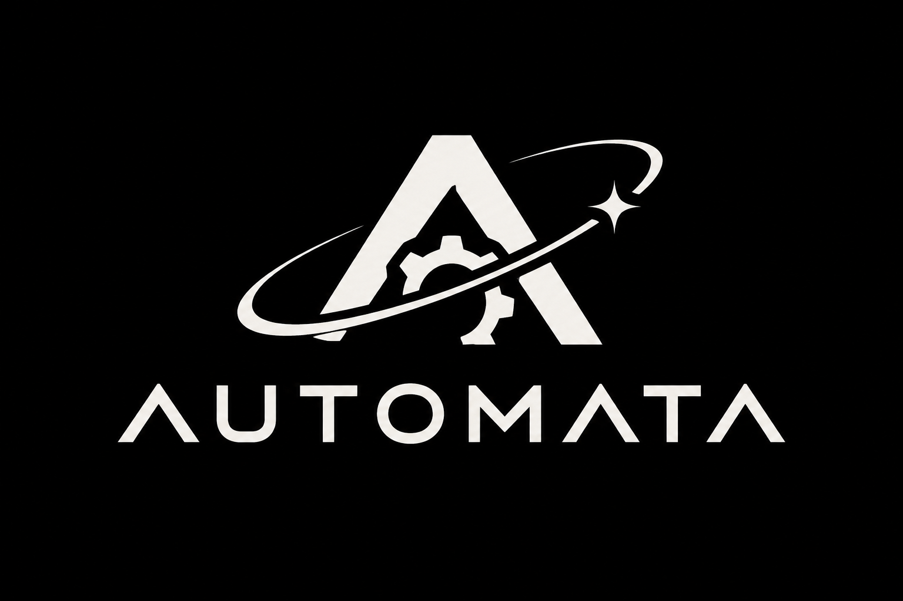

<p align="center">
  
</p>

# AUTOMATA

**A general-purpose 2D & 3D game engine for independent game development.**

- Native core in **Rust**
- Gameplay scripting in **Python** (via PyO3, Phase 5)
- Rendering on **wgpu**, physics via **Rapier**, audio via **Kira**

The full project specification — vision, architecture, roadmap, and
acceptance criteria — lives in [`build.md`](build.md).

## Status

**Phases 1–6 complete** ✅ — project foundation, windowed/headless runtime,
wgpu rendering, scene/events core, Python bindings, and physics + input.

- Rust workspace: `automata-core` (lifecycle, fixed-timestep loop),
  `automata-scene` (hecs ECS, events, resources), `automata-renderer`
  (wgpu 2D/3D), `automata-input` (keyboard/mouse/gamepad, action mapping),
  `automata-physics` (Rapier 2D/3D, raycasts, character controllers),
  `automata-python` (PyO3 bindings)
- Python API: decorator, procedural, and OOP (subclassing) styles —
  see [`docs/api.md`](docs/api.md) and [`examples/python/`](examples/python)
- CI enforces fmt, Clippy (`-D warnings`), tests, docs, and the Python
  test suite on every push

## Building

```console
python scripts/build.py            # engine + Python wheel + install
python scripts/build.py --all      # also run gates and tests
```

Requires a Rust toolchain, Python 3.11+, and (on Linux) `patchelf` for
wheel repair.


## Quickstart

```console
$ cargo run -p automata-core            # opens a 1280x720 window (Esc quits)
INFO automata_core: automata initialized title="AUTOMATA" version="0.1.0"
INFO automata_core::app: entering main loop mode=Windowed(...)
INFO automata_renderer: GPU adapter selected ...
INFO automata_renderer: surface configured ...

$ cargo run -p automata-core -- --headless   # no display required
```

Run the test suite:

```console
cargo test --workspace
```

## Play the FPS example

`examples/python/oop_fps.py` is a small playable first-person shooter built
with the engine's object-oriented `Game` / `Scene` / `Entity` API. It includes
an enclosed collision-tested arena, downloaded CC0 Kenney rifle and enemy
models, hitscan shooting, robot waves, a geometric HUD, and original
synthesized WAV effects. The example uses captured/hidden relative mouse input.

```console
python examples/python/oop_fps.py
```

Use **WASD** to move, **mouse or arrow keys** to look, **Space** to jump,
**left mouse or F** to fire, **R** to reload, and **Escape** to quit. To
exercise the game loop without a window, add `--headless`. Real device audio
is optional; install the bindings with `--features audio-cpal` to enable it
(the game remains playable with the silent backend).

## Repository layout

```text
automata/
├── build.md                # Project specification (read this first)
├── crates/
│   ├── automata-core/      # Engine core: lifecycle, time, window runtime
│   ├── automata-scene/     # ECS scene graph, events, resources
│   ├── automata-renderer/  # wgpu device, surface, presentation
│   ├── automata-input/     # Keyboard/mouse/gamepad state, action mapping
│   ├── automata-physics/   # Rapier 2D/3D worlds, raycasts, controllers
│   └── automata-python/    # PyO3 bindings + the `automata` package
├── docs/                   # Architecture, development, and API documentation
├── examples/python/        # Runnable example games (headless-capable)
├── scripts/                # build.py (one-shot build) and env helpers
└── tests/                  # (Cross-crate integration tests, when needed)
```

## License

Licensed under either of [Apache License, Version 2.0](LICENSE-APACHE) or
[MIT license](LICENSE-MIT) at your option.
