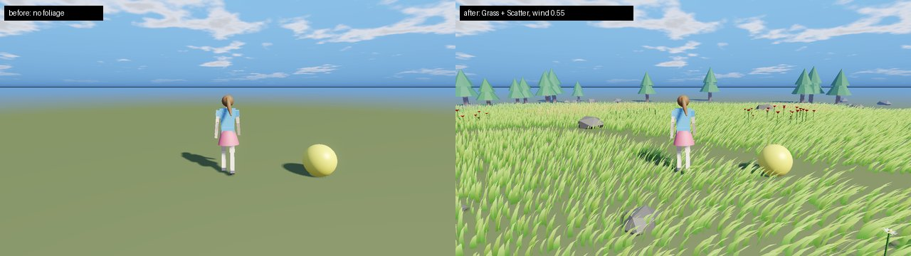
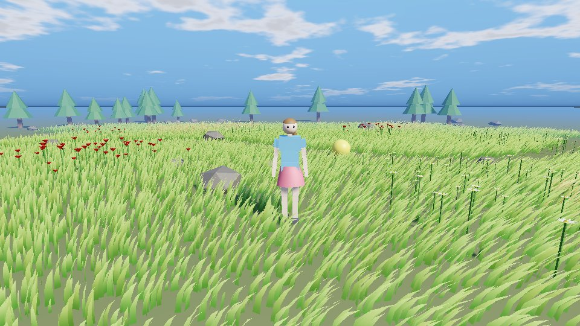

# Guide: Grass & Foliage

Two components cover the ground in a living layer:

- **`Grass`**: a field of blades that sway in the wind and bend away
  from characters and rolling objects walking through them.
- **`Scatter`**: foliage scatter. It draws the entity's own model (a rock,
  a flower, a tree) at many spots on the ground instead of once.

Both grow over an `area` and then take brush strokes: `paint` adds more,
`erase` cuts some away. In Oberon you paint them with a brush in the scene
view (see [Oberon → Grass & foliage](../oberon/foliage.md)); in code you
call the same strokes.



## Grass

```python
import automata as at

meadow = at.Grass(area=(30.0, 30.0), density=55.0, height=0.55)
for x in range(-15, 16):
    meadow = meadow.erase((x, 0.0, 2.0), radius=1.1)  # a path across
meadow = meadow.paint((18.0, 0.0, -6.0), radius=4.0)  # a patch past the edge

scene.add(at.Entity("Meadow").add(at.Transform()).add(meadow))
scene.add(at.Entity("Environment").add(at.Environment(sky=True, wind=0.5)))
```

`area` is a `width × depth` rectangle in metres along the entity's X and
Z, centred on it. It's filled at full density; `(0, 0)` means no
rectangle at all, only what you paint. The blades stand on the entity's
XZ plane, so move or tilt the entity to move the field. Brush strokes
carry their own height and surface normal, so painted grass follows
slopes and stands on top of whatever you painted onto. Over a
[`Terrain`](../oberon/terrain.md) the blades stand on its surface instead,
and keep following it when it's sculpted (`follow_terrain=False` turns
that off).

| Field | Default | Meaning |
|---|---|---|
| `area` | `(0, 0)` | The filled rectangle, metres |
| `density` | 60 | Blades per square metre where fully painted |
| `height` | 0.6 | The tallest blades, metres |
| `height_variation` | 0.45 | 0..1: how much shorter some blades are |
| `width` | 0.07 | Blade width at the root, metres |
| `base_color` / `tip_color` | greens | Colour at the root and at the tip (linear RGB) |
| `color_variation` | 0.3 | 0..1: how much blades differ: brighter, darker, drier, lusher |
| `draw_distance` | 60 | Metres from the camera it's drawn to (0 = any distance) |
| `seed` | 0 | Picks which random field grows |
| `strokes` | (read-only) | How many brush strokes it has |

```python
grass.paint(position, radius=2.0, normal=(0, 1, 0), strength=1.0)  # -> a new Grass
grass.erase(position, radius=2.0, strength=1.0)                    # -> a new Grass
grass.blade_count()  # blades it grows on an entity at the origin
```

`Grass` is a value, like the other components: `paint` and `erase`
return a changed copy. A stroke is a soft disc: full strength in the
middle half, fading out to its edge. `strength` below 1 paints thinner
grass, and erasing at 0.5 halves what's there. Positions are in the
entity's space.

Blades thin out over the far four fifths of `draw_distance` and are gone
past it; the ones left get a little wider, so the field still reads as
full. Lower graphics presets draw fewer blades.

### Wind

The `Environment`'s `wind` (0 still to 1 a gale) and `wind_direction`
(degrees around +Y, 0 = toward +X) blow over the whole scene:

- **Grass** leans downwind, with slow gusts rolling across the field
  over a quicker flutter. Even in still air it moves a little.
- **Spring bones** (hair, cloth, tails) stream downwind as well.
- **Water** throws spray off its crests from 0.5 up. Each `Water` also
  has its own `wind`; spray follows whichever is stronger.

### What pushes grass aside

Every **character** (an entity with a `CharacterController`) and every
**moving body** (a `RigidBody` that isn't fixed) bends the blades around
the bottom of its collider away from it. The circle is as wide as the
collider. A rolling ball leaves a wake, and the player parts the grass as
they walk. The eight nearest the camera count each frame. Fixed scenery
and sensors don't push.

## Scatter

```python
rocks = at.Scatter(area=(40.0, 40.0), density=0.02, scale=(0.6, 2.4), align=0.6)
poppies = at.Scatter(density=2.0).paint((-6.0, 0.0, 6.0), radius=3.0)

scene.add(at.Entity("Rocks").add(at.Transform())
          .add(at.MeshRenderer.model("models/rock.glb")).add(rocks))
scene.add(at.Entity("Poppies").add(at.Transform())
          .add(at.MeshRenderer.model("models/poppy.glb")).add(poppies))
```

A `Scatter` takes the entity's `MeshRenderer` and draws it at every spot
the scatter picks instead of once. Each copy gets a random turn and a
random size between `scale`'s two ends. All the copies draw instanced, so
a few hundred flowers cost about what one does, per part of the model.
**Keep scattered models low-poly**: a few dozen triangles for a flower.
A primitive sphere is over two thousand, and they all cast shadows.

| Field | Default | Meaning |
|---|---|---|
| `area` | `(0, 0)` | The filled rectangle, metres |
| `density` | 0.2 | Copies per square metre where fully painted |
| `scale` | `(0.7, 1.3)` | The smallest and largest size |
| `align` | 0.3 | 0 = upright, 1 = following the ground's slope |
| `seed` | 0 | Picks where the copies go |

`paint`, `erase` and `count()` work as for grass. Copies aren't solid:
give a boulder you can bump into its own collider.

## In scene files

Both are saved with their strokes:

```ron
grass: Some((
    density: 55.0,
    height: 0.55,
    area: (30.0, 30.0),
    strokes: [
        (position: (-15.0, 0.0, 2.0), normal: (0.0, 1.0, 0.0), radius: 1.1, strength: -1.0),
    ],
)),
```

A negative `strength` is an erase.

## Performance

Fields are grown once and cached. They grow again only when something
that shapes them changes: a stroke, the density, the entity moving.
Each field is split into 8 m chunks:

- Chunks outside the camera's view are skipped.
- Each chunk is baked into a vertex buffer on the GPU the first time
  it's seen. Drawing a chunk then uploads nothing.
- A chunk draws as many of its blades as its distance keeps, in one
  draw call. Nearest chunks draw first, so the blades in front hide the
  ones behind before they're shaded.
- Past 12 m each blade is one triangle instead of five.

A baked blade takes about 450 bytes of GPU memory. The Meadow example's
52,000 blades take about 23 MB. Chunks not drawn for a few seconds are
freed.

What a field costs is mostly pixels: grass covers much of the screen,
layer behind layer. If the frame rate drops, lower `density` (and raise
`width` to keep the field looking full) or shorten `draw_distance`. The
grass in the Meadow example is 55 blades per square metre over 30 × 30 m.

## Example

`examples/oberon/meadow`: a windy meadow with a footpath, flowers, rocks
and woodland to walk through, and a ball to kick. Open it in Oberon and
paint more.



## See also

- [Oberon → Grass & foliage](../oberon/foliage.md): the brush
- [Oberon → Terrain](../oberon/terrain.md): ground to grow it on
- [Rendering & Lights → Environment](rendering-and-lights.md#environment)
- [Physics → Character controller](physics.md)
