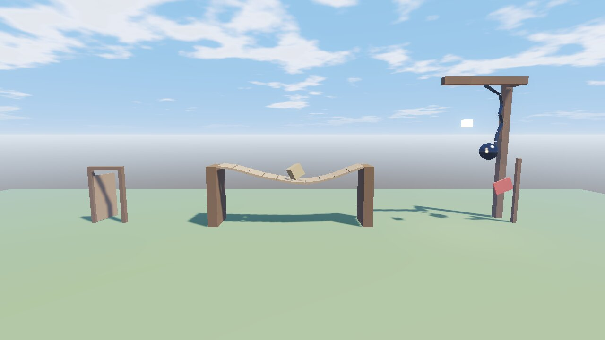

# Guide: Physics

Rapier-powered rigid bodies in 3D and 2D, a character controller, and
raycasts — stepped at a fixed 60 Hz so gameplay is identical at any frame
rate.

## Bodies

```python
at.RigidBody.dynamic()              # gravity, forces, collisions — crates, balls
at.RigidBody.fixed()                # never moves — floors, walls, platforms
at.RigidBody.kinematic_velocity()   # you set velocity; physics resolves collisions
at.RigidBody.kinematic_position()   # you set position; it pushes dynamic bodies
```

Fine-tuning: `at.RigidBody(body_type="dynamic", gravity_scale=1.0,
linear_damping=0.0, angular_damping=0.0, enabled=True)`.

## Colliders

```python
at.Collider3D.cuboid(x, y, z)   # FULL sizes — match Transform.scale exactly
at.Collider3D.ball(radius)
at.Collider3D.capsule(half_height, radius)
at.Collider3D.mesh("models/platform.glb")         # the model's own triangles
at.Collider3D.convex_hull("models/crate.glb")     # shrink-wrapped around it

at.Collider2D.cuboid(x, y)
at.Collider2D.ball(radius)
at.Collider2D.capsule(half_height, radius)
```

Chainable material modifiers: `.friction(0.8)`, `.restitution(0.3)`
(bounciness), `.density(2.0)`, `.sensor(True)` (detect overlap without
blocking movement — pickups, triggers).

> **Collider sizes are full sizes.** `Transform(scale=(40, 1, 40))` pairs
> with `Collider3D.cuboid(40, 1, 40)`. Get this wrong and things float or
> sink by exactly half.

### Colliders from models

`mesh` and `convex_hull` take a model file (relative to the scene, like
`MeshRenderer.model`) and build the shape from it when the scene starts,
after the model's import settings and at the entity's scale. The scene
stores only the path.

- **Mesh** is exact: rays and characters hit the real triangles, so
  ramps, arches and bevelled platforms behave as they look. Use it for
  static scenery (no rigid body, or a static or kinematic one). A triangle
  mesh has no inside, so it can't give a dynamic body mass: on a dynamic
  body it plays as its convex hull, and Oberon and **Build Game** flag it.
- **Convex hull** wraps the model like shrink-film: no dents or holes. Use
  it for dynamic bodies a box or capsule fits badly.
- Boxes, balls and capsules are still the cheapest. Prefer them when they
  fit.

> **2D and 3D are separate worlds.** A `Collider2D` never touches a
> `Collider3D`. Pick one per game; per entity, use the matching family.

## The per-frame toolbox

```python
ctx.physics.grounded(player)                       # standing on something?
ctx.physics.velocity(entity)                       # current (vx, vy, vz)
ctx.physics.set_velocity(entity, (0, 5, 0))
ctx.physics.apply_impulse(entity, (0, 300, 0))     # one-shot kick
ctx.physics.apply_force(entity, (10, 0, 0))        # continuous push
ctx.physics.gravity() / ctx.physics.set_gravity((0, -9.81, 0))
ctx.physics.body_count()

key = ctx.physics.cast_ray(origin, direction, max_distance=100.0, exclude=player)
hit = ctx.physics.ray_result(key)   # (entity_id, point, normal, distance) or None
ctx.physics.water_height(x, z)      # water surface height there, or None
ctx.water.splash(entity, 2.0)       # rings and foam (scene scripts; see Water)
```

`ctx.physics2d` mirrors the essentials for the 2D world (`apply_impulse`,
`grounded`, `body_count`).

## Water

Every entity with a [`Water`](rendering-and-lights.md#water) component is
also a volume of water. Dynamic bodies in it get two things each step:

- **Buoyancy**: an upward push of `water density × gravity × submerged
  volume`, applied where the body is under, so a body settles at the depth
  its density gives and tilts with the waves. A body floats when its
  collider `density` is below the water's, with that fraction under.
- **Drag**: it loses speed and spin in proportion to how much of it is
  under (`drag`, default 1.0; 0 turns it off).

```python
scene.add(at.Entity("sea").add(at.Transform()).add(
    at.Water(size=(80, 80), wave_height=0.4, wave_length=20.0)))  # density=2.0
scene.add(at.Entity("crate")
    .add(at.Transform(position=(0, 2, 0)))
    .add(at.MeshRenderer.cube(size=1.0))
    .add(at.RigidBody.dynamic())
    .add(at.Collider3D.cuboid(1, 1, 1)))              # density 1.0: half under
scene.add(at.Entity("anchor")
    .add(at.Transform(position=(3, 2, 0)))
    .add(at.MeshRenderer.cube(size=0.5))
    .add(at.RigidBody.dynamic())
    .add(at.Collider3D.cuboid(0.5, 0.5, 0.5).density(6.0)))  # sinks, slowly
```

Bodies ride exactly the waves that are drawn: physics samples the same
Gerstner waves on the CPU, on the same clock. A long wave over a large
surface moves the geometry. Waves shorter than about four of the surface's
128 grid cells only ripple the shading, so they don't move bodies either.
In Oberon, set **Density** and **Drag** in the Water section of the
Inspector.

It's built to be cheap:

- Without water it costs nothing.
- Sleeping bodies are skipped, and bodies that settle on calm water fall
  asleep.
- Awake bodies away from the water cost a couple of comparisons.
- A body in the water is sampled at 1 point if small, or 8 if not (so long
  hulls pitch and roll). About 0.25 µs per floating body per step on waves,
  measured on one core.

The surface isn't solid: give the water a floor if sinking things should
stop. The [Lagoon example](../../../examples/oberon/lagoon/README.md)
floats crates and buoys, and runs a boat round the island.

### Ripples and wakes

On top of the waves, a small wave simulation runs around the camera: a
256 × 256 grid, a quarter metre per cell (64 m across), that follows the
view. Anything crossing the surface pushes it about, dynamic and kinematic
bodies alike:

- A body that **drops in** splashes: rings spread out from it, and foam.
  The harder and bigger, the bigger the splash.
- A body that **bobs** sends out small rings as it bobs.
- A body that **moves** pushes ripples ahead and leaves a V-shaped
  **wake** behind it, with a trail of foam. Ripples spread at 1.6 m/s, so
  anything faster than that (a boat) gets a proper V.
- Scripts make their own: `ctx.water.splash(position, strength)` (scene
  scripts, Oberon included) or `ctx.physics.splash((x, y, z), strength)`
  (engine scripts). `position` can be an entity; `strength` runs from 0 to
  10, and 1 is about a crate dropped from a couple of metres.

```python
def update(entity, ctx):
    if ctx.input.just_pressed("space"):
        ctx.water.splash(entity, 3.0)   # a cannonball lands here
```

Ripples are only drawn; they don't move bodies (those ride the waves).
They fade over about ten seconds. Beyond the 64 m around the view there are
none, and the field fades out toward its edges so it never ends in a seam.

### Splashes and spray

A body that hits the water faster than 1.5 m/s also throws up a **splash**:
a burst of droplets (the `"splash"` particle preset) where it went in.
Its size follows the entry speed. A crate dropped from a metre makes a
few droplets; a dive off a pier sends up a white crown. Characters splash
too, although they're moved by teleporting rather than by velocity.

On a `Water` with `wind` above 0.5, **spray** blows off the wave crests
within 25 m of the camera, carried downwind (`wave_direction`). It gets
more frequent and denser as `wind` goes up to 1. Calm water never sprays.

Both are ordinary particle entities that remove themselves once they're
done. In Rust, `PhysicsTick::splashes` lists each step's splashes (where,
how fast and how big), and `set_water_particles(false)` stops the
particles but keeps the rings.

It costs nothing until something disturbs the water and nothing again once
it calms down. While it runs, about 0.25 ms per physics step in a release
build. The engine and Oberon point it at the camera that draws the frame;
with your own `PhysicsWorld3D` in Rust, call `set_ripple_view(eye,
target)` each frame and hand `ripples()` to `DrawList::set_ripples`.

## Joints



A **Joint** holds an entity's body to another entity's (`connected`, by
name) or to the world (`connected=None`). Both need a rigid body. An entity
has at most one joint, so a chain is each link joined to the one before it.

```python
door.add(at.Joint.hinge(axis=(0, 1, 0), connected="Door Frame",
                        anchor=(-0.54, 0, 0),            # the hinge edge, in the door's space
                        limits=(-1.7, 1.7),              # radians
                        motor=at.JointMotor(target=0.0)))  # pulls shut
link.add(at.Joint.ball(connected="Link 3", anchor=(0.2, 0, 0)))
sign.add(at.Joint.fixed(connected="Post", break_force=120.0))  # snaps past 120 N
lamp.add(at.Joint.spring(1.2, stiffness=30.0, damping=1.0, connected="Beam"))
crate.add(at.Joint.rope(3.0))                             # hangs from the world
```

| Kind | Moves | Limits | Motor | Use |
|---|---|---|---|---|
| `hinge` | turns around `axis` | angle (rad) | ✓ | doors, wheels, bridge planks |
| `ball` | swivels freely | cone (rad) | | chain links, ragdoll shoulders |
| `slider` | slides along `axis` | position (m) | ✓ | drawers, lifts, pistons |
| `fixed` | nothing | | | welds — give it a `break_force` |
| `rope` | up to `length` apart, slack closer | | | ropes, leashes |
| `spring` | pulled towards `length` apart | | | bouncy lamps, suspension |

- **`anchor`** is where the joint sits, in this entity's local space;
  `connected_anchor` is the same point in the other's. Leave that out and
  the joint holds the bodies as they were placed; a rope or spring is then
  tied to the other's centre (joined to the world: to a point above it).
- **`length=0`** (ropes and springs) means "the distance they start at".
- **`JointMotor(speed)`** turns (or slides) at `speed` rad/s (m/s);
  **`JointMotor(target=1.2)`** pulls to an angle and holds it.
  `stiffness=400, damping=80` settle in about half a second with no
  overshoot; `max_force=0` means as strong as needed.
- **`break_force`** (newtons, 0 = never) snaps the joint when it's pulled
  harder. **`collide_connected`** lets the two bodies bump each other
  (off by default, so a hinge's door and frame can overlap).
- 2D works the same with `Collider2D` bodies: hinges and balls turn around Z.

### Joints in scripts

A running joint is `entity.joint` (or `view.joint`), and `None` without one:

```python
def update(entity, ctx):
    j = entity.joint
    j.angle          # hinge angle from where it started (radians); .value for any kind
    j.force          # newtons pulling on it at the last step
    j.attached, j.broken
    j.motor_target = 1.4 if ctx.input.pressed("e") else 0.0   # or motor_speed
    j.limits = (-0.5, 0.5)      # None to free it
    j.enabled = False           # let go; True joins again
    j.connected = "Hook"        # join something else

def on_joint_broken(entity, ctx):          # once, when break_force snaps it
    print("snapped at", entity.joint.force, "N")
```

The key store reaches other entities' joints — `ctx.get("Door:joint:angle")`
— and a break also publishes `"<name>:joint:broken"` with the force.

### Joints in Oberon

**Add Component → Joint** adds a hinge, and a Rigidbody and Collider if the
entity has none. The Inspector's Joint section picks the **Type**, what it's
**Connected To** (World or any named entity), the **Anchor**, and only the
settings that type uses: hinge and ball angles in degrees, slider distances
in metres. Renaming an entity keeps joints pointed at it. The
`examples/oberon/joint_yard` example has a door, a rope bridge and a chain
to take apart.

## The character controller

The platformer recipe — tight movement that still collides and climbs
slopes:

```python
player = (
    at.Entity("player")
    .add(at.Transform(position=(0, 1.4, 0)))
    .add(at.MeshRenderer.cube(size=0.9, color=ORANGE))
    .add(at.RigidBody.kinematic_velocity())       # 1. we own the velocity
    .add(at.Collider3D.capsule(0.5, 0.4))         # 2. capsule slides over edges
    .add(at.CharacterController(snap_to_ground=0.5))  # 3. kinematic solver
    .add(at.CharacterVelocity())                  # 4. per-frame drive input
)
```

```python
def on_update(self, ctx):
    player = ctx.scene["player"]
    dx = self.controls.axis("move_x", ctx.input)
    if ctx.physics.grounded(player):
        self.vy = -1.0                             # stay snapped to ground
        if self.controls.just_pressed("jump", ctx.input):
            self.vy = JUMP_SPEED
    else:
        self.vy -= GRAVITY * ctx.time.delta
    player.character_velocity = (dx * WALK_SPEED, self.vy, 0.0)
```

`CharacterController` options (keyword-only): `snap_to_ground`,
`autostep`, `max_slope_climb_angle`, `min_slope_slide_angle`,
`offset`, `slide`, and `mode="normal"` (or `"autostep"`-friendly setups).

## Common pitfalls

- **Player falls through the floor:** collider sizes don't match the
  visual scale (use full sizes), or the floor lacks `RigidBody.fixed()`.
- **Kinematic character never moves:** you set `Transform.position` instead
  of `character_velocity` — the solver only sees the velocity component.
- **A joint drifts apart or explodes:** the bodies are very different in
  mass (a 1 kg link holding a 1000 kg ball). Raise the light ones' collider
  `density`, or lower the heavy one's.
- **A joined pair pushes itself apart:** they overlap and you turned on
  `collide_connected`; leave it off.
- **Dynamic body jitters against a wall:** that's restitution/friction;
  try `friction(0.2)` on the wall or clamp velocity yourself.

## See also

- [Scenes & Entities](scenes-and-entities.md) — component basics
- [Cookbook](../cookbook.md#movement) — coyote time, jump buffering
- [API Reference](../api-reference.md#physics-ctxphysics)
