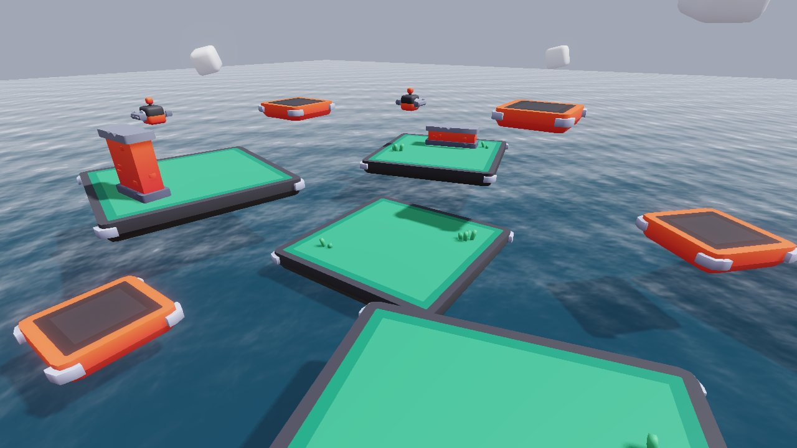

# Guide: Rendering & Lights

How things get on screen: primitives, cameras, the sun, the
environment (ambient, fog, tone mapping), and quality presets.

## Drawing primitives

```python
entity.add(at.MeshRenderer.cube(size=1.0, color=(r, g, b, a)))
entity.add(at.MeshRenderer.sphere(size=1.0, color=(r, g, b, a)))
entity.add(at.MeshRenderer.quad(size=1.0, color=(r, g, b, a)))
```

- `size` sets the primitive's base size (a sphere's diameter); the entity's
  `Transform.scale` multiplies it. A floor is a unit cube with
  `scale=(40, 1, 40)`.
- `quad` lies in the XY plane facing +Z — billboards, cards, flat details.
- Colors are linear-space floats in `0.0..=1.0`.
- Primitives are **plain data**: safe to stage before a window exists and
  inert in headless mode. The windowed driver uploads them to the GPU on
  the first frame automatically.

> Python has no texture or custom-mesh API yet. For textured, detailed
> objects, load a model (`MeshRenderer.model`), see [Models](../oberon/models.md).

## Surfaces

Colour says *what* a thing is; the surface says what it's *made of*. Every
`MeshRenderer` constructor takes four keyword-only surface arguments:

```python
gold = at.MeshRenderer.sphere(color=(1.0, 0.77, 0.34, 1), metallic=1.0, roughness=0.3)
tile = at.MeshRenderer.cube(color=(0.9, 0.9, 0.9, 1), roughness=0.15)  # glossy
felt = at.MeshRenderer.cube(color=(0.2, 0.5, 0.3, 1), roughness=0.95)  # matte
lamp = at.MeshRenderer.quad(emissive=(1.0, 0.8, 0.5), emissive_strength=4.0)
```

| Argument | Range | Effect |
|---|---|---|
| `roughness` | 0..1 | 0 is a mirror-like gloss with a tight, bright highlight; 1 is chalky with no visible highlight. Default 0.6 |
| `metallic` | 0 or 1 (in between for dusty / painted metal) | Metals have no diffuse colour: they reflect the sky and sun tinted by `color`. Default 0 |
| `emissive` | (r, g, b), ≥ 0 | Light the surface gives off itself, unaffected by sun, shadow or fog darkness |
| `emissive_strength` | ≥ 0 | Multiplies `emissive`. Above about 1 it blooms on Ultra and Beautiful |
| `glow_light` | ≥ 0 | How much the glow lights nearby surfaces (see below). 1 by default, 0 turns it off |
| `glow_shadows` | `True` / `False` | Whether objects block that light and cast shadows from it (High and up). `True` by default |

Tips:

- Metals look best with a bright, saturated base colour: gold
  `(1.0, 0.77, 0.34)`, copper `(0.95, 0.64, 0.54)`, silver `(0.95, 0.95, 0.95)`.
  They need a sky to reflect, so pair them with an Environment.
- Shiny surfaces show their shape best on round things. A glossy cube
  only lights up when a face catches the sun.
- Models keep their own materials: glTF base colour, roughness, metallic,
  normal maps, emission (`KHR_materials_emissive_strength` too) and texture
  maps are all imported. Passing `roughness` / `metallic` / `emissive`
  overrides every part of the model.

Every quality level shades surfaces; Beautiful uses the full physically
based model, Low to Ultra a cheaper approximation that looks close.

### Glowing objects light their surroundings

Anything that glows also lights the things around it, in its own colour:
a lamp sphere throws a warm pool on the floor and the wall behind it,
glowing coins light the ground under them, a neon sign tints the street.
Nothing to set up: the engine turns every glowing mesh into a light at its
center.

```python
lamp = at.MeshRenderer.sphere(0.4, color=(0.1, 0.1, 0.1, 1),
                              emissive=(1.0, 0.55, 0.2), emissive_strength=5.0)
```

- **How bright:** as bright as a real glowing object of that size and
  brightness. A bigger or brighter glow lights more, and farther. The light
  fades with the square of the distance and stops where it's too dim to see.
- **`glow_light`** scales it: `0` glows without lighting anything (screens,
  UI-like signs, distant windows), `2`–`5` for small things that should
  still throw a visible pool, like the coins in Coin Run.
- **Night and dusk** show it best. In daylight the sun outshines all but the
  brightest glows.
- **Models:** glowing parts of a model light too. An emissive texture lights
  in proportion to how much of it is lit (a few windows light less than a
  whole glowing wall).
- **Shadows:** on High and up, objects block glow light: crates around a
  lantern throw long shadows outward across the floor, and a pillar
  between a lamp and a wall leaves its outline on the wall. The glowing
  mesh itself never blocks its own light. `glow_shadows=False` (Oberon:
  untick **Glow Shadows**) lets a glow's light pass through everything,
  which is cheaper; use it for small or unimportant glows.
- **Limits:** a frame shades at most 4 (Low), 8 (Medium), 16 (High) or 32
  (Ultra, Beautiful) glow lights (placed lights, below, count too); with more, the ones nearest the camera
  win. Of those, the nearest 2 (High) or 4 (Ultra, Beautiful) that have
  `glow_shadows` on cast shadows. The rest light through walls, and so
  does every glow on Low and Medium.

## Cameras

```python
at.Camera3D(position=(0, 3.5, 9), target=(0, 1, 0), fov=60.0)
at.Camera2D(center=(0, 0), half_height=100.0)
```

- The **first entity** with a camera component is the frame's camera
  (3D for meshes, 2D for sprites).
- No camera → meshes fall back to `(0, 0, 5)` looking at the origin;
  sprites fall back to screen-space pixels, origin top-left, +Y down.

**Follow camera** — cameras are writable per frame, so tracking a player is
three lines (smooth exponential follow):

```python
def on_update(self, ctx):
    px, py, _ = ctx.scene["player"].transform.position
    blend = min(1.0, 8.0 * ctx.time.delta)        # frame-rate independent
    self.cam_x += (px - self.cam_x) * blend
    self.cam_y += (max(py + 1.6, 2.6) - self.cam_y) * blend
    ctx.scene["camera"].camera_3d = at.Camera3D(
        position=(self.cam_x, self.cam_y, 10.0),
        target=(self.cam_x, self.cam_y - 1.4, 0.0),
    )
```

## The sun

```python
scene.add(
    at.Entity("sun").add(
        at.DirectionalLight(
            direction=(-0.45, -1.0, -0.3),  # where the light travels
            color=(1.0, 0.96, 0.88),        # warm afternoon
            ambient=0.35,                   # fill on shadowed faces
            shadows=True,                   # shadow mapping on
            shadow_distance=120.0,          # metres of shadows (shorter = sharper)
            shadow_softness=1.0,            # 0 sharpest .. 8 very soft
        )
    )
)
```

- The first `DirectionalLight` entity lights the frame. No light entity →
  a neutral shadowless default (the scene is still visible).
- Meshes are Blinn-Phong shaded: `ambient * color` everywhere, plus
  sun-colored diffuse and a subtle specular highlight where lit.
- **Shadows** are shadow-mapped automatically, so any level size works.
  On High and up the view is split into cascades (2 on High, 3 on Ultra,
  4 on Beautiful): the first covers the few metres around the camera at
  full resolution, so shadows under the player are sharp, and each next
  one covers farther, coarser. Cascade edges blend, and shadows fade out
  at `shadow_distance`. A small level is covered only as far as it
  reaches, so it gets even sharper shadows. Medium uses one map around
  the whole scene (or the view, if that's smaller). Shadowed regions keep
  the ambient term.
- **`shadow_distance`** (metres, default 120): how far shadows reach.
  Shorter is sharper: a tight indoor or top-down game can use 30–50.
- **`shadow_softness`** (default 1): how soft shadow edges are. 0 is as
  sharp as the shadow map allows, higher values blur the edge (Beautiful
  shows the most difference; High and Ultra stay crisp). On Beautiful,
  shadows are sharp where an object touches the ground and soften with
  the distance to it, as much as the sun's size (`sun_size`) times the
  softness says: a pole's shadow starts crisp at its foot and blurs
  toward its tip.

## Point lights and spotlights

Place lights anywhere: a torch on a wall, a lamp post, a car's headlights,
a flashlight. A **`PointLight`** shines every way from its entity's
position. A **`SpotLight`** shines in a cone along its entity's forward
direction (local −Z, turned by the entity's rotation).

```python
# A torch on a wall: warm, reaching about 10 m.
scene.add(at.Entity("torch")
          .add(at.Transform(position=(-2.2, 2.5, -3.45)))
          .add(at.PointLight(color=(1.0, 0.58, 0.28), intensity=3.5, range=10.0)))

# A headlight: a 26° cone tipped 9° down toward the road.
scene.add(at.Entity("headlight")
          .add(at.Transform(position=(2.0, 0.72, 0.55),
                            rotation_euler=(math.radians(-9), 0, 0)))
          .add(at.SpotLight(intensity=18.0, outer_angle=26.0, inner_angle=12.0,
                            range=22.0)))
```

| Setting | Values | What it does |
|---|---|---|
| `color` | RGB 0..1 | The light's colour |
| `intensity` | ≥ 0 | Brightness. 1 lights a surface 1 m away, facing the light, as brightly as a white sun overhead; at 2 m it's a quarter of that. Torches and lamps: 2–6. Headlights and stage lights: 10–30 |
| `range` | m, 0 = auto | Where the light ends. 0 works it out from the brightness, ending where the light is too dim to see. Set a range to keep a light inside a room |
| `outer_angle` | degrees, ≤ 80 | (Spot) the cone's edge, measured from its axis. A 30° spot is 60° across |
| `inner_angle` | degrees | (Spot) full strength inside this angle, fading out toward the edge. Defaults to ¾ of `outer_angle`; closer to it gives a harder edge |
| `radius` | m | The size of the glowing source (default 0.05). Bigger looks softer up close |
| `shadows` | `True` / `False` | Whether objects block it and cast shadows (High and up). `True` by default |

- **Shadows:** placed lights share the shadow budget with glowing meshes.
  High shadows the 2 nearest point lights and Ultra and Beautiful the 4
  nearest. A spotlight costs a sixth of a point light, because its shadow
  is one view down the cone rather than six around it. So one point
  light's room shadows six spots, and a pair of headlights is cheap.
- **Fixtures don't block their own light:** a light inside a small mesh
  (up to about half a metre across: a bulb, a flame, a headlight lens)
  leaves that mesh out of its shadow. Give the mesh `glow_light=0` so it
  glows for the look without adding a second light.
- **Limits:** placed lights count toward the same per-frame cap as glows
  (4, 8, 16 or 32 lights from Low to Beautiful); the nearest and brightest
  win.
- **Oberon:** **Create → Point Light** or **Spot Light**. Selecting a
  light shows its reach in the viewport: three rings for a point light's
  range, or a spot's cone out to its range (the core is the fainter
  circle). Aim a spot with the Rotate tool.
- **Example:** `examples/oberon/night_lights` has a torch on a wall and a
  car with two headlights, all shadowed, with no light coming from a
  glowing mesh.

## Environment

The `Environment` component sets the look of the whole frame:
- hemisphere ambient light (sky above, ground below)
- the background colour
- exposure and tone mapping
- distance fog

The first entity that carries one wins.

```python
scene.add(at.Entity("look").add(at.Environment.preset("dusk")))
```

or spelled out:

```python
scene.add(
    at.Entity("look").add(
        at.Environment(
            sky_color=(0.75, 0.85, 1.0),     # ambient from above
            ground_color=(0.45, 0.4, 0.35),  # ambient from below (bounce)
            background=(0.55, 0.68, 0.85),   # replaces Game.clear_color
            exposure=1.1,
            tonemapping="aces",              # "none" | "reinhard" | "aces" | "agx"
            fog=True,
            fog_color=(0.55, 0.68, 0.85),    # match the background
            fog_density=0.012,               # per metre; 0.05 is thick
            fog_start=10.0,                  # metres of clear air first
            sky=True,                        # a sky dome with a sun and clouds
            zenith_color=(0.16, 0.34, 0.78), # sky colour straight up
            sun_size=2.0,                    # sun disk diameter, degrees
            sun_glow=1.0,                    # halo around the sun
            clouds=0.35,                     # 0 clear .. 1 overcast
            lens_flare=1.0,                  # Beautiful only
            ambient_occlusion=1.0,           # Beautiful only: 0 off .. 2
        )
    )
)
```

| Preset | Look |
|---|---|
| `"neutral"` | The default: white ambient, no fog, no tone mapping |
| `"daylight"` | Blue sky dome with sun and clouds, warm bounce, light haze, ACES |
| `"dusk"` | Violet sky with a big warm sun, dark red ground, dense warm fog, AgX |
| `"night"` | Near-black sky, cold dark ambient, black fog close to the camera, ACES |

How it combines with the sun:

- **The sky** (`sky=True`) replaces the flat background with a dome: a
  gradient from `background` at the horizon to `zenith_color` overhead,
  the sun's disk exactly where the `DirectionalLight` shines from, a halo
  that turns warm as the sun gets low, and two layers of drifting clouds.
  Water reflects it and distant fog fades into it, so the horizon has no
  seam. Move the sun (or drag **Time of Day** in Oberon) and the sky
  follows.
- **Lens flare** (`BEAUTIFUL` only): looking toward the sun adds glare,
  a starburst, a row of coloured ghosts and a faint halo ring. It fades
  out when the sun leaves the screen, and anything in front of the sun,
  scenery or clouds, hides it.
- **Ambient occlusion** (`BEAUTIFUL` only): nearby geometry blocks part
  of the sky's light, so creases, inside corners and the ground around
  and under objects get darker. It only dims ambient light, so it shows
  most in shade. `ambient_occlusion` sets the strength: 0 off, 1 default,
  2 strong.

- Ambient is `DirectionalLight.ambient × mix(ground, sky)`, picked by how
  much a surface faces up. Keep the sky and ground colours near 1.0 in
  brightness and control strength with `ambient`.
- **Sky-tinted shade:** with the sky dome on, the ambient from above leans
  a little toward `zenith_color` at the same brightness. Shade is lit by
  the sky alone, so shadows and shaded sides turn faintly blue on a clear
  day (or violet at dusk) instead of grey.
- **Fog** fades lit colour toward `fog_color` as
  `1 − exp(−density × (distance − start))`.
- **Tone mapping** runs last. ACES and AgX roll off highlights smoothly,
  so you can use brighter suns and colours without clipping. Raise
  `exposure` a little to compensate for their darker mid-tones.
- An Environment is staged data like any other component. It's saved in
  scene files and edited in [Oberon's Graphics tab](../oberon/graphics.md).

## Sky and quality

```python
class MyGame(at.Game):
    clear_color = (0.55, 0.78, 0.95, 1.0)   # the "sky" each frame clears to
    graphics = at.GraphicsQuality.HIGH
```

| Preset | Shadows | Shadow maps | Glow lights with shadows |
|---|---|---|---|
| `GraphicsQuality.LOW` | off | — | none |
| `GraphicsQuality.MEDIUM` | on | 1 × 1024px | none |
| `GraphicsQuality.HIGH` (default) | crisp | 2 cascades × 2048px | 2 (384px) |
| `GraphicsQuality.ULTRA` | crisp | 3 cascades × 2048px | 4 (512px) |
| `GraphicsQuality.BEAUTIFUL` | soft | 4 cascades × 2048px | 4 (512px, soft) |

`LOW` is also a *style*: pure flat-color faces with no shadow shading reads
as clean minimalism. Finer-grained knobs (render scale, MSAA) build on this
same setting as the renderer grows.

### Beautiful

`BEAUTIFUL` is the showcase preset. On top of what `HIGH` does it adds:

- **Contact-hardening shadows.** Four cascades split the view so shadows
  stay sharp up close and still reach the horizon. Each shadow is sharp
  where the object touches the ground and softens with the distance to
  it, scaled by the sun's size.
- **Ambient occlusion and contact shadows.** A half-resolution
  screen-space pass darkens creases and the ground around objects
  (ambient light only; `Environment.ambient_occlusion` sets how much), and
  a short ray toward the sun catches small gaps the shadow map is too
  coarse for, like a coin resting on the ground.
- **Physically based light** (GGX specular) and fog that glows toward the
  sun.
- **HDR with bloom**: bright highlights (sun glints on water, white
  surfaces in full sun) bleed softly. Then the tone mapper runs, and FXAA
  smooths the edges.
- **Refractive water** (see below).
- **Lens flare** when the camera looks toward the sun (with `sky=True`).

It's built to stay cheap. Each pixel filters only one shadow cascade (with
dithering where cascades meet), and sunlit pixels skip shadow filtering
after a quick search finds nothing between them and the sun. Ambient
occlusion and bloom run at half resolution and below. Nothing on the other
presets got slower. It
still costs more than `HIGH`. Offer it as a setting rather than the
default for games that should run on low-end laptops.

## Water

```python
scene.add(
    at.Entity("lake")
    .add(at.Transform(position=(0, -0.5, 0)))
    .add(at.Water.preset("lake"))          # or at.Water(size=(60, 40), ...)
)
```

A `Water` component draws an animated surface `size` metres wide on the
entity's XZ plane: rolling waves plus scrolling ripples, sky reflection
that strengthens at grazing angles (Fresnel), a sun glint, and light
glowing through wave crests. It receives shadows.

- On every preset below `BEAUTIFUL` it's alpha-blended over the scene.
- On `BEAUTIFUL` it refracts what's underneath. It fades to `deep_color`
  with depth (`clarity` is how many metres you can see down), and draws
  `foam` where it meets the shore or objects.

| Preset | Look |
|---|---|
| `"pond"` / `"lake"` | Low, short waves and clear water |
| `"ocean"` / `"sea"` | 200 m wide, tall long waves, deep blue, endless |
| `"default"` | 20 m, gentle waves |




`endless=True` carries the surface past its `size`, flat and calm, all
the way to the horizon, so a sea doesn't end in a visible edge. Waves,
foam and buoyancy stay within `size`; put the action there.

Things that cross the surface leave rings and wakes in it, with foam on
their crests, on every preset (see
[Physics → Ripples and wakes](physics.md#ripples-and-wakes)).

Water is also physics: dynamic bodies float in it and ride its waves (see
[Physics → Water](physics.md#water)). The surface isn't a solid collider,
so give the water a floor if sinking things should stop.

## Mood recipes

Without an Environment, these recipes use the plain look. Add a preset on
top to get fog and tone mapping too.

| Look | clear_color | sun color | ambient |
|---|---|---|---|
| Noon | `(0.55, 0.78, 0.95, 1)` | `(1.0, 1.0, 1.0)` | 0.35 |
| Golden hour | `(0.98, 0.75, 0.55, 1)` | `(1.0, 0.8, 0.6)` | 0.25 |
| Night | `(0.05, 0.07, 0.15, 1)` | `(0.6, 0.7, 1.0)` | 0.15 |
| Noir | `(0.02, 0.02, 0.03, 1)` | `(1.0, 1.0, 1.0)` | 0.05 |

## See also

- [The Game Loop](game-loop.md) — when frames render
- [Scenes & Entities](scenes-and-entities.md) — transforms and the scale trick
- [Models](../oberon/models.md) — imported materials and textures
- [Cameras](cameras.md) — follow, orbit, rails, shake, zoom
- [Cookbook](../cookbook.md#cameras) — orbit cams, screen shake
- [Oberon: Graphics](../oberon/graphics.md) — tune all of this visually
