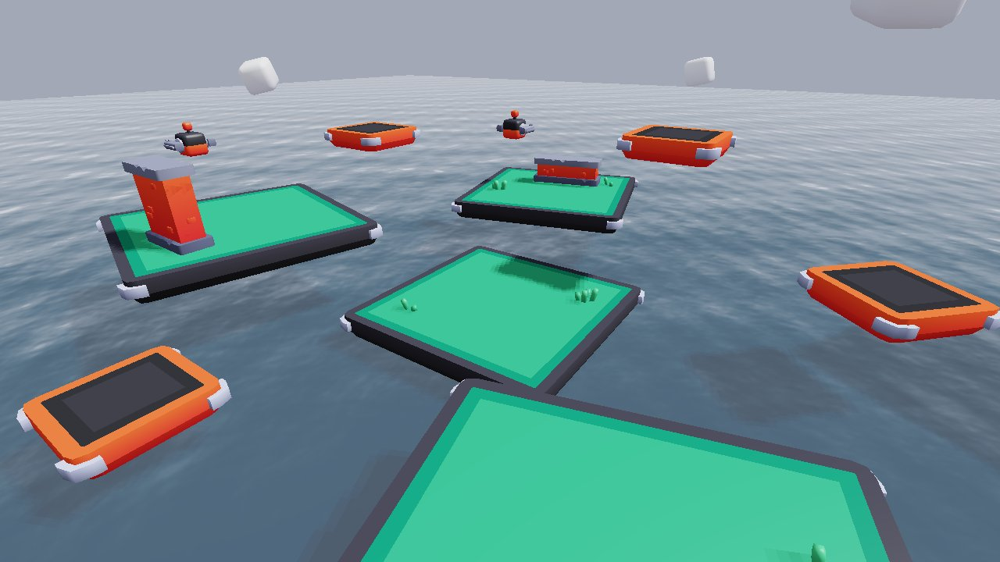

# Guide: Rendering & Lights

How things get on screen: primitives, cameras, the sun, the
environment (ambient, fog, tone mapping), and quality presets.

## Drawing primitives

```python
entity.add(at.MeshRenderer.cube(size=1.0, color=(r, g, b, a)))
entity.add(at.MeshRenderer.quad(size=1.0, color=(r, g, b, a)))
```

- `size` sets the primitive's base size; the entity's `Transform.scale`
  multiplies it. A floor is a unit cube with `scale=(40, 1, 40)`.
- `quad` lies in the XY plane facing +Z — billboards, cards, flat details.
- Colors are linear-space floats in `0.0..=1.0`.
- Primitives are **plain data**: safe to stage before a window exists and
  inert in headless mode. The windowed driver uploads them to the GPU on
  the first frame automatically.

> There is no texture or custom-mesh API in Python yet — the look is flat
> colors + lighting. That's a deliberate indie aesthetic and a roadmap
> item, not an oversight you can configure away.

## Cameras

```python
at.Camera3D(position=(0, 3.5, 9), target=(0, 1, 0), fov=60.0)
at.Camera2D(center=(0, 0), half_height=100.0)
```

- The **first entity** with a camera component is the frame's camera
  (3D for meshes, 2D for sprites).
- No camera → meshes fall back to `(0, 0, 5)` looking at the origin;
  sprites fall back to screen-space pixels, origin top-left, +Y down.

**Follow camera** — cameras are writable per frame, so tracking a player is
three lines (smooth exponential follow):

```python
def on_update(self, ctx):
    px, py, _ = ctx.scene["player"].transform.position
    blend = min(1.0, 8.0 * ctx.time.delta)        # frame-rate independent
    self.cam_x += (px - self.cam_x) * blend
    self.cam_y += (max(py + 1.6, 2.6) - self.cam_y) * blend
    ctx.scene["camera"].camera_3d = at.Camera3D(
        position=(self.cam_x, self.cam_y, 10.0),
        target=(self.cam_x, self.cam_y - 1.4, 0.0),
    )
```

## The sun

```python
scene.add(
    at.Entity("sun").add(
        at.DirectionalLight(
            direction=(-0.45, -1.0, -0.3),  # where the light travels
            color=(1.0, 0.96, 0.88),        # warm afternoon
            ambient=0.35,                   # fill on shadowed faces
            shadows=True,                   # shadow mapping on
        )
    )
)
```

- The first `DirectionalLight` entity lights the frame. No light entity →
  a neutral shadowless default (the scene is still visible).
- Meshes are Blinn-Phong shaded: `ambient * color` everywhere, plus
  sun-colored diffuse and a subtle specular highlight where lit.
- **Shadows** are shadow-mapped automatically: the engine fits the sun's
  frustum around your scene every frame, so any level size works. Shadowed
  regions keep the ambient term.

## Environment

The `Environment` component sets the look of the whole frame:
- hemisphere ambient light (sky above, ground below)
- the background colour
- exposure and tone mapping
- distance fog

The first entity that carries one wins.

```python
scene.add(at.Entity("look").add(at.Environment.preset("dusk")))
```

or spelled out:

```python
scene.add(
    at.Entity("look").add(
        at.Environment(
            sky_color=(0.75, 0.85, 1.0),     # ambient from above
            ground_color=(0.45, 0.4, 0.35),  # ambient from below (bounce)
            background=(0.55, 0.68, 0.85),   # replaces Game.clear_color
            exposure=1.1,
            tonemapping="aces",              # "none" | "reinhard" | "aces" | "agx"
            fog=True,
            fog_color=(0.55, 0.68, 0.85),    # match the background
            fog_density=0.012,               # per metre; 0.05 is thick
            fog_start=10.0,                  # metres of clear air first
        )
    )
)
```

| Preset | Look |
|---|---|
| `"neutral"` | The default: white ambient, no fog, no tone mapping |
| `"daylight"` | Blue sky, warm bounce, light haze, ACES |
| `"dusk"` | Violet sky, dark red ground, dense warm fog, AgX |
| `"night"` | Cold dark ambient, black fog close to the camera, ACES |

How it combines with the sun:

- Ambient is `DirectionalLight.ambient × mix(ground, sky)`, picked by how
  much a surface faces up. Keep the sky and ground colours near 1.0 in
  brightness and control strength with `ambient`.
- **Fog** fades lit colour toward `fog_color` as
  `1 − exp(−density × (distance − start))`.
- **Tone mapping** runs last. ACES and AgX roll off highlights smoothly,
  so you can use brighter suns and colours without clipping. Raise
  `exposure` a little to compensate for their darker mid-tones.
- An Environment is staged data like any other component. It's saved in
  scene files and edited in [Oberon's Graphics tab](../oberon/graphics.md).

## Sky and quality

```python
class MyGame(at.Game):
    clear_color = (0.55, 0.78, 0.95, 1.0)   # the "sky" each frame clears to
    graphics = at.GraphicsQuality.HIGH
```

| Preset | Shadows | Shadow map |
|---|---|---|
| `GraphicsQuality.LOW` | off | — |
| `GraphicsQuality.MEDIUM` | on | 1024px |
| `GraphicsQuality.HIGH` (default) | on | 2048px |
| `GraphicsQuality.ULTRA` | on | 4096px |
| `GraphicsQuality.BEAUTIFUL` | soft | 4 cascades × 2048px |

`LOW` is also a *style*: pure flat-color faces with no shadow shading reads
as clean minimalism. Finer-grained knobs (render scale, MSAA) build on this
same setting as the renderer grows.

### Beautiful

`BEAUTIFUL` is the showcase preset. On top of what `HIGH` does it adds:

- **Soft cascaded shadows.** Four cascades split the view so shadows stay
  sharp up close and still reach the horizon. Edges get a soft penumbra.
- **Physically based light** (GGX specular) and fog that glows toward the
  sun.
- **HDR with bloom**: bright highlights (sun glints on water, white
  surfaces in full sun) bleed softly. Then the tone mapper runs, and FXAA
  smooths the edges.
- **Refractive water** (see below).

It's built to stay cheap. Each pixel filters only one shadow cascade (with
dithering where cascades meet), bloom is a small dual-filter chain at half
resolution and below, and nothing on the other presets got slower. It
still costs more than `HIGH`. Offer it as a setting rather than the
default for games that should run on low-end laptops.

## Water

```python
scene.add(
    at.Entity("lake")
    .add(at.Transform(position=(0, -0.5, 0)))
    .add(at.Water.preset("lake"))          # or at.Water(size=(60, 40), ...)
)
```

A `Water` component draws an animated surface `size` metres wide on the
entity's XZ plane: rolling waves plus scrolling ripples, sky reflection
that strengthens at grazing angles (Fresnel), a sun glint, and light
glowing through wave crests. It receives shadows.

- On every preset below `BEAUTIFUL` it's alpha-blended over the scene.
- On `BEAUTIFUL` it refracts what's underneath. It fades to `deep_color`
  with depth (`clarity` is how many metres you can see down), and draws
  `foam` where it meets the shore or objects.

| Preset | Look |
|---|---|
| `"pond"` / `"lake"` | Low, short waves and clear water |
| `"ocean"` / `"sea"` | 200 m wide, tall long waves, deep blue |
| `"default"` | 20 m, gentle waves |




The water surface has no collider. Add a physics box under it if things
should float or stop.

## Mood recipes

Without an Environment, these recipes use the plain look. Add a preset on
top to get fog and tone mapping too.

| Look | clear_color | sun color | ambient |
|---|---|---|---|
| Noon | `(0.55, 0.78, 0.95, 1)` | `(1.0, 1.0, 1.0)` | 0.35 |
| Golden hour | `(0.98, 0.75, 0.55, 1)` | `(1.0, 0.8, 0.6)` | 0.25 |
| Night | `(0.05, 0.07, 0.15, 1)` | `(0.6, 0.7, 1.0)` | 0.15 |
| Noir | `(0.02, 0.02, 0.03, 1)` | `(1.0, 1.0, 1.0)` | 0.05 |

## See also

- [The Game Loop](game-loop.md) — when frames render
- [Scenes & Entities](scenes-and-entities.md) — transforms and the scale trick
- [Cameras](cameras.md) — follow, orbit, rails, shake, zoom
- [Cookbook](../cookbook.md#cameras) — orbit cams, screen shake
- [Oberon: Graphics](../oberon/graphics.md) — tune all of this visually
