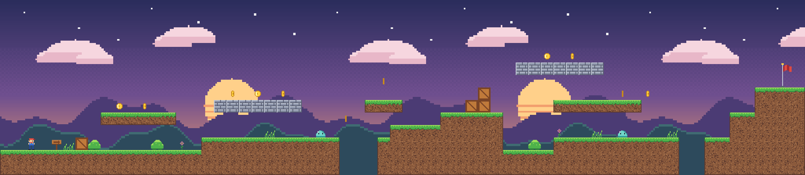

# 2D games

AUTOMATA makes side-on and top-down 2D games with the same editor, scripts
and physics as 3D ones. A 2D scene is built from five parts:

- **Sprites** are images, or sprite sheets with named animation clips.
- **Tilemaps** are grids painted with tiles from one tileset image. They
  can be solid, and their auto-tiles pick their own edge pieces.
- A **Camera 2D** shows a flat, scaled view with no perspective.
- **Camera Follow 2D** makes that camera trail the player.
- **2D colliders** and **character controllers** use 2D physics, which is
  its own world, separate from 3D.



The picture is the whole level of *Pixel Peaks*
(`examples/oberon/platformer`), built from its own tileset and sprite
sheets. The [platformer tutorial](../tutorials/platformer.md) walks through
it.

## Units and the 2D view

One world unit is one cell. Sprites are 1 × 1 unless you change **Size**,
and a tile is 1 × 1 unless you change the map's **Cell Size**. X points
right and Y points up. Everything 2D lies on the plane z = 0. **Layer**
decides what draws on top: higher layers draw over lower ones.

Oberon opens a 2D scene in its **2D view**: a flat view looking straight
at that plane. Press **2** or click **2D** on the viewport toolbar to switch
between the 2D view and the 3D view. In the 2D view, dragging pans, the
wheel zooms, and the Move gizmo has no Z arrow.

A scene counts as 2D when it has sprites, tilemaps, 2D colliders or a 2D
camera, and no 3D meshes or terrain.

## Starting out

`oberon new mygame --template 2d` makes a project with a painted tilemap,
a 2D player and a camera that follows it. In any scene, **+ Create** has the
2D pieces:

| Create | What you get |
|---|---|
| **Sprite** | An entity with a plain white Sprite, ready for an image |
| **Tilemap** | A 16 × 9 grid with a solid floor painted along the bottom |
| **Camera 2D** | A Camera 2D with a Camera Follow 2D aimed at the entity called "Player" |
| **2D Player** | A Sprite with a 2D box collider and a character controller. In Play it runs with A/D or the arrows and jumps with Space until you give it your own script |

## Sprites

| Field | Meaning |
|---|---|
| **Image** | A PNG or JPEG in the project. **None** draws a plain coloured rectangle |
| **Size** | Width and height in world units |
| **Color** | A tint, multiplied with the image. Lower the alpha to fade it |
| **Flip X / Flip Y** | Mirror the image (face the way you walk) |
| **Pixel Art** | Sharp, unblurred pixels when scaled up. Turn it off for smooth art |
| **Layer** | Drawing order |
| **Sheet** | Columns × rows of equal frames, counted left to right, top to bottom |
| **Frame** | The frame shown when no clip plays |
| **Clips** | Named runs of frames: **First**, **Last**, **FPS** and **Loop** |
| **Plays First** | The clip that starts playing when the game begins |

**+ Add Clip** suggests the usual names (idle, run, jump, fall). A clip
that doesn't loop stops on its last frame.

From a script:

```python
def update(entity, ctx):
    sprite = entity.sprite
    if not entity.grounded:
        sprite.play("jump")
    elif abs(vx) > 0.5:
        sprite.play("run")          # asking for the clip already playing does nothing
    else:
        sprite.play("idle")
    sprite.flip_x = vx < 0
```

| `entity.sprite` | |
|---|---|
| `play(clip, restart=False)` | Play a clip. `restart=True` starts it over even if it's already playing |
| `stop()` | Stop on the current frame |
| `clip` | The clip playing (`None` when stopped) |
| `clips` | The clip names |
| `finished` | A non-looping clip has reached its end |
| `frame` | The frame shown. Setting it stops the clip |
| `flip_x`, `flip_y`, `color`, `layer` | Settable |

## Tilemaps

A tilemap's grid starts at its entity's position and grows right and up:
cell (0, 0) is the bottom-left one.

| Field | Meaning |
|---|---|
| **Tileset** | The image the tiles come from |
| **Tiles** | Its columns × rows of tiles |
| **Grid** | Width × height in cells |
| **Cell Size** | World units per cell |
| **Solid** | The painted cells collide with 2D bodies and characters. Turn it off for scenery |
| **Color**, **Pixel Art**, **Layer** | As for sprites |
| **Auto-tiles** | Named sets of 16 tiles painted as one (below) |

### Painting

Select the tilemap, then pick a tile in the Inspector's palette. You can
also pick an auto-tile, or **Erase**. While a tile is picked, dragging in
the viewport paints cells; picking it again stops painting. Each stroke is
one undo step. **Clear All** empties the grid. If you make the grid smaller,
cells outside it are dropped; if you make it bigger, what's painted stays.

### Auto-tiles

An auto-tile paints ground, walls or water with the right edge on every
side, without picking edge pieces by hand. It uses 16 tiles in a row of the
tileset, starting at **First**. Each painted cell picks one of them from the
neighbours painted with the same auto-tile:

| Neighbour | Adds |
|---|---|
| above | 1 |
| right | 2 |
| below | 4 |
| left | 8 |

A lone cell uses tile `First + 0`. A cell with neighbours on every side uses
`First + 15`. A cell on a flat top, with neighbours left, right and below,
uses `First + 14`. Draw your 16 tiles in that order.

### From Python

```python
ground = at.Tilemap.from_rows(
    ["....##..", "########"],          # top row first
    legend={"#": -1},                  # -1: auto-tile 0
    tileset="sprites/tiles.png", columns=8, rows=4,
    autotiles=[at.AutoTile("Ground", first=0)],
)
ground = ground.set(0, 1, 17)          # tile 16; edits return a changed copy
```

In a cell, `0` is empty, `n` is tileset tile `n - 1` and `-n` is auto-tile
`n - 1`. `get(x, y)` returns a cell's value, `tile_at(x, y)` returns the tile
it shows (with auto-tiles worked out), and `cell_at(x, y)` returns the cell
under a point.

## Cameras

A **Camera 2D** sees **Half Height** world units above and below its
centre. Its width follows the window's shape. It looks at its entity's
position, and the first Camera 2D in the scene is the one that draws.

**Camera Follow 2D** moves that entity after a target:

| Field | Meaning |
|---|---|
| **Target** | The name of the entity to follow |
| **Offset** | Where to aim relative to the target, such as a little above it |
| **Smoothing (s)** | About how long the camera takes to catch up. 0 snaps to the target |
| **Dead Zone** | How far the target can move from the centre before the camera follows |
| **Bounds** | Left, bottom, right and top edges the view stays inside (all 0 means no limit) |

Set **Bounds** to the level's edges, and the player never sees past the
end of the map.

## Physics

2D physics is its own world: 2D colliders only ever touch other 2D
colliders. The rules are those of 3D [physics](../guides/physics.md):

- An entity with a **Collider 2D** and no **Rigidbody** is fixed ground
  that stays where it is. Moving its Transform moves it.
- A **Rigidbody** makes it dynamic or kinematic.
- A **Character Controller**, a kinematic Rigidbody and a Collider 2D make
  a character. A script sets `entity.character_velocity`, and
  `entity.grounded` says whether it's standing on something.
- A solid tilemap makes boxes for its painted cells. Cells side by side
  in a row share one box, so characters running along don't catch on the
  seams. Changing the cells or moving the map rebuilds the boxes.

Collider 2D shapes are **Box**, **Circle** and **Capsule**, with an
**Offset**. **Is Trigger** makes a sensor that reports overlaps but doesn't
block. Moving a character's Transform from a script teleports it, which is
how respawning works.

## Limits

- Ray casts from scripts (`ctx.physics.raycast`) look at the 3D world only.
  `ctx.physics2d` has `apply_impulse`, `grounded` and `body_count`.
- Lighting, shadows, water, fog and post effects are for 3D scenes.
  Sprites and tiles are drawn unlit with their own colours.
- The audio listener is placed for 3D cameras. In 2D, sounds play without
  distance fading.
