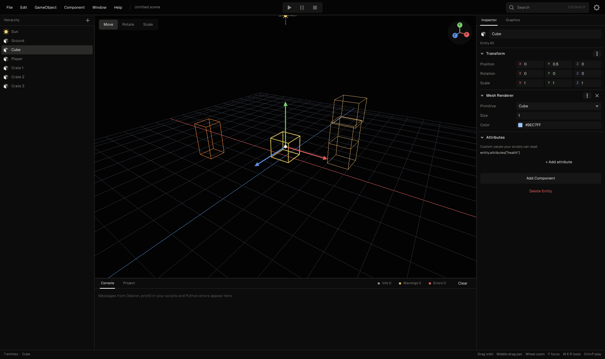

# Oberon

Oberon is the AUTOMATA editor. It's a native desktop app written in Rust. You
build scenes visually and attach Python behaviour scripts. Then you press
Play to run the scene inside the editor. Scenes save as plain `.ron` files,
and the same files run from Python with `automata.run_scene`.



## Run it

```console
git clone https://github.com/x017/automata && cd automata
cargo run -p oberon --release              # an empty starter scene
cargo run -p oberon --release level.ron    # open a scene file
```

Oberon needs a GPU that supports Vulkan, Metal, or DX12 to render the
viewport. Without one it still runs and draws the scene as wireframes, so
editing works anywhere.

For Play mode, Oberon starts a Python interpreter: the project's own
`.venv`, or `python3`, or the one you pick in **Settings → Python**. That
interpreter needs only the standard library.

To start a project from the command line, run `oberon new mygame`. That
gives you a level, a typed starter script, tests, and a `.venv` with the
engine and a language server. [The `oberon` command](command-line.md) covers
this and `oberon run`, `test`, `export` and `doctor`.

## The manual

| Page | What it covers |
|---|---|
| [The interface](interface.md) | Every panel, moving around the scene, gizmos, Play mode |
| [The `oberon` command](command-line.md) | `oberon new`, `run`, `test`, `export`, `doctor`; the project's own Python |
| [Keyboard shortcuts](shortcuts.md) | The complete list |
| [Scripting](scripting.md) | Behaviour scripts, the `entity` / `ctx` API, hot reload, errors |
| [Cameras](cameras.md) | Scene cameras, the preview, Look Through, driving cameras from Python |
| [Graphics](graphics.md) | The Graphics panel: quality, sun, environment, fog, test scenes |
| [The code editor](code-editor.md) | Writing scripts inside Oberon: completion, language servers, find/replace |
| [The UI editor](ui-editor.md) | Game menus and HUDs as `ui/*.ui.ron` documents: canvas, widget tree, themes |
| [Materials](materials.md) | Shared `.mat.ron` looks with textures: the material editor, its live preview, dragging materials onto objects |
| [Models](models.md) | Importing glTF and OBJ models, the Assets tab, import settings (scale, rotation, pivot), fitted colliders |
| [Animation graphs](animation-graphs.md) | `.anim.ron` state machines: parameters, blend spaces, transitions, layers with bone masks |
| [Attachments & IK](attachments-and-ik.md) | Attach To Bone (swords, hats), Feet On Ground on slopes and stairs, reaching and looking at from scripts |
| [Ragdolls](ragdolls.md) | Characters that go limp when hit: bodies and joints from the skeleton, pushes, standing back up with a blend |
| [Navigation](navigation.md) | Bake a navigation mesh from the level, Nav Agents that chase and follow, jump links, `ctx.nav.path` |
| [Terrain](terrain.md) | Sculpt hills, cliffs and beaches with brushes, paint four ground layers, Auto Paint, heightmaps |
| [AI](ai.md) | State machines, behaviour trees, sight cones with line of sight, and hearing (`ctx.ai`) |
| [Audio](audio.md) | Sound files, Audio Sources, previews, playing sounds from scripts |
| [Prefabs & attributes](prefabs-and-attributes.md) | Reusable objects that stay linked: overrides, Apply / Revert, variants; custom per-entity data |
| [Editor workflow](editor-workflow.md) | Editing many objects at once, snapping, Duplicate Along a Line, the Profiler |
| [Exporting your game](exporting.md) | Building standalone Windows, Linux, macOS and Android games (Ctrl+Shift+B) |

New to Oberon? Do the [first scene tutorial](../tutorials/first-scene.md)
first. It takes about ten minutes and covers the main ideas.

## How Oberon fits with the engine

```text
          Oberon (Rust)                         Python
 ┌──────────────────────────────┐    JSON    ┌──────────────────┐
 │ scene document · undo        │  per frame │ bridge runner    │
 │ wgpu viewport · physics      │ ─────────▶ │ your scripts'    │
 │ Play loop                    │ ◀───────── │ start / update   │
 └──────────────────────────────┘   writes   └──────────────────┘
              │ Ctrl+S
              ▼
         level.ron ──────────▶ at.run_scene("level.ron")   (the real engine)
```

- **Editing** happens in Rust. The scene is a document with undo history,
  and every edit is one undo step.
- **Play** clones the scene and runs physics and the renderer in Oberon.
  Your scripts run in a separate Python process. Every frame Oberon sends
  that process the scene state, and the scripts send back their changes.
  The process is separate on purpose: a script crash can't take down the
  editor, and you can switch Python environments without restarting.
- **Stop** throws the Play copy away. Your edited scene is unchanged.
- **Shipping** doesn't need Oberon at all. `at.run_scene("level.ron")` runs
  the same scene and scripts in the engine.
