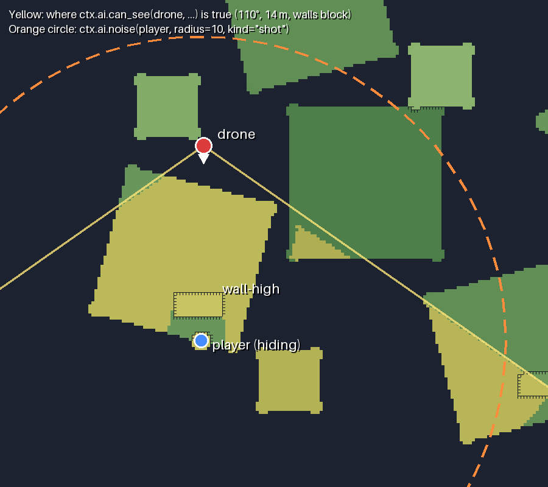

# AI



`ctx.ai` gives scripts the building blocks for enemies, guards and
creatures that make decisions:

| | What it does | Use it for |
|---|---|---|
| [**State machines**](#state-machines) | One mood at a time (patrol, chase, search), each with its own code, and clear rules for switching | Most enemies |
| [**Behaviour trees**](#behaviour-trees) | Small tasks plugged together: "try this, else that", "do these in order", "wait 2 s" | Bosses and characters with lots of options |
| [**Sight**](#sight) | `ctx.ai.can_see(viewer, target)`: a cone in front of the viewer, blocked by walls | Noticing the player |
| [**Hearing**](#hearing) | `ctx.ai.noise(...)` makes a noise; `ctx.ai.hear(listener)` returns the ones that reach it | Gunshots, footsteps, alarms |

It's all plain Python in the shared script API, so it works the same in
Play, in exported games, in `run_scene` and in tests.

[The FPS example](../../../examples/oberon/fps) uses a state machine with
sight and hearing: its drones look around until they see you or hear a
shot, chase you, and search where they lost you. See
[the tutorial](../tutorials/fps.md#4-the-drones).

## State machines

A state machine is always in exactly one *state*. Each state is a
function that runs every frame while it's active. Returning the name of
another state switches to it:

```python
def patrol(entity, ctx):
    entity.nav.go(entity.state["post"])
    if ctx.ai.can_see(entity, "Player"):
        return "chase"


def chase(entity, ctx):
    entity.nav.go("Player")
    if not ctx.ai.can_see(entity, "Player"):
        return "patrol"


def start(entity, ctx):
    entity.state["post"] = entity.transform.position
    entity.state["brain"] = ctx.ai.state_machine(
        {"patrol": patrol, "chase": chase}, initial="patrol")


def update(entity, ctx):
    entity.state["brain"].update(entity, ctx)
```

Make the machine in `start` and keep it in `entity.state`, so each entity
has its own.

A state can also be a dict (or an object) with `enter`, `update` and
`exit`, any of which may be missing. `enter` runs once on the way in,
`exit` once on the way out:

```python
brain = ctx.ai.state_machine({
    "idle": {"enter": stop_moving, "update": look_around},
    "alarm": {"enter": sound_the_alarm, "update": run_to_the_button, "exit": calm_down},
})
```

State functions are called with `(entity, ctx)`, or `(entity, ctx,
machine)` if they take a third argument, which is handy for `machine.time`
(how long it's been in this state).

Instead of returning names, you can list the rules separately with `when`.
They're checked every frame before the state's update; `"*"` means "from
any state":

```python
brain.when("patrol", "chase", lambda e, c: c.ai.can_see(e, "Player"))
brain.when("*", "flee", lambda e, c: e.attributes["health"] < 20)
```

| `StateMachine` | |
|---|---|
| `update(entity, ctx)` | Runs one frame: the rules, then the state's update. Returns the state it's in |
| `state` | The current state's name (`None` before the first update) |
| `previous` | The one before |
| `time` | Seconds in the current state (from `ctx.time.delta`) |
| `go(name)` | Switch now (`exit`, then `enter`) |
| `is_in(*names)` | True if it's in any of them |
| `add(name, spec, enter=, update=, exit=)` | Add or replace a state |
| `when(source, target, condition)` | A switching rule; `condition(entity, ctx)` |
| `history` | The last 16 states, oldest first |
| `states` | Every state's name |
| `on_change` | Set to `fn(entity, ctx, old, new)` to hear about every switch |

A misspelt state name raises `KeyError` with a suggestion.

## Behaviour trees

A behaviour tree is built from *nodes*. Every frame you `tick` the root,
and each node answers `SUCCESS`, `FAILURE` or `RUNNING` (not done yet,
tick me again next frame). Plain functions become actions: returning
`True` (or nothing) is success, `False` is failure, and returning
`ctx.ai.RUNNING` keeps it going.

```python
def attack(entity, ctx):
    ctx.audio.play("sounds/swing.ogg")


def go_home(entity, ctx):
    entity.nav.go(entity.state["home"])
    return True if entity.nav.arrived else ctx.ai.RUNNING


def start(entity, ctx):
    ai = ctx.ai
    entity.state["tree"] = ai.selector(           # the first that doesn't fail
        ai.sequence(                               # all of these, in order
            ai.condition(lambda e, c: c.ai.can_see(e, "Player", distance=2)),
            ai.cooldown(1.5, attack),
        ),
        ai.sequence(go_home, ai.wait(3.0)),
    )


def update(entity, ctx):
    entity.state["tree"].tick(entity, ctx)
```

| Node | Answers |
|---|---|
| `ai.action(fn)` | What `fn(entity, ctx)` returns |
| `ai.condition(fn)` | `SUCCESS` if `fn` is true, else `FAILURE`; never running |
| `ai.sequence(*children)` | Runs the children in order; fails at the first failure, succeeds when all succeed. A running child is carried on next frame |
| `ai.selector(*children)` | Tries the children in order; succeeds at the first success. Starts from the top every frame, so a higher-priority branch can take over |
| `ai.parallel(*children, need="all")` | Ticks every child each frame; succeeds when all (or with `need="one"`, one) succeed |
| `ai.invert(child)` | Swaps success and failure |
| `ai.succeed(child)` | Success whatever the child says (once it's done) |
| `ai.repeat(child, times=None)` | Runs the child again and again (forever, or `times` times), once per frame |
| `ai.wait(seconds)` | Running for that long, then success |
| `ai.cooldown(seconds, child)` | Runs the child; once it succeeds, fails straight away for `seconds` (a shot, a shout) |

Every node has `tick(entity, ctx)`, `status` (its last answer), `reset()`
and `describe()`, which prints the tree with each node's status, handy
with `ctx.log`.

Which to use? A state machine is easiest when a character has a few
clear moods. A tree is better when it has many options in a priority
order, such as a boss that heals if it's hurt, else attacks if you're close,
else walks over.

## Sight

```python
if ctx.ai.can_see(entity, "Player", fov=110, distance=15):
    ...
```

`can_see(viewer, target, fov=120, distance=20, eye=1.6, aim=1.0,
forward=(0, 0, -1), walls=True)` is true when the target is:

1. within `distance` metres,
2. inside a cone `fov` degrees wide around the way the viewer faces
   (`forward`, which is −Z unless you say otherwise, turned by the
   viewer's rotation), and
3. not behind anything: a ray from the viewer's eye (`eye` m above its
   origin) to the target's middle (`aim` m above its origin) must reach it
   first. `walls=False` skips the ray.

The target can be an entity, a name or an `(x, y, z)` point. The viewer
needs to face where it's looking: turn it with `transform.rotation_euler`
or a Nav Agent's Face Movement. Walls are anything with a collider.

`ctx.ai.visible(viewer, targets=None, ...)` takes the same options and
returns every entity in `targets` (default: all of them) that the viewer
can see, nearest first.

## Hearing

A noise is a point with a radius: anything inside the circle can hear
it. Make one when something loud happens:

```python
ctx.ai.noise(entity, radius=10, kind="shot")   # from where this entity is
ctx.ai.noise((4, 0, 2), radius=25, kind="alarm")
```

Listeners ask what reached them this frame:

```python
for noise in ctx.ai.hear(entity, kinds="shot"):
    entity.state["clue"] = noise.position
```

| `ctx.ai` | |
|---|---|
| `noise(position_or_entity, radius=10, kind="noise", source=None)` | Makes a noise. From an entity, that entity is its source and doesn't hear it. Returns the `Noise` |
| `hear(listener, hearing=1.0, kinds=None)` | The noises within `radius × hearing` of the listener that it hasn't heard yet, closest (for their radius) first. `hearing=2` for sharp ears; `kinds` a label or a list of them |
| `noises` | Every noise still around |

A `Noise` has `position`, `radius`, `kind`, `source` (a name, or `None`),
`time` (`ctx.time.elapsed` when it was made) and `distance` (from the
listener). A noise lasts this frame and the next, so a listener whose
script runs before the noisy one still hears it. Each listener hears each
noise once.

Noises don't play sounds: call `ctx.audio.play` as well.

## In Python

Python games get the same classes from `automata.ai`:

```python
from automata import ai

brain = ai.StateMachine({"idle": idle, "chase": chase}, initial="idle")
tree = ai.Selector(ai.Sequence(ai.Condition(close), attack), wander)
assert tree.tick(entity, ctx) in (ai.SUCCESS, ai.FAILURE, ai.RUNNING)
```

Sight and hearing need a `ctx` with `physics.raycast` and `time`, as in
`run_scene`. To test a script with a fake `ctx`, give it the real helpers
with `from automata.script_api import AI` and `ctx.ai = AI(ctx)`, as
[the FPS tests](../../../examples/oberon/fps/tests/test_fps.py) do.

## Tips

- **Remember what was seen.** `can_see` answers for this frame only. Keep
  the last place you saw the player in `entity.state`, so the enemy can go
  there when it loses them.
- **Don't let sight flicker.** Wait a little (`s["unseen"] > 3`) before
  giving up, otherwise a pillar passing in front switches states every
  frame.
- **Line of sight is a ray.** Only colliders block it, so put a collider
  on every wall and crate that should hide the player. The target's own
  collider (and anything close to it) counts as a hit on the target.
- **Raise the eye** for tall enemies and lower `aim` for crouching
  targets.
- **Debug with `describe()`.** `ctx.log(tree.describe())` and
  `ctx.log(brain.history)` show what the AI was thinking.
