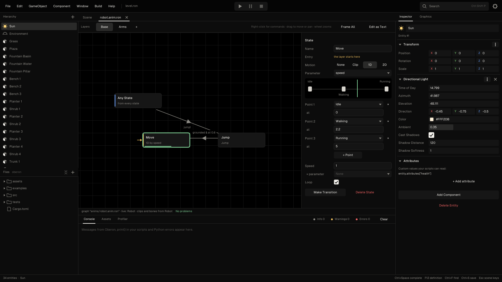

# Animation graphs

An animation graph decides which clips a character plays, so your scripts
don't have to. The script says *what's going on*: how fast the character
moves, whether it's on the ground, that the player pressed jump. The graph
turns that into clips: it blends Idle into Walk into Run as the speed
rises, cuts to Jump when the jump trigger fires, and goes back to running
once it lands.

Graphs are `.anim.ron` files in your project (put them in `anims/`). An
[Animation](models.md#animation) component uses one through its **graph**
field. Then its **Clip**, **Loop** and **Play On Start** stop mattering:
the graph picks the clips, and **Speed** scales the whole graph.

```ron
// level.ron
animation: (graph: "anims/robot.anim.ron"),
```

## What's in a graph

| Part | What it is |
|---|---|
| **Parameters** | Named values scripts set: `Float` (a speed), `Int` (a weapon slot), `Bool` (grounded) and `Trigger` (jump: on until a transition uses it) |
| **Layers** | State machines stacked bottom to top. The first one animates the whole model. A later one animates only the bones in its **mask** (say, the upper body), over the layers below, at its **weight** |
| **States** | What a layer can be doing. Each plays a **motion**: one clip, a 1D or 2D **blend space**, or nothing (`Empty`) |
| **Transitions** | The ways from one state to the next. Each has **conditions**, a **fade** time and, optionally, an **exit time** |

Here's a robot that walks, runs, jumps and waves with its arms while it
walks:

```ron
(
    parameters: [
        (name: "speed", kind: Float(0.0)),
        (name: "grounded", kind: Bool(true)),
        (name: "jump", kind: Trigger),
        (name: "wave", kind: Trigger),
    ],
    layers: [
        (
            name: "Base",
            states: [
                (
                    name: "Move",
                    motion: Blend1D(param: "speed", points: [
                        (clip: "Idle", at: 0.0),
                        (clip: "Walking", at: 2.2),
                        (clip: "Running", at: 5.0),
                    ]),
                    position: (0.0, 0.0),
                ),
                (name: "Jump", motion: Clip("Jump"), looping: false, position: (240.0, 0.0)),
            ],
            transitions: [
                (from: "*", to: "Jump", when: [Triggered("jump")], fade: 0.1),
                (from: "Jump", to: "Move", when: [IsTrue("grounded")], fade: 0.25, exit_time: 0.6),
            ],
        ),
        (
            name: "Arms",
            mask: ["Torso"],  // the chest, arms and head
            states: [
                (name: "Off", motion: Empty, position: (0.0, 0.0)),
                (name: "Wave", motion: Clip("Wave"), looping: false, position: (240.0, 0.0)),
            ],
            transitions: [
                (from: "Off", to: "Wave", when: [Triggered("wave")], fade: 0.2),
                (from: "Wave", to: "Off", fade: 0.3),
            ],
        ),
    ],
)
```

Fields you leave out take their defaults, so hand-written graphs stay
short. `position` is where the editor draws the state.

## States and motions

| Field | Default | Meaning |
|---|---|---|
| `name` | | Unique in its layer. Scripts and transitions use it |
| `motion` | `Empty` | `Clip("Walking")`, `Blend1D(...)`, `Blend2D(...)` or `Empty` |
| `speed` | 1 | Playback rate |
| `speed_param` | none | A number parameter the rate is multiplied by (play the walk faster as the character speeds up) |
| `looping` | true | Off plays the motion once and holds the last frame; the clip's `end` event fires |

A layer starts in its `entry` state, or in its first state when `entry` is
left out.

### Blend spaces

A **1D blend space** spreads clips along one parameter. The two clips on
either side of the value blend: with Walking at 2.2 and Running at 5, a
speed of 3.6 is half of each. Below the first point or past the last, that
clip plays alone.

A **2D blend space** spreads clips over two parameters, for strafing:

```ron
motion: Blend2D(x: "side", y: "forward", points: [
    (clip: "Idle", at: (0.0, 0.0)),
    (clip: "WalkForward", at: (0.0, 1.0)),
    (clip: "WalkBack", at: (0.0, -1.0)),
    (clip: "StrafeLeft", at: (-1.0, 0.0)),
    (clip: "StrafeRight", at: (1.0, 0.0)),
]),
```

Every clip weighs in by how close the point is (gradient band
interpolation, the "freeform" kind). On a clip's point, that clip plays
alone.

Either way the clips stay **in step**: they share one position through
their cycle and move at the average of their lengths, weighted by how much
each shows. A walk and a run put the same foot down together, so blending
them never makes the feet skate. Events come from the clip that shows most,
and so does root motion, blended by weight.

## Transitions

| Field | Default | Meaning |
|---|---|---|
| `from` | | The state it leaves, or `"*"` for **any state** in the layer |
| `to` | | The state it goes to |
| `when` | none | Conditions that must all hold |
| `fade` | 0.2 | Seconds to crossfade |
| `exit_time` | none | How far through its motion the state must have played first: 0.5 is halfway, 1 is once through, 2 twice |

Conditions:

| Condition | Holds when |
|---|---|
| `Above("speed", 0.1)`, `Below("speed", 0.1)` | The number is greater or less |
| `Equals("slot", 2)`, `NotEquals("slot", 2)` | The number is (or isn't) that whole number |
| `IsTrue("grounded")`, `IsFalse("grounded")` | The bool is on or off |
| `Triggered("jump")` | The trigger is set. Firing the transition clears it |

Each frame, every layer checks its transitions before it plays on.
Any-state transitions go first, then the current state's own, in file
order. The first one that's ready fires. A transition with no conditions
and no exit time fires when the state's motion ends, which is how a jump
or a wave hands back to the state before. An any-state transition needs a
condition, or it would fire all the time.

A transition can fire in the middle of a fade. The new fade then starts
from whatever the layer showed at that moment, so nothing jumps.

## Layers and masks

A layer's `mask` lists bones by name. The layer animates each one and
everything below it in the skeleton, so `["Torso"]` covers the chest,
arms and head, and the legs stay with the layers underneath. With no mask,
the layer covers the whole model.

`weight` (0 to 1, default 1) sets how strongly the layer shows over the
ones below. An `Empty` state switches the layer off, and fading to or from
one fades the layer out or in. That makes "Off" plus a one-shot clip the
usual shape for an upper-body layer: wave, salute, reload.

The first layer always shows fully and ignores its weight.

## From a script

A script only tells the graph what's going on. It never names a clip:

```python
def update(entity, ctx):
    anim = entity.animation
    anim.set("speed", speed)            # Float and Int parameters
    anim.set("grounded", on_ground)     # Bool parameters
    if ctx.input.just_pressed("space"):
        anim.trigger("jump")            # Trigger parameters
```

| Call | What it does |
|---|---|
| `anim.set(name, value)` | Sets a Float, Int (rounded) or Bool parameter. An unknown name raises `KeyError`; a trigger raises `TypeError` |
| `anim.trigger(name)` / `anim.reset_trigger(name)` | Turns a trigger on (until a transition uses it) or off again |
| `anim.get(name)` / `anim.parameters` | One parameter's value, or all of them as a dict |
| `anim.state` / `anim.layer_state(layer)` | The state the first layer (or `layer`) is in. During a fade, the one it's fading to |
| `anim.state_time` / `anim.in_transition` | Seconds in the current state, and whether the first layer is fading |
| `anim.layers` / `anim.layer_weight(layer)` / `anim.set_layer_weight(layer, w)` | The layers, and how strongly one shows |
| `anim.play_state(state, layer=None, fade=0)` | Jumps straight to a state (a cutscene, a respawn) |
| `anim.graph` | The graph's path. Assign another to switch, or `None` to go back to clips |

Reads see your own requests at once, so `anim.set("speed", 2)` followed by
`anim.get("speed")` gives 2. A trigger shows as `True` until a transition
uses it. These calls raise `RuntimeError` when the Animation has no graph.
With a graph running, `anim.play("Dance")` jumps to the first layer's
state called Dance.

## In Oberon

Select an animated model and click the Animation section's **Graph** row.
Pick a graph, or type a new name: Oberon makes the file in `anims/`,
starting with one state per clip of the model. You can also drag a
`.anim.ron` from the Files panel onto the model. **Edit** opens the file;
**×** goes back to playing the Clip.



A graph opens in its own tab as a graph:

- **The canvas** shows the shown layer's states as boxes and its
  transitions as arrows, labelled with their conditions. **Any State** sits
  above the others, and a small arrow marks the entry state. Drag a state
  to move it, drag the background (or hold the middle button) to pan, and
  use the wheel to zoom. Double-click the background to add a state.
  Right-click for the rest: add a clip, 1D, 2D or empty state, **Make
  Transition** (then click the state it goes to), **Set as Entry State**,
  delete. **Delete** removes what's selected and **Esc** stops drawing a
  transition.
- **Layers** are tabs along the top. **+** adds one, and the panel sets its
  name, weight and mask. Bones come from the model's skeleton through the
  mask's **+** menu, or you can type them.
- **Parameters** are listed with their kind and starting value. **+** adds
  one, and renaming one renames it in every condition.
- **A selected state** shows its motion. Switch between None, Clip, 1D
  and 2D, pick clips from the model's list, and set the speed, a parameter
  to multiply the speed by, and Loop. Blend spaces get an editor: a line
  for 1D and a plane for 2D, with a handle per clip that you drag to move.
- **A selected transition** shows its fade, exit time and conditions. Pick
  a parameter and a test for each condition. A transition drawn from Any
  State starts with a condition on a trigger, because without one it would
  fire all the time.

The status line names the model the clips and bones come from (an entity
using the graph, else the selected or any animated one) and the graph's
first problem, if it has any. **Edit as Text** shows the file as RON, and
a file that doesn't read opens that way, with the error. Every graph edit
is one undo step, and **Ctrl+S** saves. Editing in the graph view writes
the whole file again, so comments in it are lost; Edit as Text keeps
them.

During Play the graph shows what the selected entity's graph is doing.
If the selected entity doesn't run this graph, it shows the first entity
that does. The state it's in glows green, with its progress along the
bottom. A transition lights up while it fades, parameters show the
script's values, and a blend space marks where the parameters put the
character. Edits take effect at once, even unsaved: the running graph
switches over and stays in its state, and parameters keep their values.

`automata-cli check` (and Build) checks every graph the start scene uses
against its model: clips and bones it doesn't have show up as warnings.

## When something's wrong

A graph with mistakes still runs: transitions to states that don't exist,
conditions on unknown parameters, and clips the model doesn't have are
left out, with a warning in the log naming each one. A graph file that
doesn't load at all (missing, or not valid RON) is logged too, and the
Animation plays its **Clip** instead.
