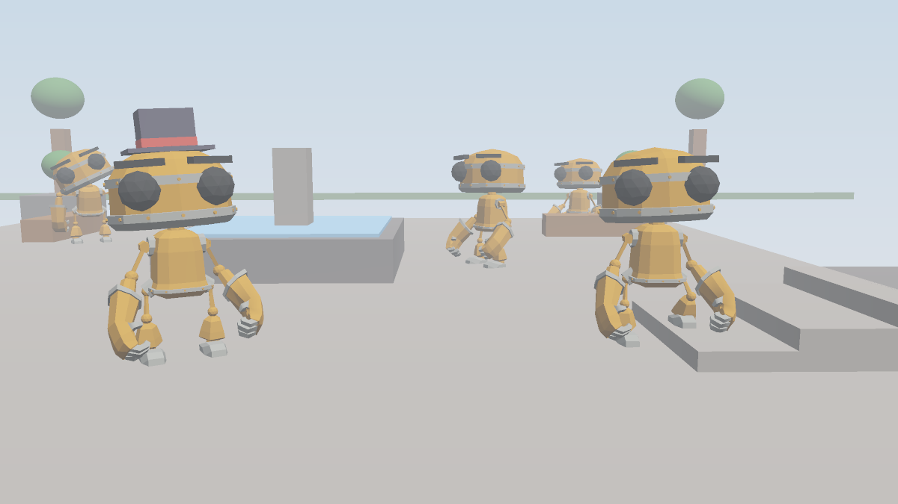

# Attachments and IK



Three ways to make an animated character fit its world:

| | What it does | Set up in |
|---|---|---|
| [**Attach To Bone**](#attach-to-bone) | Another entity follows one of the character's bones: a sword in the hand, a hat on the head | A component on the sword or hat |
| [**Feet On Ground**](#feet-on-ground) | Each foot stands on whatever is under it (slopes, stairs), and the hips drop for the lower foot | The Animation component |
| [**Reach and look at**](#reach-and-look-at) | A hand (or foot) reaches for a point or an entity, and the head turns to look at one | Scripts |

They work on any animated model with a skeleton: glTF files from Blender,
Mixamo, Quaternius and others. Bones are found by their usual names, so a
rig that calls its shin `LowerLeg.L`, `mixamorig:LeftLeg` or `calf_l` all
work.

[Robot Plaza](../../../examples/oberon/robot_plaza) shows all three.

## Attach To Bone

Select the entity that should follow (the hat), then use **Add Component →
Attach To Bone**:

| Row | What it does |
|---|---|
| **Follow** | The entity to follow: a menu of the scene's named entities. It turns red if no entity has that name |
| **Bone** | The bone to follow: a menu of that entity's skeleton, indented like a tree. **None (its origin)** follows the entity itself |

From then on, the entity's **Transform** is its *offset from the bone*,
measured in the bone's own space. When you first attach it, its position
is reset to zero, so the hat jumps onto the bone (its rotation and scale
stay). Move it into place with the
gizmo. The gizmo works in the world as usual, and Oberon turns what you do
into the offset. An offset of `(0, 0.56, 0)` puts the hat 56 cm up along the
head bone, wherever the head goes.

Some details:

- **Size.** The attached entity keeps its own size. Neither the model's
  import scale nor the bone's scale is passed on, so a 1 m sword stays 1 m
  long.
- **In the editor.** The attachment shows while you edit, on the pose your
  character holds. It follows the animation preview too, so you can scrub
  a clip and check the sword stays in the hand.
- **Chains.** Attachments can chain: a gem on a sword in a hand. A loop
  (A follows B, B follows A), or a name no entity has, leaves the entity
  where it is.
- **Duplicate names.** The entity to follow is found by name. If several
  entities share that name, the first one is used.

In a scene file it's an `attach` block, with the Transform as the offset:

```ron
(
    name: Some("Hat Crown"),
    transform: Some((position: (0.0, 0.73, 0.0), rotation_euler: (0.0, 0.0, 0.0), scale: (0.42, 0.32, 0.42))),
    mesh: Some(Cube(color: (0.13, 0.12, 0.16, 1.0))),
    attach: Some((to: "Robot", bone: "Head")),
)
```

### Picking things up from a script

```python
# scripts/sword.py
import math

def update(entity, ctx):
    player = ctx.scene.find("Player")
    near = math.dist(player.transform.position, entity.transform.position) < 1.0
    if entity.attached_to is None and near and ctx.input.just_pressed("e"):
        # Into the player's right hand, 10 cm along it.
        entity.attach(player, "Palm2.R", position=(0, 0.1, 0))
    elif entity.attached_to and ctx.input.just_pressed("q"):
        entity.detach()          # stays where it was let go
```

| Member | What it does |
|---|---|
| `entity.attach(to, bone="", position=…, rotation_euler=…, scale=…)` | Follow `bone` of `to` (an entity or its name) from the next frame on, at that offset (radians). A `Transform` can stand in for the three |
| `entity.detach()` | Stop following and stay where it is |
| `entity.attached_to` | `(entity name, bone)`, or `None` |

## Feet On Ground

Animations are made on flat ground. On a slope or a step, one foot floats
in the air or sinks into the ground. Turn on **Feet On Ground** in the
Animation component and the character fixes that each frame:

- **Each foot** is lifted onto (or lowered to) what's under it, and its
  knee bends to match.
- **The hips** drop by as much as the lowest foot needs, so the other leg
  can still reach.
- **The foot** tilts to the slope (up to about 35°).

A foot never lifts more than half a leg's length, so a character walking
off a ledge doesn't stretch to the floor below. The feet ease in and out
of their corrections, so a step doesn't snap.

When the game is running, the feet stand on **colliders**: anything with a
Collider counts, except the character itself and trigger sensors. In the
editor, and in games without physics, they stand on **meshes**, skipping
the character's own mesh and anything attached to it. Give stairs and
ramps a collider (Oberon's **Fit Collider** does it for models) and they
work in both.

Scripts can switch it with `entity.animation.foot_ik = True`. In Python,
pass `at.Animation("Idle", foot_ik=True)`.

## Reach and look at

These are for scripts, since what to reach for or look at depends on the
game:

```python
def update(entity, ctx):
    player = ctx.scene.find("Player")
    near = math.dist(player.transform.position, entity.transform.position) < 8
    if near != entity.animation.looking:
        entity.animation.look_at(player if near else None)
```

| Member | What it does |
|---|---|
| `entity.animation.look_at(target, weight=1.0)` | Turn the head (and a little of the neck) towards `target`: an entity, an entity's name, or a point `(x, y, z)`. `None` stops. `weight` (0 to 1) sets how far. An animated target is looked in the eye: at its head, not its feet |
| `entity.animation.reach(bone, target, weight=1.0)` | Bend the arm (or leg) ending at `bone` (`"Palm2.R"`, `"mixamorig:LeftHand"`) so the bone reaches `target`. Same targets as `look_at`; `None` stops |
| `entity.animation.looking` / `.reaching` | Whether it's looking at something, and the bones that are reaching |
| `entity.animation.foot_ik` | [Feet On Ground](#feet-on-ground), readable and settable |

Some details:

- **Easing.** Both ease in and out over a quarter of a second, so you can
  call them on any frame without the pose jumping.
- **Following.** A target entity is followed as it moves, until you stop.
- **Look limits.** The head turns at most about 70° from where the
  animation points it. Past that it holds at the limit instead of looking
  over its shoulder.
- **Reach limits.** A target out of reach gets the limb fully stretched
  towards it.
- **Elbows and knees** keep the side the animation bent them to.

Everything runs on top of the playing clip or [animation
graph](animation-graphs.md): the character keeps walking, and its head
turns as it walks.

## From Python

```python
hat = (
    at.Entity("Hat")
    .add(at.Transform(position=(0, 0.56, 0), scale=(0.66, 0.035, 0.66)))
    .add(at.MeshRenderer.cube(size=1.0, color=(0.13, 0.12, 0.16, 1)))
    .add(at.Attach("Robot", "Head"))
)
robot.add(at.Animation("Idle", foot_ik=True))
```

While a Python game runs, `view.attach(to, bone, offset)`, `view.detach()`
and `view.attached_to` do the same as in behaviour scripts. Under
`view.animation` you get `look_at`, `reach`, `foot_ik`, `looking` and
`reaching` (see the [API reference](../api-reference.md#animation)).

## Troubleshooting

| Problem | Fix |
|---|---|
| **Follow** is red | No entity has that name. Rename the entity, or pick it again from the menu |
| **Bone** is red | The followed entity's model has no bone of that name (a different model, or a renamed bone). Pick it again |
| The attached entity is huge or tiny | It keeps its own scale, not the model's. Set its Transform's scale in metres |
| Feet don't move on a ramp | Feet On Ground needs something solid under the feet. Give the ramp a collider, and check the Animation has Feet On Ground ticked |
| Feet don't move on a model | The rig's leg bones must be named as legs (thigh/upper leg, shin/lower leg/calf, foot/ankle) with `.L`/`.R`, `Left`/`Right` or `_l`/`_r` sides |
| The head doesn't turn | The skeleton needs a bone named `Head` (or `mixamorig:Head`, `head`) |
