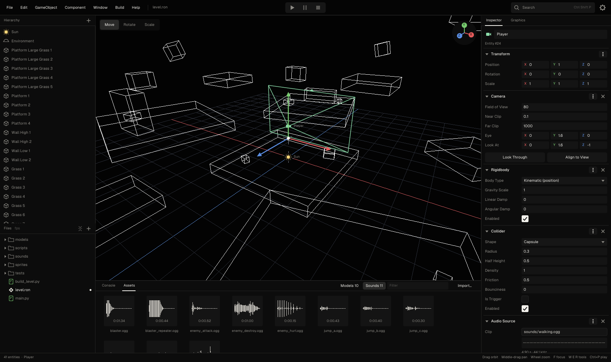

# Audio

Sounds work the same way as models. Put a sound file in the project and drop
it into the scene. The entity that's created plays it, and scripts can start
and stop it.

| Format | Notes |
|---|---|
| `.ogg` (Vorbis) | Recommended: small files that loop cleanly. |
| `.wav` | Uncompressed. Good for short effects. |
| `.mp3`, `.flac` | Also supported. |

## Add a sound

- **Drag a sound file from your system file manager** onto the scene view.
  Oberon copies it into the project's `sounds/` folder and creates an entity
  with an **Audio Source** where you dropped it.
- **Drag a sound from the Files panel** or the **Assets** tab onto the scene
  view, or onto the Inspector to give it to the selected entity.
- **GameObject → Sound…** (or **+ → Create Sound…** in the Hierarchy) opens
  a searchable list of the project's sounds. **GameObject → Import Sound…**
  picks a file anywhere on disk.
- Or select an entity and use **Add Component → Audio Source**, then pick a
  clip with **Change…**.

Right-click a sound in the Files panel for **Preview**, **Add to Scene** and
**Play from <entity>** (sets the selected entity's clip).

## Hear it before you play

Double-click a sound in the Files panel or the Assets tab to preview it. In
the Assets tab's **Sounds** view, each sound shows its waveform and length,
so you can find the short click among the long loops without listening to
all of them.



## The Audio Source

| Row | What it does |
|---|---|
| **Clip** | The sound file, relative to the scene, with its length, sample rate and waveform. It turns red if the file is missing. **Preview** plays it; **Change…** picks another. |
| **Volume** | `1` plays it as recorded; `0.5` is quieter. |
| **Pitch** | Speed and pitch together: `2` is twice as fast and an octave up. |
| **Loop** | Start over at the end. Use it for music, engines and footsteps. |
| **Play On Start** | Start playing as soon as the scene runs. |
| **3D (fade)** | Quieter with distance from the camera, and panned left or right. |
| **Range** | With 3D on: the distance in metres at which it falls silent. |

A looping sound stops when its entity is despawned, and every sound stops
when you press Stop.

## From scripts

Play an entity's Audio Source:

```python
def update(entity, ctx):
    if ctx.input.just_pressed("space"):
        entity.audio.play()           # starts over if it's already playing
    if ctx.input.just_pressed("x"):
        entity.audio.stop()
```

`entity.audio.playing` says whether it's playing. Footsteps are a looping
source that you start and stop as the player moves:

```python
moving = ctx.input.axis("a", "d") != 0 or ctx.input.axis("s", "w") != 0
if moving and entity.grounded and not entity.audio.playing:
    entity.audio.play()
elif not moving and entity.audio.playing:
    entity.audio.stop()
```

For one-off effects, you don't need a component. `ctx.audio.play` plays any
file in the project once:

```python
ctx.audio.play("sounds/blaster.ogg")                          # everywhere
ctx.audio.play("sounds/enemy_hurt.ogg", position=enemy)       # fades with distance
ctx.audio.play("sounds/jump_a.ogg", volume=0.6, pitch=1.2)
```

A `position` can be an entity or an `(x, y, z)` point. Both calls work the
same in Oberon's Play mode, under `run_scene`, and in exported games.

## From Python

```python
import automata as at

radio = (
    at.Entity("Radio")
    .add(at.Transform(position=(3, 1, 0)))
    .add(at.AudioSource("sounds/music.ogg", volume=0.8, looping=True,
                        play_on_start=True, spatial=True, range=15))
)
```

In the scene file it's one more component:

```ron
audio_source: Some((
    clip: "sounds/music.ogg",
    volume: 0.8,
    pitch: 1.0,
    looping: true,
    play_on_start: true,
    spatial: true,
    range: 15.0,
)),
```

## Exporting

Sounds are copied with the rest of the project. **Build → Build Game**
stops with an error if an Audio Source points at a missing file, and warns
about an Audio Source with no clip.

## Troubleshooting

| Symptom | Fix |
|---|---|
| Nothing plays in Oberon | Oberon plays sound through your system's default output device. If there's none (or Oberon was built with `--no-default-features`), sounds are silent, but scripts and `entity.audio.playing` still work. |
| A 3D sound is silent | The camera is further away than **Range**. Raise it, or turn **3D** off. |
| A loop clicks at the seam | The file has silence or a jump at its ends. Trim it in an audio editor, or use `.ogg`. |
| Clip row red | The file moved. **Change…** to re-pick it. |
