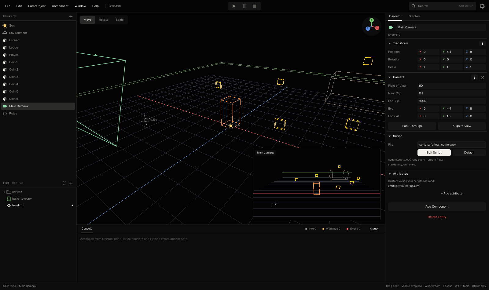

# Cameras

AUTOMATA has two kinds of view:

- **The editor view** is the free orbit camera you navigate with in
  Oberon. It isn't part of the scene and is never saved.
- **Scene cameras** are entities with a **Camera** component. They're
  saved in the scene file. Play mode and the shipped game render through
  the first one.



## Add a camera

**+ → Camera** in the Hierarchy, or **GameObject → Camera**. You can also
use **Graphics → Camera → Add Camera**. You can add a Camera component to
any entity too: **Add Component → Camera**.

A new camera is placed where you're currently looking from, aimed at the
same point, so it starts with a sensible view.

## Camera fields

| Field | Meaning |
|---|---|
| Field of View | Vertical angle in degrees. Around 60 is natural; 30 is a telephoto zoom; 90+ is a wide action view |
| Near Clip / Far Clip | Nothing closer than Near or farther than Far is drawn. Keep Near as large as you can (0.1–0.5) to avoid depth flicker |
| Eye | Where the camera is |
| Look At | The point it aims at |

The camera aims at a *point* rather than storing a rotation, because that
matches how games usually move cameras: follow something, look at
something.

**Moving the entity moves the camera.** When you drag a camera with the
Move gizmo, or change its Transform position, Eye and Look At move with it.
That keeps the aim. Editing Eye or Look At directly doesn't drag the
Transform along.

## See what the camera sees

- **Frustum.** Every camera draws its view pyramid in the scene view. The
  selected one is brighter, and a small notch marks the top edge.
- **Preview.** While a camera is selected, a live render of its view
  appears in the bottom-right corner of the scene view. You can turn it
  off with **Graphics → Camera → Preview**. It hides automatically when
  the view is too small.
- **Look Through** jumps the editor view to the camera's position, aim,
  and field of view. It's the quickest way to frame a shot exactly.
- **Align to View** does the reverse: it moves the camera to where the
  editor view is now. A good workflow is to navigate until the shot looks
  right, then click Align to View. It's one undo step.

Look Through and Align to View are in the Inspector's Camera section and
in **Graphics → Camera**.

## Cameras in Play mode

When the scene has a camera, **Play renders through the first one** in the
hierarchy. The editor's own view is ignored until you Stop. The built-in
player's WASD movement is relative to the camera's facing.

With no camera, Play uses the editor view and follows the player. That's
handy for quick tests, but a shipped game should always have a camera.

## Driving a camera from a script

Attach a script to the camera entity, or to anything else, and use
`entity.camera` or `ctx.camera`:

```python
def update(entity, ctx):
    cam = ctx.camera                     # the camera Play renders through
    cam.follow(ctx.scene["Player"])      # smooth third-person follow
```

| Member | Meaning |
|---|---|
| `cam.position` | Eye `(x, y, z)`. Read it or assign it |
| `cam.target` | Look-at point `(x, y, z)` |
| `cam.fov` | Vertical field of view in degrees (clamped to 1–179) |
| `cam.look_at(point_or_entity)` | Aim at a point or at an entity's position |
| `cam.follow(entity, offset=(0, 3, 8), smooth=8.0, look_height=0.6)` | Ease toward `entity + offset` and look at the entity. Call it every frame. `smooth=0` snaps |

The same API works in Oberon's Play mode and under `at.run_scene`.

### Recipes

**Fixed security camera that tracks the player**

```python
def update(entity, ctx):
    entity.camera.look_at(ctx.scene["Player"])
```

**Side-scroller**: lock the camera's Z distance and follow only X and Y.

```python
def update(entity, ctx):
    x, y, _ = ctx.scene["Player"].transform.position
    cam = entity.camera
    cx, cy, cz = cam.position
    k = min(1.0, 6.0 * ctx.time.delta)
    cam.position = (cx + (x - cx) * k, cy + (y + 1.5 - cy) * k, 12.0)
    cam.target = (cam.position[0], cam.position[1] - 1.0, 0.0)
```

**Orbit with Q / E**

```python
import math

def start(entity, ctx):
    entity.state["yaw"] = 0.0

def update(entity, ctx):
    yaw = entity.state["yaw"]
    yaw += (ctx.input.pressed("e") - ctx.input.pressed("q")) * 2.0 * ctx.time.delta
    entity.state["yaw"] = yaw
    px, py, pz = ctx.scene["Player"].transform.position
    entity.camera.position = (px + 8 * math.sin(yaw), py + 3.5, pz + 8 * math.cos(yaw))
    entity.camera.look_at((px, py + 0.6, pz))
```

**Zoom while a key is held** (Z)

```python
def update(entity, ctx):
    goal = 35.0 if ctx.input.pressed("z") else 60.0
    entity.camera.fov += (goal - entity.camera.fov) * min(1.0, 10 * ctx.time.delta)
```

More: the [third-person camera tutorial](../tutorials/third-person-camera.md)
and the [camera rail / cutscene tutorial](../tutorials/camera-rail.md).

## Cameras in plain Python

In code-first games (no Oberon), cameras are ordinary components. See
[Guide: Cameras](../guides/cameras.md).
