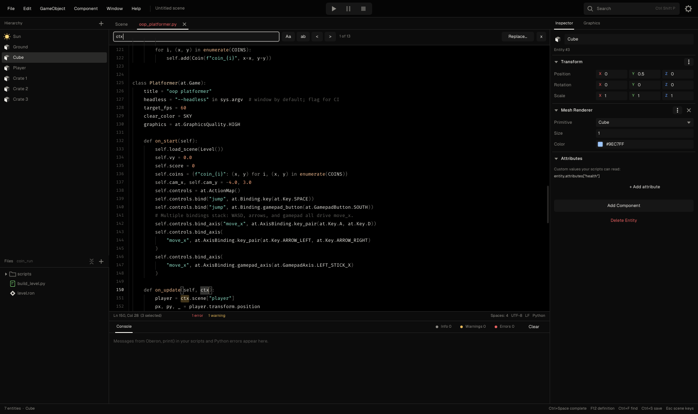

# The code editor

Oberon has a native code editor built in, so you can write scripts without
leaving the scene. Scripts open as tabs next to the **Scene** tab. Press
**Esc** to go back to the scene view; the tab stays open.



## Open a script

- Double-click a `.py` file in **Files** (left sidebar).
- **File → New Script…** / **Open Script…**.
- Right-click an entity → **Edit Script**.
- Click a **file:line** link in the Console.
- **Ctrl+E** (Go to File): type part of a script name. Open scripts come
  first, most recent first. The command palette (Ctrl+Shift+P) finds
  scripts too.

## Tabs

The keys are the same as in VS Code, and they also work while the Scene
tab is showing:
- **Ctrl+Tab** shows your open tabs in the order you last used them. Keep
  Ctrl held and press Tab again to go further back; let go to switch.
- **Ctrl+PgUp / Ctrl+PgDn** steps through the tabs in strip order.
  **Alt+1…9** jumps to a tab by position (the Scene is Alt+1).
- **Ctrl+W** closes a tab, and **Ctrl+Shift+T** brings back the last one
  you closed. When you close the active tab, Oberon shows the tab you used
  before it.
- Middle-click a tab to close it, or drag it to reorder. Right-click a tab
  for **Close Others**, **Close to the Right**, **Close Saved**, **Copy
  Path** and **Reveal in Files**. When there are too many tabs to fit,
  scroll the strip with the wheel.

## Editing

You get what you'd expect from a modern editor:
- Python syntax highlighting
- auto-indent after `:`
- bracket and quote pairing
- line moves, duplicates, and comments
- indentation guides
- current-line highlight
- multi-line paste that keeps relative indentation
- multiple carets: **Ctrl+D** adds the next match of the selected word,
  **Ctrl+Shift+L** selects every match, **Alt+click** adds a caret, and
  **Ctrl+Alt+↑/↓** adds one above or below. Every caret types at once, and
  one Ctrl+Z undoes the whole edit.

The full key list is in [Keyboard shortcuts](shortcuts.md#code-editor).

**Find / Replace** (Ctrl+F / Ctrl+H) supports case-sensitive and
whole-word matching, shows match counts, and can replace all at once.

The **status line** shows the cursor position, selection size, diagnostics
counts, indentation, encoding, and line endings.

## Completion

Completion is built in and needs no setup. It knows the scripting API:

- `ctx.` → `time`, `input`, `scene`, `camera`, `physics`, `log`, …
- `entity.transform.` → `position`, `rotation_euler`, `scale`, …
- `ctx.camera.` / `entity.camera.` → `position`, `target`, `fov`,
  `look_at`, `follow`
- inside `ctx.input.pressed("`: every key name
- inside `ctx.scene["`: the names of the entities in your scene
- inside `entity.attributes["`: the attribute names you've defined

Each suggestion has an icon for its kind: a cube for functions and methods,
`[▪]` for variables, linked boxes for classes, a tag for properties,
`{ }` for modules, a boxed `=` for constants, and lines for keywords.

Suggestions appear as you type. Turn that off in **Settings → Script
Editor** if you'd rather press **Ctrl+Space**. Hover a name for its
documentation.

## Language servers

If a Python language server is installed, Oberon starts it when you open
a script. It adds:
- diagnostics (squiggles plus the status-line counts)
- richer completion
- hover
- **F12** go to definition

Oberon looks for these, in order: **basedpyright**, **pyright**,
**pylsp**, **jedi-language-server**. It checks the project's `.venv` first.
Projects made by [`oberon new`](command-line.md) already have basedpyright
there. For other folders:

```console
oberon pip install basedpyright   # into the project's .venv
```

With [type hints](scripting.md#types-and-completion) on `entity` and `ctx`,
the server completes the whole script API and underlines misspelt names.

**Settings → Python → Language server** shows which one is running and
has a **Restart server** button.

## Settings

**Settings → Script Editor** has these options:
- font size
- **Editor scale**: zooms only the code editor (text, gutter, find bar,
  popups and status line) and leaves the rest of the interface alone. You
  can also hold Ctrl and use the wheel over the editor. The whole-interface
  zoom is **Settings → Appearance → Interface scale**.
- current-line highlight
- indentation guides
- whitespace markers
- suggest while typing
- trim trailing whitespace on save
- **Save scripts before Play**, on by default, so Play always runs what
  you see

Prefer another editor? Edit the files in VS Code, Vim, or anything else.
Oberon hot-reloads saved scripts during Play either way.
