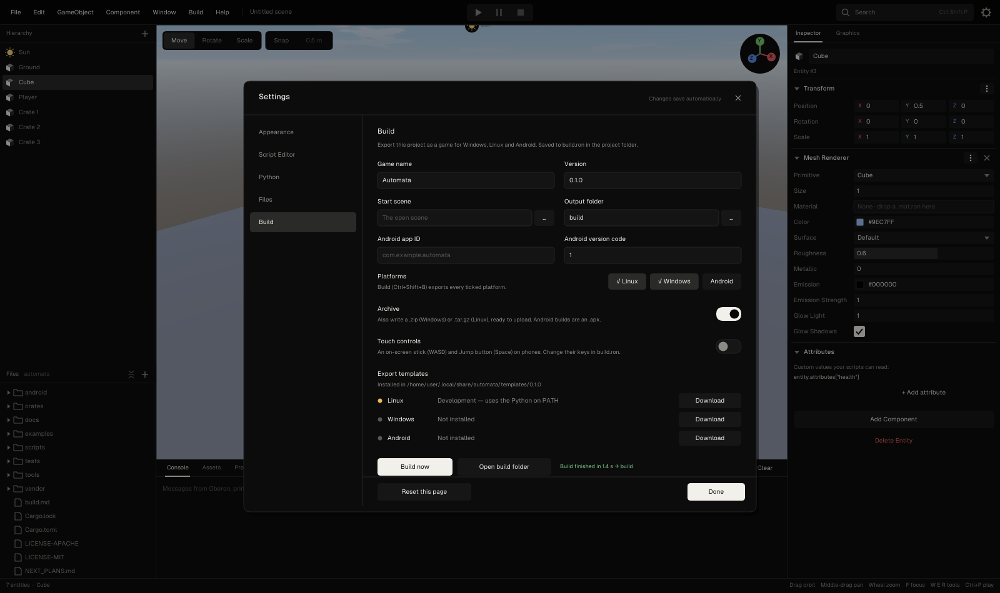

# Exporting your game

An export turns your project into a game other people can run. They don't
need Oberon, Rust or Python installed. AUTOMATA exports to **Windows**
and **Linux** (64-bit), and to **Android** as an `.apk` you can install
on a phone ([Android](#android) below; still being polished).

Each export is a folder you can zip and share. You can also turn on
**Archive** to get a ready-made `.zip` (Windows) or `.tar.gz` (Linux).

```
build/
  windows/Coin Run/
    Coin Run.exe        ← players double-click this
    game/               ← your scenes, scripts and assets
    runtime/            ← a private Python with the engine inside
  linux/Coin Run/
    Coin Run
    game/
    runtime/
  Coin Run-0.1.0-windows-x86_64.zip
  Coin Run-0.1.0-linux-x86_64.tar.gz
  android/
    Coin Run-0.1.0.apk  ← install this on a phone
```

## Build from Oberon

1. Save your scene into the project folder (Ctrl+S).
2. Open **Build ▸ Build Settings…**. Set the game name and version, and
   pick the platforms.
3. Press **Build now**, or **Ctrl+Shift+B** anywhere in the editor.



The build runs in the background, so you can keep working while it runs.
Its progress appears in the status bar and the Console. If anything
fails, the Console opens and lists every problem: a missing script, a
scene that won't load, or a missing template. **Open build folder** shows
the result in your file manager.

| Setting | What it does |
|---|---|
| Game name | Window title, executable name and folder name |
| Version | Used in archive names, e.g. `Coin Run-0.1.0-linux-x86_64.zip` |
| Start scene | The scene the game opens. If empty, the build uses the scene open in Oberon. |
| Output folder | Where builds go, relative to the project (`build`) |
| Android app ID | The app's unique ID on Android, like `com.yourname.coinrun`. Empty: `com.example.<name>`, fine for testing |
| Android version code | A whole number Android compares to decide what's an update. Raise it for each release |
| Platforms | What **Build** / Ctrl+Shift+B exports. **Build ▸ Build for Linux / Windows / Android** exports just one. |
| Archive | Also write a `.zip` / `.tar.gz` of each build |
| Touch controls | An on-screen stick and buttons that hold the game's keys on touch screens. Turning it on writes a stick for WASD and a Jump button for Space; change them in `build.ron` ([Touch controls](../guides/touch-controls.md)) |

Settings are saved to `build.ron` in the project folder, so commit it with
your project. Each build leaves out `.oberon/`, `__pycache__/`, version
control folders, virtual environments (under any name) and installed
packages (`site-packages/`), the output folder and `tests/`. To
leave out more, add paths to `exclude` in `build.ron`. A trailing `/`
means a folder:

```ron
BuildConfig(
    name: "Coin Run",
    version: "1.0.0",
    start_scene: Some("level.ron"),
    targets: [Linux, Windows, Android],
    archive: true,
    exclude: ["tests/", "art/source/"],
    android: (package: "com.yourname.coinrun", version_code: 1),
)
```

## Export templates

An export doesn't compile anything. It copies a prebuilt **export
template** (the game launcher plus a private Python with the engine
installed), then adds your project. That's why a build takes seconds, and
why you can export for Windows from Linux and the other way round.

Templates are downloaded once per engine version. **Build** fetches a
missing template by itself, or you can use **Build ▸ Download Export
Templates** or the **Download** buttons on the Build page. The Linux
template is about 75 MB and the Windows one about 25 MB. The Android
template is an APK for phones (`arm64-v8a`) and emulators (`x86_64`).

While the repository is private, the plain download link needs you to be
signed in. Oberon and `automata-cli` try these in order:

1. the public release link;
2. the GitHub CLI, if you've signed in with `gh auth login`;
3. a token in `GH_TOKEN` or `GITHUB_TOKEN` (it needs read access to the
   repository).

If none of them works and you run Oberon from a source checkout
(`cargo run -p oberon`), Build compiles `automata-player` with cargo and
uses it as a **Development** template for your own platform.

The Build page shows each template's state:

- **Ready**: the game ships its own Python. This is what you give to
  players.
- **Development**: the game uses the Python on `PATH`, which must have
  `automata` installed. Oberon sets one up automatically when you run a
  source checkout and no template is installed yet. It's fine for testing
  on your own machine, but don't ship it.
- **Not installed**: Build downloads it the first time you build for
  that platform.

Templates live in `~/.local/share/automata/templates/<version>/` on Linux
and `%APPDATA%\automata\templates\<version>\` on Windows. You can choose
another folder by setting `AUTOMATA_TEMPLATES`.

## Build from the command line

The same exporter is available as `automata-cli`, the AUTOMATA command
line (it was called `automata-export` before). Use it in CI, or for
code-first games that don't use Oberon:

```bash
cargo build --release -p automata-cli
automata-cli templates download             # once per engine version
automata-cli init my_game --scene level.ron # writes build.ron
automata-cli check my_game                  # validate without building
automata-cli stage my_game --out staged/    # just the game folder
automata-cli build my_game --target all     # or linux / windows / android
```

A code-first game, written in Python with `at.Game` and no scene file,
starts from a script instead of a scene:

```bash
automata-cli init my_game --main main.py
```

The exported game runs `main.py` exactly like `python main.py` would,
with the game folder as the working directory. Load files with paths
relative to that folder.

`stage` writes only the game folder a build would ship: your files minus
the ones left out, plus `game.json`. It doesn't need a template. Use it to
look at what gets shipped, or to package the game yourself.

## Android

**Build ▸ Build for Android** (or `automata-cli build --target android`)
writes `build/android/<name>-<version>.apk`. Like the desktop builds it
needs no compiler, and no Android SDK, NDK or Java either. The build
copies the Android template and then:

- adds your game's files to the APK;
- gives the app your game's name, **Android app ID** and version;
- aligns and signs the APK.

Install it on a phone with `adb install "build/android/Coin Run-0.1.0.apk"`,
or copy the file over and open it. Android asks you to allow installs from
that app first.

The first time the game starts, it unpacks its files into the app's
storage, which takes a moment. After that it starts straight away, until an
update brings different files. Saves and settings stay through updates.

**Signing.** Android only installs signed apps, and only accepts an update
signed by the same key. The first Android build makes a *debug key* for
your machine, like Android Studio does, and every build after that uses
it. The key is saved as `android-debug.key` in `~/.config/automata/`
(Linux, macOS) or `%APPDATA%\automata\` (Windows), or wherever
`AUTOMATA_ANDROID_KEY` points. Keep this file. If you build on another
machine, copy the key there too, or that machine's builds won't install
over yours. Debug signing is fine for your own phones and for testers.
Publishing on Google Play needs your own release key; support for that is
coming.

**App ID.** Choose it before anyone installs your game. Android treats a
different ID as a different app. Use letters, digits and `_`, in at least
two parts separated by dots (`com.yourname.coinrun`).

On a phone the game fills the screen in the shape of its resolution
(landscape for 1280×720). Touch controls are set up under
[Touch controls](../guides/touch-controls.md).

## Running an exported game

Players start the executable. It also accepts two flags, which help with
smoke tests in CI:

| Flag | Effect |
|---|---|
| `--headless` | Run without a window |
| `--frames N` | Quit after N frames |

```bash
"build/linux/Coin Run/Coin Run" --headless --frames 60
```

Each run writes its output and any Python traceback to
`logs/last_run.log` next to the executable. On Windows, the game has no
console window, so when it crashes the log opens in Notepad.

## How it works

`automata-player` is a small native launcher written in Rust. It finds
`runtime/` and starts its Python with `python -m automata.player game/`.
The player reads `game/game.json`, which holds the name, the start scene
or main script, and the resolution, then runs the game. Scenes run through
`at.run_scene` and scripts through `runpy`. Templates come from the
[Export templates workflow](https://github.com/x017/automata/actions/workflows/export.yml)
on GitHub. It builds the launcher and the engine wheel on Windows and
Linux, installs them into a portable CPython 3.12, smoke-tests an export
of *Coin Run*, and publishes the results to the `export-templates`
release.

The Android template comes from the
[Android workflow](https://github.com/x017/automata/actions/workflows/android.yml).
python-for-android builds an APK with Python, the engine and the player,
but no game. The workflow then builds *Coin Run* from it with
`automata-cli`, plays it on an Android emulator, and publishes the
template. An Android build puts the game in the APK under
`assets/automata/game/`. It changes the app ID, name and version in the
APK's compiled manifest and resource table, and signs the APK with APK
Signature Scheme v2.
