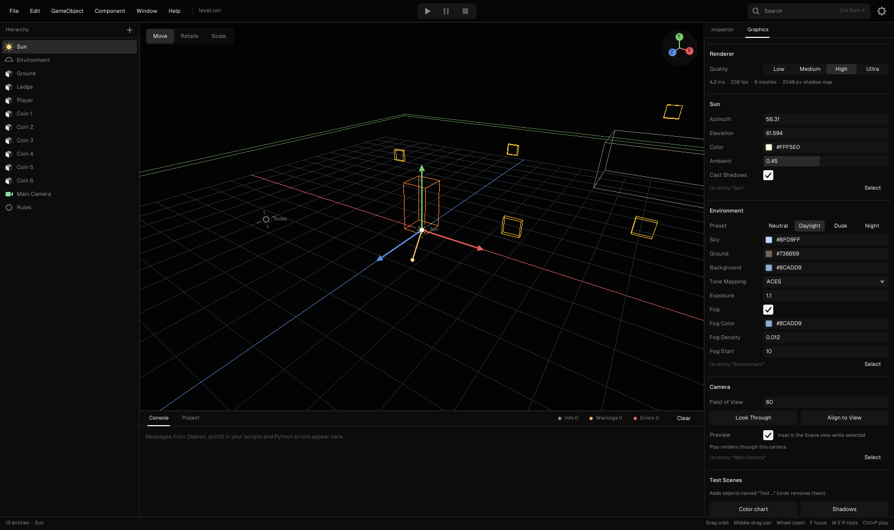
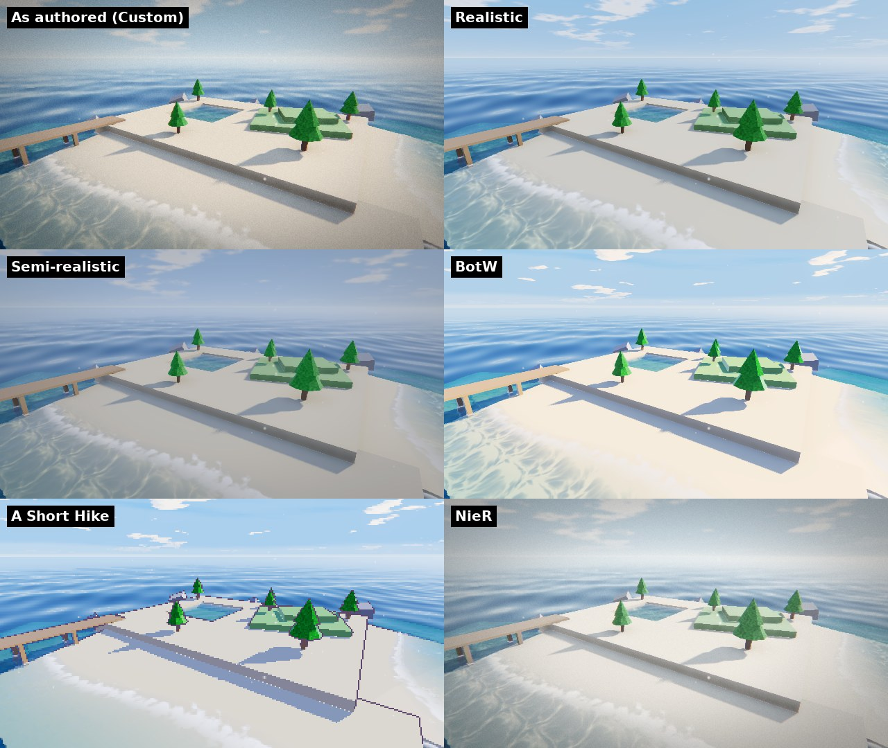

# Graphics

The **Graphics** tab sits next to the Inspector in the right dock. It
collects everything that decides how the frame looks, plus tools for
testing it. Every edit is undoable and saved with the scene, except
**Quality** and **Preview**, which are editor preferences.

The panel edits real scene entities. Each group shows which entity it
edits, for example *On entity "Sun"*, with a **Select** button that jumps
to that entity in the Inspector. Nothing in the panel is hidden state: a
scene tuned here looks the same in Play and under `at.run_scene`.

## Renderer

- **Quality**: Low / Medium / High / Ultra / Beautiful. This sets the
  shadow map resolution, or turns shadows off on Low. Beautiful switches to
  contact-hardening cascaded shadows, ambient occlusion, physically based
  light, HDR bloom, FXAA and refractive water. It applies immediately.
- **Stats** update live: frame time in ms, fps, meshes drawn, and shadow
  map size. Use them with the *400 cubes* test scene to see what your
  scene costs.

| Quality | Shadows | Shadow maps | Glow lights with shadows |
|---|---|---|---|
| Low | off | — | none |
| Medium | on | 1 × 1024 px | none |
| High (default) | crisp, 2 cascades | 2 × 2048 px | 2 nearest |
| Ultra | crisp, 3 cascades | 3 × 2048 px | 4 nearest |
| Beautiful | contact-hardening, 4 cascades, plus ambient occlusion | 4 × 2048 px | 4 nearest, soft |

Water is a component. Use **Create → Water** (it starts as a calm pond)
or select an entity and use **Add Component → Water** in the Inspector.
It has fields for size, colors, clarity, waves and foam. Tick **Endless**
on a sea to carry it, calm, past its edges to the horizon. **Caustics**
sets how strongly light dances on what's under it. **Wind** blows spray
off the crests from 0.5 up. In Play, a camera under the surface sees a
blue-green world and hears it muffled.
See [Rendering & Lights](../guides/rendering-and-lights.md#water).

## Point and spot lights

Use **Create → Point Light** for a lamp or torch, and **Create → Spot
Light** for a flashlight, headlight or stage light. You can also add
either to any entity with **Add Component**. A point light shines every way
from the entity. A spot light shines along the entity's forward axis
(its blue Z handle points backward), so aim it with the **Rotate** tool.
New spot lights start tipped down, lighting the ground in front of them.

| Field | What it does |
|---|---|
| Color | The light's colour |
| Intensity | Brightness. 1 lights a surface 1 m away like a white sun overhead. Torches and lamps 2–6, headlights 10–30 |
| Range | Where the light ends (m). 0 works it out from the brightness |
| Cone Angle | (Spot) the cone's edge, in degrees from its axis (up to 80) |
| Inner Angle | (Spot) full strength inside this angle. Closer to the cone angle gives a harder edge |
| Radius | The size of the glowing source. Bigger looks softer up close |
| Cast Shadows | Whether objects block it (High and up; see the shadow table) |

Placed lights share the shadowed-light budget in the table above with
glowing meshes. A spot light costs a sixth of a point light, so a pair of
headlights is cheap. A small mesh around a light (a bulb, a flame, a lens)
never blocks it. See
[Rendering & Lights](../guides/rendering-and-lights.md#point-lights-and-spotlights).

## Sun

This group edits the scene's first **Directional Light**. If there isn't
one, **Add Directional Light** creates it.

| Field | Meaning |
|---|---|
| Time of Day | Moves the sun along a simple day arc in one drag: 6 = sunrise, 12 = highest (65°), 18 = sunset. Sets Azimuth and Elevation together |
| Azimuth | Compass direction the light comes **from**, in degrees. 0 = from +Z (behind the default view), 90 = from +X |
| Elevation | Height of the sun above the horizon. 90 = straight down (noon), 5–15 = long sunset shadows |
| Color | Sunlight tint |
| Ambient | How bright the shadowed sides are (0 = black shadows, 1 = no shading) |
| Cast Shadows | Shadow mapping for this light |
| Shadow Distance | How far from the camera shadows reach, in metres (default 120). They fade out beyond it. Shorter is sharper |
| Shadow Softness | How soft shadow edges are: 0 sharpest, 1 default, up to 8. Shows most on Beautiful, where shadows start sharp at the object and widen with distance by the Sun Size times this |

Azimuth and elevation are a friendlier way to set the light's direction
vector. The Inspector's Directional Light section shows the same two
fields.

## Environment

The **Environment** component sets the look of the whole scene: the sky
and sun, ambient colour, exposure, tone mapping, and fog. The first entity
that has one wins. A scene without one uses the neutral default look: white
ambient, a near-black background, no fog, and no tone mapping. Click
**Customize Environment** to create an Environment entity and start
tuning.

**Presets** give you a starting point:

| Preset | Look | Tone mapping |
|---|---|---|
| Neutral | Plain lighting, no fog: the default | None |
| Daylight | Blue sky with sun and clouds, warm ground bounce, light haze | ACES |
| Dusk | Violet sky with a big warm sun, dark red ground, dense warm fog | AgX |
| Night | Near-black sky with a small dim disk, cold ambient, black fog | ACES |

| Field | Meaning |
|---|---|
| Sky / Ground | Ambient light from above and from below. Surfaces facing up take the sky colour; surfaces facing down take the ground colour; the rest blend between them. This hemisphere ambient makes flat-coloured scenes look grounded |
| Sky & Sun | Draw a sky dome instead of a flat colour: a gradient from Horizon to Zenith, the sun disk where the Directional Light shines from, a halo around it, and drifting clouds. Water and fog pick up the same sky |
| Background / Horizon | With the sky off, the flat colour behind everything. With it on, the sky colour at the horizon (also the far fog's colour) |
| Zenith | Sky colour straight up |
| Sun Size | Diameter of the sun disk in degrees (the real sun is about 0.5; 2 reads well in games) |
| Sun Glow | Brightness of the halo around the sun. Low suns glow warmer on their own |
| Clouds | Cloud cover, 0 = clear, 1 = overcast |
| Lens Flare | Strength of the glare, starburst and ghosts when you look toward the sun. Beautiful quality only; scenery and clouds in front of the sun hide it |
| Tone Mapping | How bright values are squeezed into the screen's range. **None**: values above 1 clip. **Reinhard**: soft and flat. **ACES**: filmic contrast and saturation. **AgX**: filmic, keeps bright colours from turning neon |
| Exposure | Brightness multiplier applied before tone mapping. Raise it with ACES or AgX, which darken mid-tones |
| Occlusion | Ambient occlusion strength: how much creases, corners and the ground around objects darken. 0 off, 1 default, up to 2. Beautiful quality only; it dims ambient light, so it shows most in shade |
| Fog | Exponential distance fog |
| Fog Color | Usually the same as Background, so distant objects melt into the sky |
| Fog Density | How quickly fog thickens per metre. 0.01 is light haze, 0.05 is thick |
| Fog Start | Distance from the camera with no fog at all |
| Fog Height | Height fog: the fog has full density below this height (m) |
| Fog Falloff | How fast it thins above Fog Height: e times thinner every 1/falloff metres. 0 keeps the fog even at every height |
| Fog Sun Glow | How much fog toward the sun glows in the sun's colour |
| God Rays | Sun shafts streaming past trees and walls toward the camera, 0 off to 2. Beautiful quality, with Sky & Sun on |
| Depth of Field | Blur on what's nearer or farther than the focus, 0 off to 4. Beautiful quality only |
| Focus Distance | Metres from the camera kept sharp. 0 follows the camera's Look At point (shown once Depth of Field is above 0) |
| Focus Range | Metres either side of the focus that stay sharp too |

> With the sky off, fog is applied before tone mapping and the
> background after it, so with ACES or AgX the far fog can look slightly
> different from the background. If the horizon shows a seam, nudge Fog
> Color, or turn on **Sky & Sun**, which fades fog into the sky itself.

Picking an Environment preset keeps your post effects.

## Style

The **Style** group picks a whole look for the scene: **Realistic**,
**Semi-realistic**, **BotW**, **A Short Hike** or **NieR**. A style sets
tone mapping, exposure, the lens, the shape of the height fog, shading,
outlines, pixels and the Post group's values. It keeps your colours, the
fog's colour and density, the sky and the clouds. Change any setting
afterwards and the dropdown shows **Custom**. Pick the style again to
reset it. The same dropdown sits in the Inspector's Environment section.

| Setting | What it does |
|---|---|
| Toon Bands | Toon shading: sunlight in this many flat steps, 1 to 4. 0 is smooth shading |
| Band Softness | How soft the steps' edges are (shown with Toon Bands above 0) |
| Shade Tint | The colour of shade. White leaves it alone; a light blue gives an illustrated look |
| Rim Light | Light along objects' edges from the sky, and from the sun when it's behind them, 0 to 2 |
| Painted Sky | With Sky & Sun on: a banded, brushed gradient, flat clouds and a flat sun |
| Outline | Dark lines on silhouettes and creases, in pixels on a 720 px screen. 0 is off |
| Outline Color | The lines' colour (shown with Outline above 0) |
| Pixelate | Pixel art: pixel size on a 720 px screen, scaled to the window. 0 is off |
| Palette | Levels per colour channel with a dither, for a retro palette. 0 is full colour |

Outline, Pixelate and Palette need Medium quality or higher. The rest
work everywhere.

## Post

The **Post** group grades the finished frame: colour, bloom, vignette,
grain and colour fringes. The values live on the Environment, so click
**Customize Environment** first. They also show in the Inspector's
Environment section. Grading runs on Medium quality and up, and bloom on
High and up.

The row of **looks** at the top sets every field at once, and the current
look is highlighted. Pick one, then fine-tune:

| Look | Feel |
|---|---|
| Neutral | No grade: the default |
| Bleached | Overexposed, washed out and pale, with strong bloom |
| Vivid | Warm, saturated sunshine |
| Film | Gentle contrast and warmth, grain, vignette |
| Noir | Black and white, hard contrast |

| Field | Meaning |
|---|---|
| Bloom | Glow around bright things, 0 off to 4. High and up |
| Contrast | Spread around mid grey. 1 is unchanged |
| Saturation | 0 is black and white, 1 is unchanged, up to 3 |
| Temperature | White balance: negative is cooler (blue), positive is warmer (orange) |
| Tint | White balance: negative is greener, positive is more magenta |
| Lift | Added to the shadows, per channel (R, G, B). Raises the blacks |
| Gamma | Midtone power per channel. Above 1 brightens the midtones |
| Gain | Highlight multiplier per channel. Above 1 overexposes |
| Vignette | Darkens the corners |
| Grain | Animated film grain |
| Aberration | Red and blue colour fringes toward the frame's edges |

For a bleached, overexposed look, start from **Bleached** or raise Gain
to about 1.2 and drop Saturation to 0.5. For a warm adventure look, start
from **Vivid** or set Temperature to 0.15 and Saturation to 1.35. See
[Post effects and colour grading](../guides/rendering-and-lights.md#post-effects-and-colour-grading)
for the details.

## Camera

This group edits the scene's first camera, the one Play renders through.
If there isn't one, **Add Camera** creates one framed on your current
view.

- **Field of View**
- **Look Through** / **Align to View**
- **Preview**: show the live inset when a camera is selected

Full guide: [Cameras](cameras.md).

## Test Scenes

These buttons drop known content into the scene so you can judge a look
or a setting fairly. Every object they add is named `Test …`, and each
button press is one undo step. **Remove N test objects** deletes them all
at once, also as one undo step.

| Scene | Use it to |
|---|---|
| Color chart | A sweep of hues and brightness. Switch tone mapping and watch how saturated colours and highlights behave |
| Shadows | A floor, pillars, and a floating slab. Check shadow shape, contact, and acne while you move the sun |
| Fog depth | Pillars marching out to 150 m. Tune fog density and start until the far ones fade the way you want |
| 400 cubes | A 20×20 field. Watch the frame time stat at each quality level |
| Lantern | A glowing lantern ringed by crates. Try it at night: on High and up the crates throw shadows outward from the lantern. Untick its **Glow Shadows** to compare |

Test objects are ordinary entities. Remember to remove them before you
save, unless you want to keep them.

## A tuning workflow

1. Add **Shadows** and **Color chart**.
2. Pick the preset closest to your mood.
3. Set **Elevation**: low for drama, high for clarity. Then rotate
   **Azimuth** until the shadows fall where they read best.
4. Adjust **Sky / Ground** until the shadowed sides look right, then
   **Ambient** for overall contrast.
5. Pick **Tone Mapping**, then fix overall brightness with **Exposure**.
6. Turn on **Fog**. Match Fog Color to Background and set **Fog Start**
   just past the play area.
7. Click **Remove test objects** and save.

The same look in plain Python is in
[Guide: Rendering & Lights](../guides/rendering-and-lights.md#environment).
The [Lighting & mood tutorial](../tutorials/lighting-and-mood.md) walks
through three complete looks.
