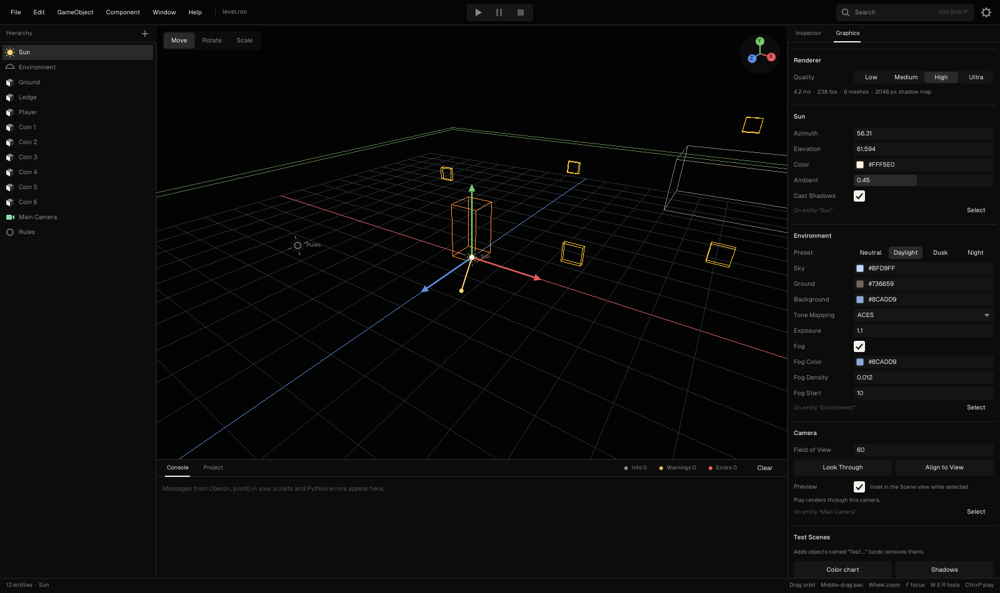

# The interface

```text
┌ File Edit GameObject Component Window Help ─── ▶ ❚❚ ■ ───── Search ⚙ ┐
│ Hierarchy    │ Scene  script.py               │ Inspector  Graphics  │
│              │                                │                      │
│  Sun         │      (3D viewport / editor)    │  name, components,   │
│  Ground      │                                │  attributes          │
│  Main Camera │                                │                      │
├ Files ───────┤                                │                      │
│ ▾ scripts    ├────────────────────────────────┤                      │
│     coin.py  │ Console                        │                      │
└ status bar ──────────────────────────────────────────── shortcut hints ┘
```

All panel borders can be dragged. **Window → Reset Layout** restores the
default sizes.

## Top bar

- **Menus**: File (scenes, scripts, prefabs), Edit (undo, clipboard,
  tools), GameObject (create), Component (add to the selection), Window,
  Help.
- **Play / Pause / Stop** sit in the centre. The scene name next to the
  menus shows a dot when you have unsaved changes.
- **Search** (Ctrl+Shift+P) opens the command palette. Type part of any
  command, entity, or script name and press Enter.
- **⚙** (Ctrl+,) opens Settings.

## Hierarchy

Lists every entity in the scene. Each icon shows the entity's main
component: cube, sun, camera, horizon (Environment), or empty.

- Click to select. Double-click (or press F) to frame the entity in the
  view.
- **+** opens the Create menu: Empty, Cube, Sphere, Plane, Directional
  Light, Point Light, Spot Light, Camera, Environment, Water, Physics Cube,
  Player.
- Right-click an entity for Rename, Duplicate, Copy/Paste, Delete, Frame,
  Save as Prefab, and Attach/Edit Script.

## Files

The bottom of the left sidebar is a file tree of your project: the folder
your scene is saved in. Drag the divider between Hierarchy and Files to
share the space, or hide either one from the **Window** menu.

- Click a folder to expand or collapse it. The **collapse** button in the
  panel's title bar folds everything back up.
- Double-click a `.py` file to open it in the code editor, a `.ron` file
  to open it as a scene, or a `.prefab` to place it in the scene.
- Models (`.glb`, `.gltf`, `.obj`, shown with a cube icon) can be dragged
  onto the scene view to place them, or onto the Inspector to give them to
  the selected entity. Double-click a model to add it where you're
  looking. See [Models](models.md).
- The open scene and the script you're editing are shown in bright text
  with a dot.
- Right-click a file for Open, Edit Script, **Attach to** the selected
  entity, or Instantiate. Right-click anywhere for **New Script…** and
  **New Folder**. New files go in the selected folder, and the tree opens
  to show them.
- **+** in the title bar does the same as right-clicking empty space.
- **Drag a file onto a folder** to move it there (onto empty space to move
  it to the project root). Scenes that use the file, such as an attached
  script, a model or a sound, are updated to the new path in one undo step.
- Right-click a file or folder for **Rename…**, **Duplicate**, **Copy
  Path**, **Copy Relative Path**, **Show in File Manager**, and **Move to
  Trash**. Deleting always asks first and goes to the system trash where
  there is one, so it can be restored.

Click in the panel to give it the keyboard:

| Keys | Action |
|---|---|
| ↑ / ↓ | Select the previous / next file |
| → / ← | Expand / collapse a folder (← on a file goes to its folder) |
| Enter | Open the file (scene, script, prefab) or toggle a folder |
| F2 | Rename in place (the extension is kept) |
| Ctrl+D | Duplicate |
| Del | Move to Trash (asks first) |
| Ctrl+Shift+C | Copy the file's path |

## File browser

Open, Save As, New Script, Import Model, and the **…** buttons in Settings
all use the same browser, so you rarely need to type a path:

- **Places** on the left: the project, its Scripts/Models/Scenes folders,
  folders you used recently, and your home folder.
- **Breadcrumbs** across the top: click any part of the path to go back to
  it. **← → ↑** go back, forward and up (Alt+← / Alt+→ / Alt+↑).
- **Click** a file to select it, **double-click** to open it. One click on
  a folder opens it. Click a column header to sort by name, size or date.
- **Type to filter**: the name field narrows the list as you type, and
  Enter takes the highlighted match, so `pla` + Enter opens `player.py`.
  **Tab** completes the name.
- **Keyboard**: ↑/↓, PgUp/PgDn, Home/End move the highlight; Enter opens a
  folder or chooses a file; Backspace in an empty field goes up a folder;
  F5 refreshes; Esc closes.
- **+ New Folder** makes a folder right there and asks for its name.
- Saving over an existing file asks first. Dropping a file from your
  desktop onto the browser jumps to it.
- Each kind of dialog remembers the folder you used last.

Hidden files and `__pycache__`, `target`, and `node_modules` folders are
left out.

## Scene view

This is the 3D viewport, rendered by the engine's own wgpu renderer.

| To | Do |
|---|---|
| Select | Click an object |
| Orbit | Drag empty space, right-drag, or Alt+drag |
| Pan | Middle-drag |
| Zoom | Mouse wheel |
| Frame selection | F, or double-click in the hierarchy |
| Context menu | Right-click without dragging |

**Gizmos.** The floating toolbar (top-left) switches between **Move** (W),
**Rotate** (E), and **Scale** (R). Drag a coloured axis handle to edit
along that axis. Arrow keys nudge the selection across the ground relative to the view, PgUp/PgDn move it up and down, and holding Shift makes the steps finer. The axis
widget (top-right) shows the view orientation.

**Overlays.**
- Lights draw as icons: a sun for the Directional Light, a bulb for a
  Point Light, a lamp with its beam for a Spot Light (in the light's own
  colour). A selected Point Light shows its range as three rings, and a
  selected Spot Light shows its cone out to its range. The fainter inner
  circle is where the light is still at full strength.
- Cameras draw their view **frustum**: a pyramid showing exactly what the
  camera sees, with a notch marking "up".
- When a camera is selected, a **live preview** of its view appears in
  the bottom-right corner. See [Cameras](cameras.md).

## Inspector

Shows the selected entity.

- **Name** at the top.
- **Components**: Transform, Mesh Renderer, Directional Light, Point
  Light, Spot Light, Camera, Environment, Rigidbody, Collider, Character Controller, Script. Each
  section folds open and closed. The **⋮** menu has Reset, Copy/Paste
  Component, and Remove.
- **Fields**: drag the label to scrub a number, or click the field and
  type. Colour swatches open a colour picker with hex input.
- **Attributes**: custom values your scripts read. See
  [Prefabs & attributes](prefabs-and-attributes.md).
- **Add Component** lists every component the entity doesn't have yet.

Every edit is one undo step. Scrubbing a value counts as one step, not
one per frame.

### Surfaces

Below **Color** the Mesh Renderer has the material rows:

| Row | What it does |
|---|---|
| **Surface** | A preset: Default, Matte, Glossy, Metal, Brushed Metal, Rubber or Glowing (glows in the mesh's colour). Shows *Custom* once you change a value by hand. |
| **Roughness** | 0 = mirror-like gloss, 1 = chalk. |
| **Metallic** | 0 = plastic, wood, stone; 1 = metal (reflects the sky, tinted by Color). |
| **Emission** | The colour the surface glows with. Black = no glow. |
| **Emission Strength** | Multiplies Emission. Above about 1 it blooms on Ultra and Beautiful. |
| **Glow Light** | How much the glow lights the things around it, in its colour. 1 = like a real glowing object of this size, 0 = off, up to 10 for small glows that should throw a visible pool. |
| **Glow Shadows** | Objects in the way block the glow's light and cast shadows (on High and up). Untick it for small glows that don't need shadows; that's cheaper. |

Metal and gloss show best on a **Sphere** under a sky. On models, Default
keeps the file's own materials. See [Rendering & Lights](../guides/rendering-and-lights.md#surfaces).

## Graphics

The second tab in the right dock. It's a single place to test and tune how
the scene looks:
- renderer quality and live frame time
- the sun angle
- environment presets, tone mapping, and fog
- the scene camera
- one-click test scenes

Full guide: [Graphics](graphics.md).



## Console

The bottom dock collects `print()` output from your scripts, Oberon
messages, and Python errors with clickable file and line links. The
Info / Warnings / Errors chips filter the list.

## Assets

The **Assets** tab, beside the Console (**Window → Assets**), shows every
model in the project as a thumbnail and every sound as a waveform with its
length. Drag a tile onto the scene to add it, or double-click it. See
[Models](models.md#the-assets-tab) and [Audio](audio.md).

## Play mode

Press **▶** (Ctrl+P). Oberon copies the scene and starts simulating:

- **Physics.** Rigidbodies fall and collide. The **Player** (Character
  Controller) walks with WASD or arrows, jumps with Space, and sprints
  with Shift.
- **Scripts** get `start` once, then `update` every frame.
- **Camera.** If the scene has a Camera, Play renders through it, and
  player input is relative to that camera's direction. Without one, the
  editor view follows the player.
- **❚❚** pauses. **■** (Ctrl+P again) stops and restores the scene
  exactly as it was before Play.

Edits are locked during Play, so you can't lose work to a scene that gets
thrown away on Stop.

## Status bar

The left side shows the entity count and the current selection. The right
side shows shortcut hints for whatever has focus. You can turn the hints
off in **Settings → Appearance**.
