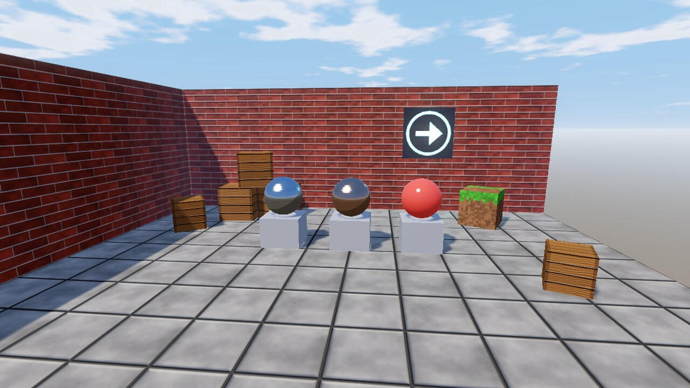
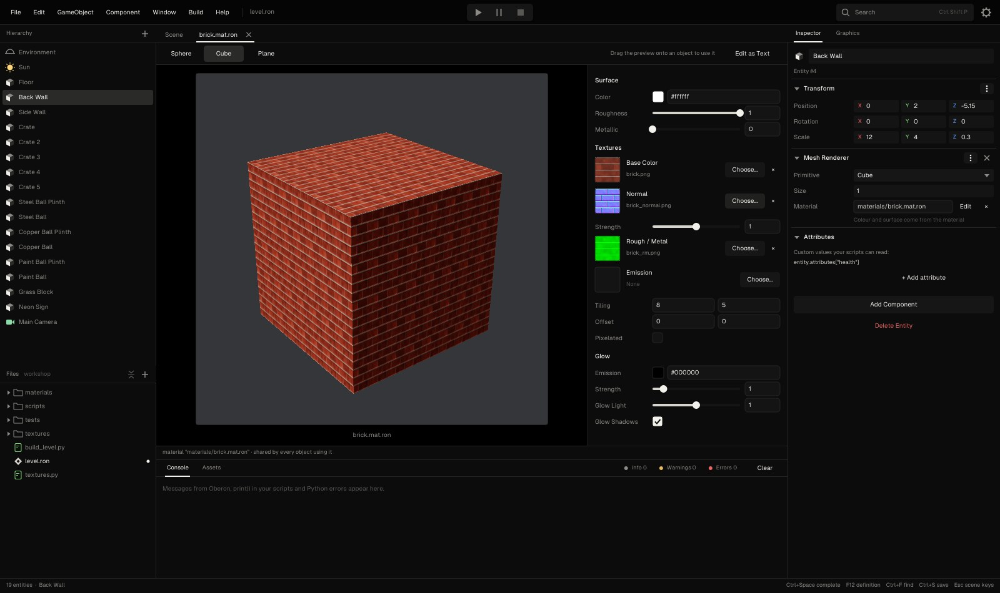

# Materials

A **material** is a look saved as a file: a colour, a surface (roughness,
metalness, glow) and up to four textures, with tiling. It's a
`materials/<name>.mat.ron` file in the project. Objects name it on their
Mesh Renderer instead of carrying their own colour, and every object that
names the same file shares it. Change the file once and all of them change.
The GPU draws them with one shared material, so they also batch together.



Materials work on every Mesh Renderer: cubes, spheres and planes, and models
too. On a model, a material replaces the file's own materials on every part.

## Making one

**File → New Material…** (or **New Material…** in the Files panel's `+`
menu) asks for a name and creates `materials/<name>.mat.ron`: plain white,
roughness 0.6, no textures. It opens in the material editor.

Double-click a `.mat.ron` file in the Files panel to open it again.
Materials open as tabs next to your scripts, in the editor instead of as
text.

## The material editor



| Part | What it does |
|---|---|
| **Toolbar** | The preview shape (**Sphere**, **Cube** or **Plane**), and **Edit as Text** |
| **Preview** (left) | The material on that shape, under a soft studio light, drawn on the GPU as you edit. Drag it onto an object to use the material there |
| **Surface** | **Color** (`#rrggbb`, or `#rrggbbaa` for see-through), **Roughness** and **Metallic** |
| **Textures** | The four texture slots, each with a thumbnail, **Choose…** and **×** to remove it |
| **Tiling** / **Offset** | How many times the textures repeat across the object, and how far they're shifted. **Pixelated** turns off smoothing on the colour textures, for crisp pixel art |
| **Glow** | **Emission** colour and **Strength**, **Glow Light** and **Glow Shadows**, as on a [Mesh Renderer](interface.md#surfaces) |
| **Status line** | The path scenes use for it, and whether there are unsaved changes |

Drag a slider, or click a field, type, and press Enter. While you edit,
**every object using the material shows the change right away**, in the
scene view and the preview, before you save. **Ctrl+S** saves the file.
**Ctrl+Z** undoes one change at a time (a whole slider drag is one step).
If you close the tab without saving, the objects go back to the saved file.

**Edit as Text** shows the file itself. **Back to the Editor** returns. A
file that doesn't read (a typo made in the text view or another editor)
shows the error and a **Fix it as Text** button.

## Texture slots

| Slot | What it holds |
|---|---|
| **Base Color** | The surface's colours. Multiplied by **Color**, so leave Color white to see the image as it is |
| **Normal** | Fine bumps and grooves the light catches (OpenGL convention, green up, as glTF uses). **Strength** under it scales them |
| **Rough / Metal** | glTF packing: **green** scales roughness, **blue** scales metalness. Set Roughness and Metallic to 1 to use the map's values as they are |
| **Emission** | Where the surface glows. Multiplied by the Emission colour and Strength |

Textures can be PNG or JPEG. **Choose…** opens the file browser, or drag
an image from the Files panel onto a slot. Texture paths are stored
relative to the material file (`../textures/brick.png`), so a material and
its textures can move together.

## Using a material

Any of these puts a material on an object's Mesh Renderer:

- **Drag the file** from the Files panel (or the editor's preview) onto
  the object in the scene view, onto its row in the Hierarchy, or onto
  the Inspector.
- Click the Inspector's **Material** row and choose the file.
- Right-click the file in the Files panel: **Use on** *the selected
  object*.

The **Material** row shows the file. Click it to choose another, double-click
it (or **Edit**) to open it, and **×** to go back to the object's own colour.
While a material is set, the Mesh Renderer's own Color and surface rows are
hidden, since the material decides them. Changing the shape (Primitive)
keeps the material.

In the scene file the object just names it:

```ron
mesh_visual: Some((
    primitive: Cube(size: 1.0),
    color: (1.0, 1.0, 1.0, 1.0),
    material: "materials/crate.mat.ron",
)),
```

Moving or renaming a material (or its folder) in the Files panel updates
the objects that use it. A missing or broken material file logs a warning
once and the object draws in its own colour.

## The file

A material is a small RON file. Everything is optional and has a plain
default:

```ron
// A material. Entities that use it share its colour, surface and
// textures: material: "materials/brick.mat.ron" on a Mesh Renderer. Texture paths are
// relative to this file's folder.
(
    color: (1.0, 1.0, 1.0, 1.0),
    roughness: 1.0,
    base_map: "../textures/brick.png",
    normal_map: "../textures/brick_normal.png",
    roughness_metal_map: "../textures/brick_rm.png",
    tiling: (8.0, 5.0),
)
```

| Field | Default | Meaning |
|---|---|---|
| `color` | `(1, 1, 1, 1)` | Base colour, linear RGBA |
| `roughness` | `0.6` | 0 = mirror, 1 = chalk |
| `metallic` | `0.0` | 0 = plastic, wood, stone; 1 = metal |
| `emissive` | `(0, 0, 0)` | Glow colour |
| `emissive_strength` | `1.0` | Multiplies `emissive` |
| `glow_light` | `1.0` | How much the glow lights its surroundings |
| `glow_shadows` | `true` | Whether objects block that light |
| `base_map`, `normal_map`, `roughness_metal_map`, `emissive_map` | none | Texture paths, relative to the material file |
| `normal_strength` | `1.0` | Scales the normal map |
| `tiling` | `(1, 1)` | Texture repeats in U and V |
| `offset` | `(0, 0)` | Texture shift, in texture widths |
| `pixelated` | `false` | Crisp (unsmoothed) colour textures |

Edited by hand, a saved file reloads in the editor and the running scene
within half a second, and so does a texture changed in a paint program.

## From Python

```python
import automata as at

at.set_asset_root("my_game")          # where "materials/..." resolves
wall = at.MeshRenderer.cube(material="materials/brick.mat.ron")
wall.material                          # "materials/brick.mat.ron" (None: own colour)
```

All four constructors (`cube`, `sphere`, `quad`, `model`) take
`material=`. The file is read right away: a missing one raises
`FileNotFoundError`, and a broken one, or a path that doesn't end in
`.mat.ron`, raises `ValueError`. Scenes save and load the path.
See the [API reference](../api-reference.md#visuals).

## Exporting

An export checks every material the scene uses. A missing material, one
that doesn't read, or one outside the project folder is an error (it
wouldn't ship). A texture that's missing or outside the project is a
warning: the material still draws, without it.

## The Material Workshop

`examples/oberon/workshop/` is a room dressed only with materials: brick
walls, a tiled floor, five crates sharing one wood material, brushed steel,
copper and glossy paint on turntables, a glowing neon sign and a pixel-art
grass block.

```console
cargo run -p oberon --release examples/oberon/workshop/level.ron
```

Open `materials/crate.mat.ron` and drag Roughness, or change the tiling:
all five crates follow. Its textures are drawn by `textures.py` with the
Python standard library, and `build_level.py` writes the materials and the
scene.
