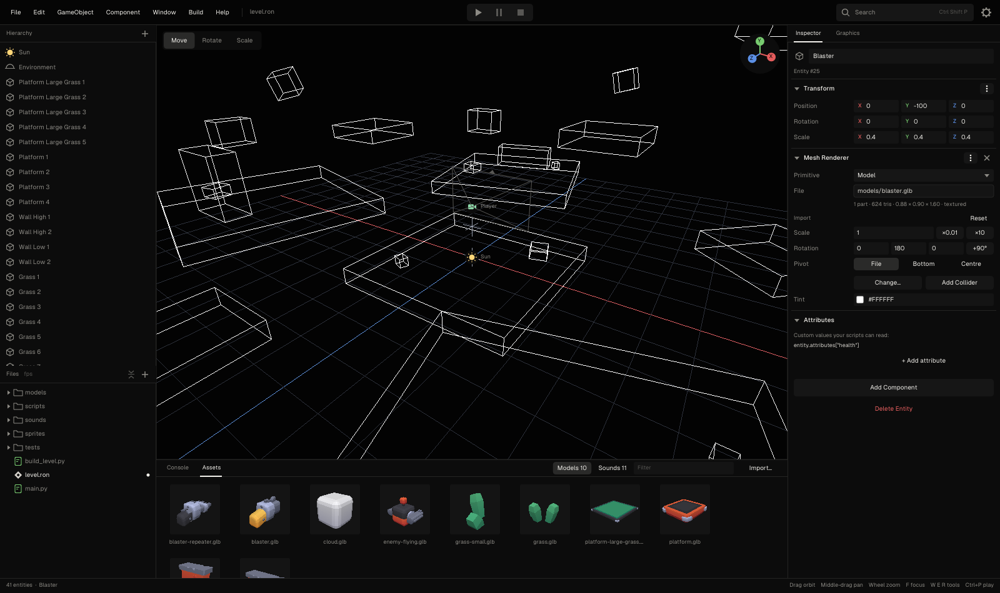
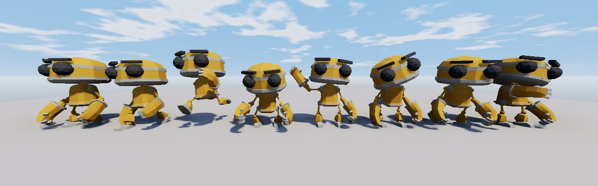
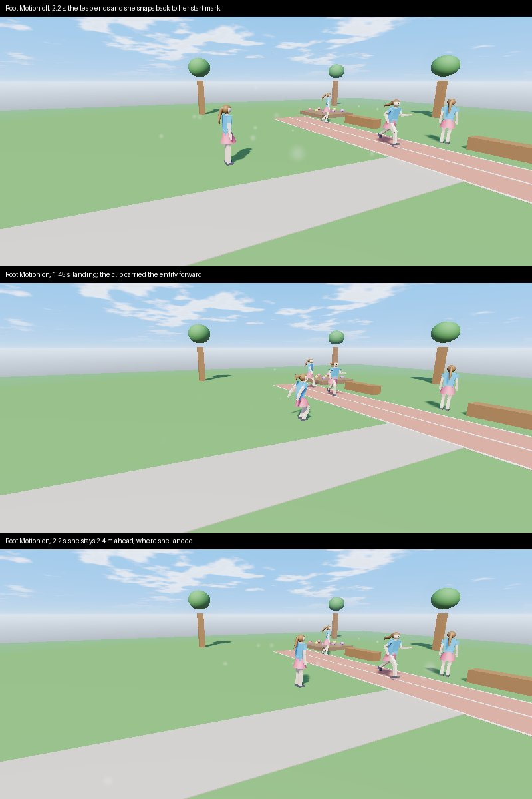
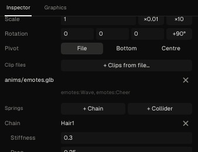
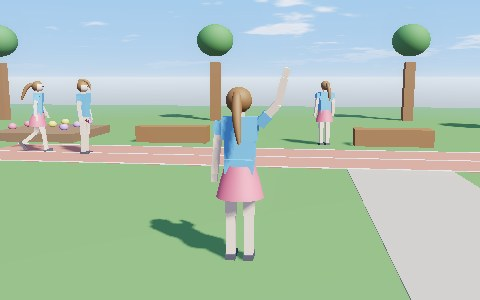
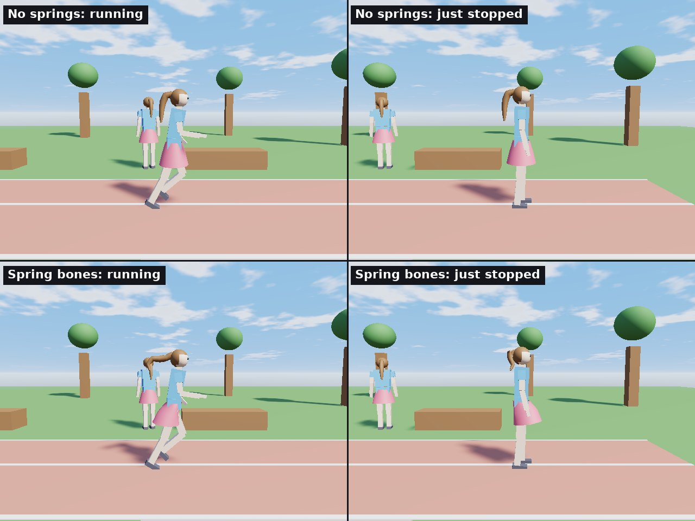
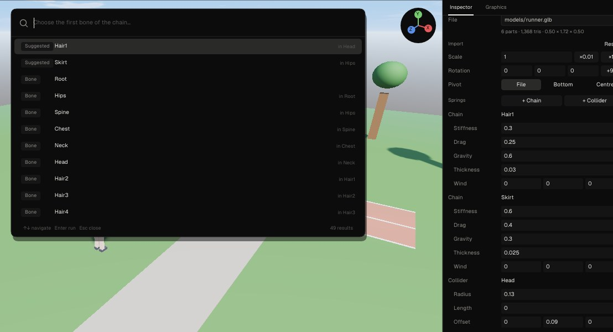

# Models

Import 3D models made in Blender or any other modelling tool, or
downloaded from an asset store, and give them to your entities. Oberon
reads two formats:

| Format | Files | Notes |
|---|---|---|
| glTF 2.0 | `.glb` (one file) or `.gltf` (+ `.bin`, images) | Recommended. Blender: **File → Export → glTF 2.0**. |
| Wavefront OBJ | `.obj` (+ `.mtl`, images) | Universal and simple. Has no node hierarchy. |

From each glTF material Oberon takes the full PBR set: **base colour** and
its texture, **roughness** and **metallic** (factors and the
metallic-roughness map), the **normal map**, and **emission** (colour, map
and `KHR_materials_emissive_strength`). Textures can be PNG or JPEG.
Spec-gloss materials and `KHR_texture_transform` are converted too. OBJ
files bring base colour and texture, and are drawn as a non-metal with
roughness 0.6. The model draws with the engine's lighting, shadows and fog,
like the built-in cubes.

### Animated models

glTF files keep their **skeleton and animations**: skinned meshes (up to
four bones per vertex, 128 bones per model) and parts moved by animated
nodes, like a robot whose arms are separate meshes. The renderer poses
them on the GPU, and shadows follow the pose.

An entity plays its model's clips with an **Animation** component. See
[Animation](#animation) below.

## Add a model to the scene

Pick whichever way suits you:

- **Pick it in the Assets tab** (below). Every model in the project is
  shown as a thumbnail.
- **Drag a file from your system file manager** onto the scene view. Oberon
  copies it into the project's `models/` folder and places it where you
  dropped it, standing on the ground.
- **Drag a model from the Files panel** onto the scene view.
- **Double-click a model** in the Files panel to add it where the view is
  looking.
- **GameObject → Model…** (or **+ → Create Model…** in the Hierarchy)
  opens a searchable list of the project's models. Choose **Import from
  file…** at the bottom of the list to pick a file anywhere on disk.

The new entity is named after the file (`oak_tree.glb` becomes **Oak
tree**). It shows the whole model: every mesh and material in the file
draws as one entity, so you move, rotate and scale it as one object.

## The Assets tab

**Window → Assets** opens the Assets tab next to the Console. It shows every
model in the project as a rendered thumbnail, so you can find the crate you
want without reading file names.



| Control | What it does |
|---|---|
| **Models** / **Sounds** | Switch between model thumbnails and sound waveforms. The count is the number of files. |
| **Filter** | Type part of a name or folder (`walls`, `enemy`) to narrow the grid. |
| **Import…** | Copy a model or sound from anywhere on disk into the project. |

Tiles work like files in the Files panel:

- **Drag** a model tile onto the scene to place it there, or onto the
  Inspector to give it to the selected entity.
- **Double-click** a tile to add the model where the view is looking.
- **Right-click** a tile for the same menu as in the Files panel (*Add to
  Scene*, *Use on <entity>*, …).

Thumbnails render on the CPU, so they work without a GPU too. They're
cached, and they redraw when the file or its import settings change.

### What importing copies

Only the project folder ships with an exported game, so files from outside
the project are copied in:

- A self-contained file (`.glb`, or a `.gltf` / `.obj` that uses no other
  files) goes to `models/<name>`.
- A model with companion files (`.bin`, `.mtl`, textures) gets its own
  folder, `models/<name>/`. The companions keep their paths relative to the
  model, so the model's internal references keep working.
- A model that's already inside the project is used where it is.

## Give a model to an existing entity

- Select the entity and drag a model from the Files panel onto the
  **Inspector**.
- Or open the Mesh Renderer's **Primitive** menu and choose **Model…**.
- Or right-click a model in the Files panel and choose **Use on
  <entity>**.

If the entity has a collider, it's refitted to the new model (see
[Colliders](#colliders)).

## The Inspector

With a model selected, the **Mesh Renderer** section shows:

| Row | What it does |
|---|---|
| **Primitive** | `Model`. Switch to Cube, Sphere or Quad to go back to a primitive. |
| **File** | The model's path relative to the scene. It turns red if the file is missing or can't be read. Double-click it to show the file in the Files panel. |
| *summary* | Parts (one per material), triangle count, size in metres, and whether it's textured. If loading failed, this line shows the error instead. |
| **Change…** | Pick a different model. |
| **Add Collider / Fit Collider** | Adds a collider shaped for the model, or refits the existing one. |
| **Material** | A shared [material file](materials.md) that replaces the model's own materials on every part. Empty keeps them. |
| **Tint** | Multiplies every material's colour. Leave it white to see the model as authored. |
| **Surface**, **Roughness**, **Metallic**, **Emission** | Leave them at Default to keep the file's materials. Setting one overrides it on every part. See [Surfaces](interface.md#surfaces). |
| **Glow Light** | Glowing parts of the model light their surroundings. This scales that light (0 = off). |
| **Glow Shadows** | Whether other objects block that light and cast shadows from it (High and up). |

## Animation



Add a model that has animations and Oberon gives the entity an
**Animation** component set to the model's idle clip (the first clip with
"idle" in its name, or else the first clip). Add one by hand with
**Add Component → Animation**.

| Row | What it does |
|---|---|
| **Clip** | The clip played when the game starts. The menu lists the model's clips, with **None** for the rest pose. It turns red if the model has no clip of that name, or no animations at all. |
| **Speed** | Playback rate: 1 is as authored, 0.5 half speed, negative backwards. |
| **Loop** | Off plays the clip once and holds its last frame (a character that sits down stays seated). |
| **Play On Start** | Off holds the first frame until a script calls `play`. |
| **Root Motion** | The clip's own travel across the ground moves the entity. See [Root motion](#root-motion). |
| **Preview** | Plays the clip in the scene view without pressing Play. The button plays and pauses it. Drag the time bar to scrub, which pauses it on that frame. Yellow ticks on the bar mark the clip's [events](#animation-events); hover one for its name. The preview follows Speed and Loop, and stops when you select something else. |

While you edit, an animated model holds its clip's first frame, so you place
it in its real pose instead of the T-pose. Press Play and every Animation
with **Play On Start** starts.

For a character with many clips, an [animation graph](animation-graphs.md)
picks them for you from a few values your script sets (speed, grounded,
jump).

### From a script

`entity.animation` controls the clip while the game runs:

```python
def update(entity, ctx):
    anim = entity.animation
    if not ctx.physics.grounded(entity):
        anim.play("Jump", loop=False, fade=0.1)
    elif ctx.input.pressed("w"):
        anim.play("Running", fade=0.2)      # blend over 0.2 s
    else:
        anim.play("Idle", fade=0.3)
```

Asking for the clip that's already playing does nothing, so working out the
right clip and asking for it every frame is fine: it only changes when the
answer does. `fade` crossfades from whatever was playing, and a new `play`
mid-fade blends on from the current pose. `loop=False` plays once.
`anim.playing` turns False when it ends, so you can tell when to move on.
`speed=` sets the rate, and `restart=True` starts a clip that's already
playing over.

| Member | Meaning |
|---|---|
| `play(clip, loop=True, fade=0.0, speed=None, restart=False)` | Switch clips. An unknown name raises `KeyError` (names are case-sensitive; see `clips`) |
| `stop(fade=0.0)` | Blend back to the rest pose |
| `clip`, `time`, `duration` | The clip, seconds into it, and its length. Assign `time` to jump |
| `playing`, `looping`, `speed` | Assign `speed` to change it mid-clip |
| `clips`, `length(clip)` | Every clip name, in file order, and any clip's length |
| `springs`, `reset_springs()` | Whether the model has [spring bones](#spring-bones), and put them back at rest |
| `root_motion` | Whether the clip's travel moves the entity. Assign to switch it |

Reads see your own requests made earlier in the frame. The pose updates
after every script has run.

### From Python

```python
robot = (
    at.Entity("Robot")
    .add(at.Transform())
    .add(at.MeshRenderer.model("models/robot.glb"))
    .add(at.Animation("Wave", speed=1.0, looping=False, play_on_start=True))
)
```

In a `Game` update, `ctx.scene["Robot"].animation` has the same members. See
the [API reference](../api-reference.md#animation).

### Animation events

An event is a named moment in a clip: a foot touching the ground, the
frame a sword connects, the instant a jump leaves the floor. Scripts hear
the event when the playhead passes that moment. Then a footstep sound or
a hit lands on the exact frame, whatever speed the clip plays at.

Mark events in the model's import settings, next to the model:

```ron
events: [
    (clip: "Run", time: 0.18, name: "footstep"),
    (clip: "Run", time: 0.54, name: "footstep"),
    (clip: "emotes:Leap", time: 0.85, name: "land"),
],
```

`clip` is the exact clip name ([borrowed clips](#clips-from-other-files)
too) and `time` is seconds into it. Saving the file reloads the model, and
the events appear as ticks on the Animation's **Preview** bar. A clip played
once also fires `end` when it finishes, without your marking it.

There are two ways to listen. The entity's own script can define
`on_animation_event`:

```python
def on_animation_event(entity, ctx, name):
    if name == "land":
        ctx.particles.burst("dust", entity, count=24)
```

Any script can also subscribe to the channel
`<entity name>:animation:<event>`. `*` and `?` work as wildcards, so one
subscription can cover every entity:

```python
def kick_up_dust(msg):
    msg.ctx.particles.burst("dust", msg.entity, count=5)

def start(entity, ctx):
    ctx.subscribe("*:animation:footstep", kick_up_dust)   # every runner
    ctx.subscribe("Player:animation:hit", deal_damage)     # just one
```

The function gets a message with `channel`, `entity`, `event`, `clip` and
`ctx`. Subscribing the same function again does nothing, so it's safe in
`update`. A subscription ends when the subscribing entity goes, or when you
call `ctx.unsubscribe(pattern)` or `cancel()` on what `subscribe`
returned. Your own messages work the same way: `ctx.publish("door:open",
data)` reaches every subscriber at once. Events arrive at the start of the
next frame, before `update`, in the order they happened. A clip that's
fading out fires none, and jumping with `time =` skips the events in
between.

### Root motion

Many animations move the character as they play: a lunge, a dodge roll,
a vault. The hips travel in the clip, but the entity stays where it was,
so when the clip ends the model snaps back. Turn on **Root Motion** in the
Animation (or `at.Animation(..., root_motion=True)`, or
`entity.animation.root_motion = True` from a script). The clip's travel
across the ground then moves the entity, and the model stays over it. Up
and down movement, like a jump's arc, stays in the animation.



An entity with a **Character Controller** is moved through it, so root
motion slides along walls and stops at them like any other movement, on top
of the character's velocity. Without one, the transform moves directly.
Clips that run on the spot, like most walk and run cycles, have no travel,
so leaving Root Motion on is harmless. While a clip carries the entity,
don't also set its position from a script every frame, or the two fight.

## Import settings

Models from different tools and stores rarely agree on size, facing or
origin. Instead of fixing every entity that uses a model, fix the model
once. Its **Import** block in the Inspector (under the Mesh Renderer) holds
three settings:

| Setting | What it does | Quick buttons |
|---|---|---|
| **Scale** | Multiplies the model's size. Use it for kits authored in centimetres or at toy scale. | **×0.01**, **×10** |
| **Rotation** | Turns the model, in degrees about X, Y and Z, before the entity's own rotation. | **+90°** about Y |
| **Pivot** | Where the entity's position sits on the model: **File** (the file's own origin), **Bottom** (centre of the base, so it stands on the ground) or **Centre**. | |

Type a value or use a quick button, and every entity using that file
updates at once, along with its thumbnail. **Reset** goes back to the file
as it is. The settings apply wherever the model is used: in Play, under
`run_scene`, and in exported games.

Settings are saved next to the model as `<file>.import.ron`. For example,
`models/blaster.glb.import.ron`:

```ron
(
    scale: 1.0,
    rotation: (0.0, 180.0, 0.0),
    pivot: File,
)
```

Commit these files with your models. A model without one is used exactly
as the file describes it. Fitted colliders use the model's size after the
import settings, so press **Fit Collider** after changing them.

## Levels of detail

A model that is used many times, such as a tree, a rock or a fence, can
carry simpler versions of itself for far away. Put them in the same file
as nodes whose names end in `_LOD1`, `_LOD2` and so on (any case, for
example `Pine_LOD1`). Everything under such a node belongs to that level;
everything else is the full-detail model. The engine draws one level at
a time, and the levels never show up as parts of their own.

Each level takes over at a camera distance. By default that's 15, 30,
60… times the model's radius. To choose the distances yourself, list them
in the import settings, nearest first:

```ron
(
    lod_distances: [25.0, 60.0],
)
```

The graphics preset scales these distances: Low switches to simpler levels
at half the distance and Beautiful at twice the distance. Animated models
always draw at full detail. A file with `_LOD` nodes and a skeleton logs a
warning and leaves the levels out.

To stop drawing a model altogether past some distance, give its entity a
**draw distance**. Set `draw_distance: 80.0` in the scene file's
`mesh_visual`, or pass `draw_distance=80` to `MeshRenderer.model` (or any
other constructor) in Python. The model then dithers away over the last
tenth of that distance instead of popping. Fog that hides distant objects
makes this cut invisible, so a draw distance just past where the fog
turns opaque costs nothing in looks.

## Clips from other files



Animations often come one per file: a store's animation pack, or a
download per move from Mixamo. A model can borrow the clips of any glTF
made for the **same skeleton** (the same bone names). Under **Clip files**
in the Import block (rigged models only), press **+ Clips from file…** and
pick the file from the project's `.glb` and `.gltf` files. Its clips join the
model's own: they show in the Animation component's **Clip** menu, and
scripts play them like any other clip.

Borrowed clips are named after their file, so two files can both have a
clip called "Take 001":

| The file has | Its clips are called | For example |
|---|---|---|
| One clip | The file's name, without the extension | `anims/Run Fast.glb` gives `Run Fast` |
| Several clips | `file:Clip` | `sword.glb` with Slash and Block gives `sword:Slash` and `sword:Block` |

```python
anim.play("Run Fast", fade=0.2)
anim.play("sword:Slash", loop=False)
```

Names are exact and case-sensitive, like every clip name. Bones are matched
by name, and keys for bones the model doesn't have are skipped. A file
turns red in the list when it gave no clips: it's missing, has no
animations, or its bones have other names. If a borrowed name is already
taken, the model's own clip wins and Oberon logs a warning. The ×
next to a file removes it.

The files are saved in the import settings, relative to the model:

```ron
clips: [
    (file: "anims/emotes.glb"),
],
```

Editing a clip file while Oberon is open reloads the model, as if you'd
edited the model itself. Exported games include the clip files.
[Ponytail Park](../../../examples/oberon/ponytail_park/README.md#clips-from-another-file)
borrows its wave and cheer this way.



## Spring bones



Hair, skirts, tails, capes and antennae don't need to be animated by hand.
Make their bones **spring bones** and they swing on their own whenever the
character moves: they trail behind when it runs, swing on when it stops,
then settle back into place. They also follow the animation, so a head turn
swings the ponytail too.

Spring bones are part of a model's import settings, under **Springs** in
the Import block (rigged models only). Like the rest of the import settings
they apply to every entity using the file, in Play, under `run_scene` and
in exported games.



**+ Chain** opens a searchable list of the model's bones. Bones that look
like the start of hair or cloth (names like *hair*, *tail*, *skirt*, *cape*)
come first under **Suggested**. Pick one and it and every bone below it
swing. A bone with several children, like a skirt's waistband, stays put
and each branch below it swings on its own, so one chain covers a whole
skirt.

| Chain setting | What it does |
|---|---|
| **Stiffness** | How strongly the bones spring back to their animated pose: 0 is limp, 1 is stiff. |
| **Drag** | How quickly swinging dies down, like air resistance: 0 swings longest, 1 barely swings. Running also streams the chain out behind against the drag. |
| **Gravity** | How much gravity pulls the chain down (1 is full gravity). Long hair wants more, a stiff tail less. |
| **Thickness** | The bones' radius when they bump into colliders, in metres. |
| **Wind** | A steady wind in m/s² along X, Y and Z (world directions). It gusts a little around this. |

**+ Collider** puts a sphere or capsule on a body bone that chains can't
pass through: a head the fringe can't go into, a chest for the ponytail,
thighs that push the skirt out of the way. Body bones (*head*, *chest*,
*spine*, *thigh*, …) come first in the list.

| Collider setting | What it does |
|---|---|
| **Radius** | The sphere's radius, in metres. |
| **Length** | 0 for a sphere. Otherwise a capsule this long along the bone's Y axis (negative goes the other way, down a leg). |
| **Offset** | Where the sphere sits relative to the bone's origin, in the bone's own frame. |

Sizes are in metres on the imported model (after **Scale**), and grow with
the entity's scale. A chain or collider naming a bone the model doesn't
have shows its name in red and is skipped. The **×** removes it.

The settings are saved in the model's `.import.ron` with the others:

```ron
(
    scale: 1.0,
    rotation: (0.0, 0.0, 0.0),
    pivot: File,
    springs: (
        chains: [
            (root: "Hair1", stiffness: 0.3, drag: 0.25, gravity: 0.6, radius: 0.03),
            (root: "Skirt", stiffness: 0.6, drag: 0.4, gravity: 0.3, radius: 0.025),
        ],
        colliders: [
            (bone: "Head", offset: (0.0, 0.09, 0.0), radius: 0.13),
            (bone: "ThighL", radius: 0.07, length: -0.38),
        ],
    ),
)
```

Spring bones run while the game plays and in the Animation **Preview**; in
the editor the model holds still. They move with the entity, so a script
moving the transform, a Character Controller and physics all swing them.
A big jump (a teleport, a respawn) puts them back at rest by itself. For a
small one, call `entity.animation.reset_springs()`. A model with spring
bones but no clips gets them too, without an Animation component.

## Colliders

**Add Collider** picks a shape from the model:

| The model | Shape |
|---|---|
| Fills at least 90% of its bounding box (crates, slabs) | **Box**, fitted to the bounds |
| Anything else, with no rigid body or a static one | **Mesh**: the model's own triangles |
| Anything else, on a dynamic or kinematic body | **Convex Hull**: shrink-wrapped around the model |

The collider section's **Shape** menu shows the choice; pick another to
override it. Mesh and Convex Hull appear in the menu when the entity shows a
model, and a **Model** row shows which file the shape comes from. Shapes
built from a model follow the entity's scale and the model's import
settings by themselves.

A box doesn't scale with the entity. Models are rarely centred on their
origin (a tree's origin is at its roots), so a fitted box also gets an
**offset** that centres it on the mesh. After you scale a model, press
**Fit Collider** to resize the box. Fit keeps the shape you picked. Swapping
the model picks the shape again, since the old one was chosen for the old
model.

A Mesh collider on a **Dynamic** body shows an error. A triangle mesh has
no inside, so it can't give the body mass, and it plays as its convex hull.
Pick Convex Hull, or make the body Static or Kinematic. **Build Game**
refuses to export a scene with that mistake. For a character or a round
object, use Capsule or Sphere and adjust the size.

## Editing a model while Oberon is open

Oberon watches model files. Re-export from Blender and the scene view
updates within half a second, with no reload. The Console says *Model files
changed on disk; reloaded*. Texture and `.mtl` changes are picked up too.

## Scene files and paths

The scene stores only the path, relative to the scene's folder:

```ron
mesh_visual: Some((
    primitive: Model(
        path: "models/tree.glb",
    ),
    color: (1.0, 1.0, 1.0, 1.0),
)),
collider_3d: Some((
    shape: Cuboid(extents: (1.5, 2.4, 1.5)),
    offset: (0.0, 1.2, 0.0),
    // …
)),
```

A Mesh or Convex Hull collider stores the model path, not the triangles:

```ron
collider_3d: Some((
    shape: Mesh(model: "models/platform.glb"),
    // …
)),
```

Paths always use `/`, so scenes move between Windows and Linux unchanged.
Keep models inside the project folder. **Build → Build Game** refuses to
export a scene that references a missing model or one outside the project,
and warns if a model's textures are missing.

## From Python

```python
import automata as at

tree = (
    at.Entity("Tree")
    .add(at.Transform(position=(2, 0, -3), scale=(1.5, 1.5, 1.5)))
    .add(at.MeshRenderer.model("models/tree.glb"))
    .add(at.RigidBody.fixed())
    .add(at.Collider3D.cuboid(2.2, 3.6, 2.2).offset(0, 1.8, 0))
)

m = at.MeshRenderer.model("models/crate.obj", color=(1, 0.8, 0.8, 1))
(lo, hi) = m.bounds      # model-space box, e.g. for sizing a collider
```

Relative paths resolve against the scene's folder when the scene came from
`Scene.load` / `run_scene`. Otherwise they resolve against your script's
folder, and you can call `at.set_asset_root(path)` to choose a folder
yourself. A missing file raises `FileNotFoundError`. See the
[API reference](../api-reference.md#visuals).

## Try it

`examples/oberon/robot_plaza/` is a town square with five copies of an
animated CC0 robot. You walk one of them around, and its script blends
between Idle, Walking, Running, Jump and Wave. The others dance, sit, wave
when you come near, and walk in slow motion. Open it and pick clips for
them in the Inspector:

```console
cargo run -p oberon --release examples/oberon/robot_plaza/level.ron
```

`examples/oberon/ponytail_park/` shows spring bones: a runner whose
ponytail and skirt are spring chains. One jogs up the track and stops dead
at each end, one strolls round a flowerbed, and you run around as another
(Shift runs). Select one and open **Springs** in the Import block to tune
them while it plays:

```console
cargo run -p oberon --release examples/oberon/ponytail_park/level.ron
```

`examples/oberon/fps/` uses ten of Kenney's CC0 models, three of them with
import settings. See the [FPS tutorial](../tutorials/fps.md).

`examples/models/` has a two-material glTF tree with an embedded texture,
a textured OBJ crate, and `scene.ron` placing them. Open it:

```console
cargo run -p oberon --release examples/models/scene.ron
```

Press Play and the top crate drops onto the bottom one. Their offset box
colliders cover the meshes, not the pivots. `make_models.py` regenerates
the files.

## Troubleshooting

| Symptom | Fix |
|---|---|
| File row red, *File not found* | The model moved or the scene was saved elsewhere. **Change…** to re-pick it. |
| *…mesh compression, which isn't supported* | Re-export without mesh compression. These glTF extensions aren't supported. |
| Clip row is red | The model has no clip with that name (names are case-sensitive), or no animations at all. Pick one from the menu. |
| Hair or cloth passes through the body | Add a **Collider** on the body bone it goes through, or make the chain's **Thickness** bigger. |
| A chain swings on for too long | Raise its **Drag**. Raise **Stiffness** to keep it nearer its animated shape. |
| A chain or collider name is red | The model has no bone by that name (it was renamed in the modelling tool). Remove it and pick the bone again. |
| Animated model doesn't move in Play | Check the Animation's **Play On Start**, and that a script isn't calling `stop()`. |
| Model is huge or tiny | Modelling tools disagree on units. Set **Import → Scale** (×0.01 for centimetres), or export from Blender with **Apply Unit** checked. glTF is always metres. |
| Model faces the wrong way | glTF's forward is +Z. Press **Import → Rotation → +90°** until it faces the right way. |
| Model floats or sinks when placed | Its origin isn't at its base. Set **Import → Pivot** to **Bottom**. |
| Looks inside-out | The mesh's faces point inward. Recalculate normals in the modelling tool (Blender: **Mesh → Normals → Recalculate Outside**). |
| Untextured but should be | Only the base colour texture is read. Check the image is PNG or JPEG and that the path in the `.mtl` / `.gltf` exists. |
