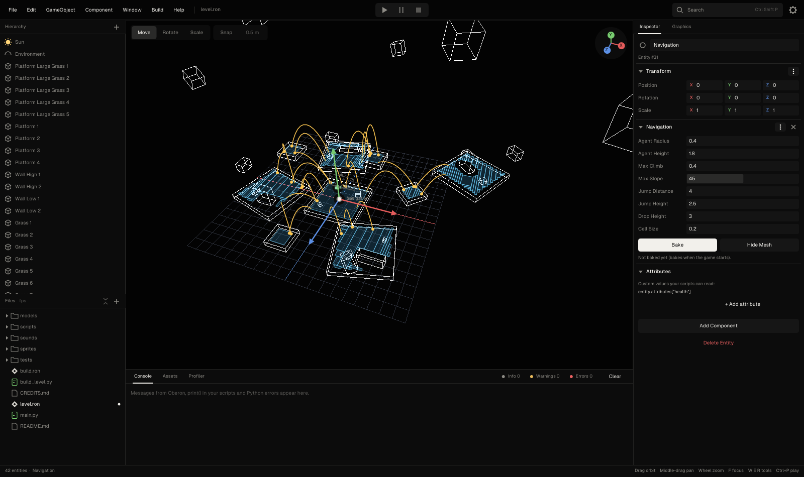

# Navigation



Navigation lets characters and drones find their own way around a level:
round walls, up ramps, and across gaps they can jump. It has three parts:

| | What it does | Set up in |
|---|---|---|
| [**The navigation mesh**](#the-navigation-mesh) | Where agents can walk, worked out from the level's static colliders | A **Navigation** component on any entity (one per scene) |
| [**Nav Agents**](#nav-agents) | Entities that walk the mesh by themselves: you give them a target, they find the way, steer round corners and each other, and take the jumps | A **Nav Agent** component, and scripts |
| [**Path queries**](#paths-from-scripts) | `ctx.nav.path(a, b)` and friends, for your own logic | Scripts |

[The FPS example](../../../examples/oberon/fps) uses all three: once a
drone notices you (you come near, or shoot it), it chases you round the
walls and down the platforms until you're in range.

## The navigation mesh

Add **Component → Navigation** to any entity (an empty one called
"Navigation" is tidy). Its rows describe the agents that will walk the
mesh:

| Row | What it does |
|---|---|
| **Agent Radius** | How far the mesh keeps from walls and edges (m). Use your widest agent |
| **Agent Height** | The headroom it needs (m): no walking under low ceilings |
| **Max Climb** | The highest step walked straight up (m). Kerbs and stairs below this are just floor |
| **Max Slope** | The steepest walkable ground (degrees) |
| **Jump Distance** | The widest gap jumped across (m); 0 turns automatic jumps off |
| **Jump Height** | The highest ledge jumped up to (m) |
| **Drop Height** | The deepest drop jumped down (m) |
| **Cell Size** | The detail (m). Smaller is more exact but slower to bake |

The mesh is built from every collider that doesn't move: colliders without
a Rigid Body, and those on **Fixed** bodies. Dynamic crates, characters,
sensors and Nav Agents are left out. Meshes, boxes, balls and capsules all
count.

### Bake and the overlay

Press **Bake** in the Navigation component. Oberon works out the mesh
(usually well under a second), saves it next to the scene as
`<scene>.nav.ron`, and points the component's file at it. The Console
reports how much is walkable, in how many areas, with how many jumps.

The scene view then draws it over the level:

- **Blue** is where agents can walk.
- **Orange arcs** are jumps: across gaps, up onto ledges and down drops.
  A dot marks where each one lands.

**Hide Mesh** turns the overlay off; **Show Mesh** brings it back.

You don't *have* to bake: without a saved file, the mesh is baked when the
game starts. Baking ahead makes the start quicker and lets you check the
result. Bake again after moving the level about: Oberon warns in the
Console at Play when the saved mesh doesn't match the level any more, and
bakes a fresh one for that run.

### How it works

Baking follows the usual recipe: the colliders are cut into a grid of
columns (**voxelised**), the tops of solid columns with enough headroom
and gentle enough slopes become walkable cells, the cells are shrunk away
from walls by the agent radius, joined into connected **regions** (tiny
islands are dropped), and merged into rectangular **polygons**. Finally,
each edge is checked for a landing spot within jump distance; clear ones
become jump links.

### Hand-placed links

When the automatic jumps don't cover it (a ladder, a teleporter, a gap
wider than the agents should normally jump), place a link by hand: put an
entity where the link starts, add **Component → Nav Link**, and pick the
entity where it ends in **To**. **Both Ways** lets agents use it back.
Bake again to include it.

## Nav Agents

Add **Component → Nav Agent** to anything that should find its own way:

| Row | What it does |
|---|---|
| **Speed** | Top speed (m/s) |
| **Acceleration** | How quickly it speeds up, slows down and turns (m/s²) |
| **Radius** | How much room it takes up, for keeping clear of other agents (m) |
| **Hover** | How high it floats above the mesh (m): a drone at head height. Not shown on characters, which stand on the ground |
| **Stop Distance** | How close to the target counts as there (m) |
| **Avoid Others** | Steer clear of other agents (they step aside for each other) |
| **Face Movement** | Turn to face where it's going |

A Nav Agent on a **character** (an entity with a Character Controller)
walks through its controller, so it falls, slides along walls and climbs
steps like the player. Anything else glides **Hover** metres above the
mesh. Jumps follow an arc either way.

Agents do nothing until a script sends them somewhere:

```python
def update(entity, ctx):
    entity.nav.go("Player")       # follow the player, wherever they go
```

| `entity.nav` | |
|---|---|
| `go(target)` | Head for a point `(x, y, z)`, an entity, or an entity's name (followed as it moves). `None` stops. Calling it every frame with the same target is fine |
| `stop()` | Slow to a halt |
| `target` | Where it's heading, or `None` |
| `arrived` | It's within `stop_distance` of the target (or going nowhere) |
| `moving`, `jumping` | Whether it's on its way, and whether it's mid-jump |
| `velocity` | Its velocity (m/s) |
| `path` | The corners still ahead, ending at the target |
| `remaining_distance` | How far it still has to go along the path (m) |
| `speed`, `stop_distance`, `hover` | Read, or set to change |

`entity.nav` is `None` without a Nav Agent. Agents look for a new way about
three times a second, so a moving target is followed round corners.

The FPS drones bob by changing their hover height, and stop short at
firing range:

```python
# scripts/enemy.py
    if s["chasing"] and entity.nav is not None:
        # The Nav Agent flies it: the shortest way round the walls, stopping
        # short at firing range. Bobbing is its hover height going up and down.
        entity.nav.go(player)
        entity.nav.hover = s["hover"] + bob
```

## Paths from scripts

`ctx.nav` answers questions about the mesh, for logic of your own (patrol
routes, "can the guard get there?", a path drawn on the HUD):

| `ctx.nav` | |
|---|---|
| `ready` | True when the scene has a navigation mesh |
| `path(start, end, partial=False)` | The shortest walkable way as a list of corner points, both ends included, or `None` when there's no way. With `partial=True`, an unreachable end gives the way to the closest reachable point |
| `path_length(start, end)` | How far that walk is (m), or `None` |
| `nearest(point, max_distance=5.0)` | The closest point on the mesh, or `None` |
| `reachable(start, end)` | Whether there's a walkable way |

Points can be `(x, y, z)` tuples or entities. A point a little above the
mesh (a character's middle) snaps down onto it.

```python
def update(entity, ctx):
    way = ctx.nav.path(entity, "Exit")
    if way is not None and len(way) > 1:
        ctx.log(f"{len(way) - 1} legs, {ctx.nav.path_length(entity, 'Exit'):.1f} m")
```

## In Python

The same components exist in Python, and scene files save them:

```python
import automata as at

scene.add(at.Entity("Navigation").add(at.Navigation(agent_radius=0.4, jump_distance=4.0)))
guard = at.Entity("Guard").add(at.NavAgent(speed=3.0, stop_distance=1.5))
```

See the [API reference](../api-reference.md#navigation) for every option.

## Tips

- **One Navigation per scene.** Its settings should fit your widest
  agent: a mesh baked for a 0.4 m radius lets a 1 m-wide agent scrape
  walls.
- **Starting off the mesh is fine.** An agent placed beside the mesh (a
  drone over an edge) moves freely back onto it.
- **Agents don't push the player.** Characters with Nav Agents collide
  with the world through their controller; the others glide, so give
  drones a collider for shots to hit.
- **Big levels:** a 0.2 m cell is plenty for people-sized agents. Raise
  **Cell Size** for huge outdoor levels if baking gets slow.
