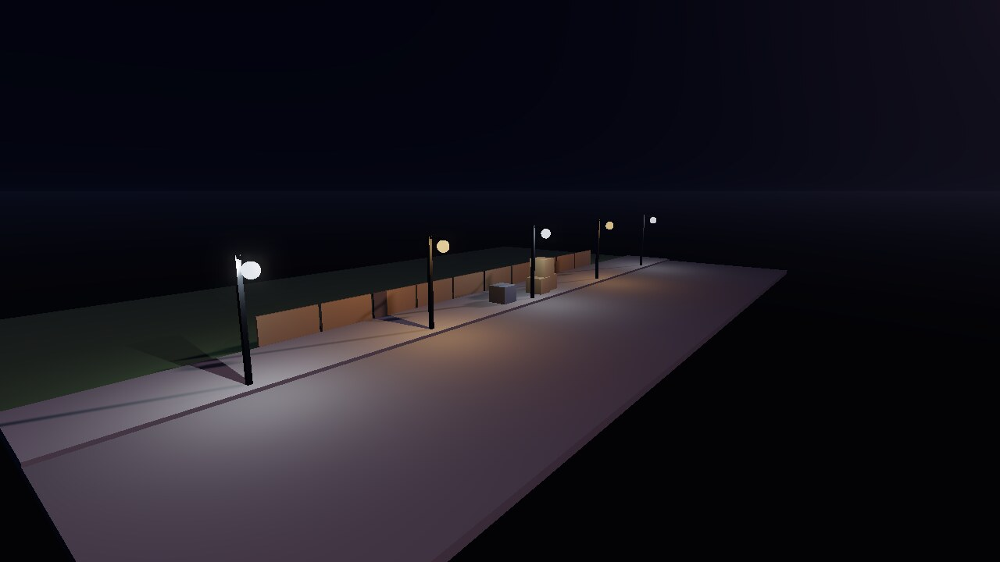

# Prefabs & attributes

## Attributes

Attributes are named values that you set per entity in the Inspector and
read from scripts. Use them to tune gameplay without touching code: a
coin's value, an enemy's speed, a door's key colour.

**Inspector → Attributes → + Add attribute** asks for a name and a type:

| Type | Python value | Example |
|---|---|---|
| Bool | `True` / `False` | `locked` |
| Int | `int` | `value = 10` |
| Float | `float` | `speed = 3.5` |
| Text | `str` | `next_level = "cave.ron"` |
| Vec3 | `(x, y, z)` tuple | `patrol_to` |
| Color | `(r, g, b, a)` tuple | `tint` |

In a script, `entity.attributes` works like a dict:

```python
def update(entity, ctx):
    speed = entity.attributes.get("speed", 2.0)
    entity.transform.translate((speed * ctx.time.delta, 0, 0))

    hp = entity.attributes["health"]
    if hp <= 0:
        entity.attributes["dead"] = True     # writes back like any other change
```

- Attributes are saved in the scene file, so they're part of the level
  data.
- Writes made during Play are visible to other scripts on the next
  frame. They're thrown away on Stop, like every other Play change.
- `entity.state` is the place for private values your script doesn't
  want to show in the Inspector.

## Prefabs

A prefab is an entity, or a few, saved to its own file (`.prefab`) so you
can stamp copies of it into any scene. The copies stay **linked**: change the
prefab file and every copy follows.



- **Save:** right-click an entity → **Save as Prefab…**, or **File → Save
  Selection as Prefab…**. The entity's components, attributes, and
  attached script all go into the file, and the entity becomes the
  prefab's first instance.
- **Use:** **File → Instantiate Prefab…** (or double-click a `.prefab` in
  the Files panel) drops a linked copy on the ground at the point the view
  is looking at.

Prefab instances show in blue in the Hierarchy.

### Overrides

An instance can differ from its prefab: tint one crate, give one enemy
more health. Each field you change on an instance is an **override**. The
instance keeps it when the prefab changes, and takes everything else from
the file. Where an instance stands (position and rotation) and its name are
its own, and never count as overrides.

The Inspector shows a **Prefab** block at the top of a linked entity:

| | |
|---|---|
| **Apply** | Writes this instance's overrides into the prefab file. Every instance gets them. |
| **Revert** | Drops every override: back to the prefab's values. |
| **Unlink** | Keeps the current values but stops following the prefab. |
| **Select All** | Selects every instance of the prefab in the scene. |

Below the buttons, each override is listed by name (*Mesh Renderer ›
Color*, *Attributes › hp*) with its own **Revert** button. The same
commands are in the entity's right-click menu. Apply, Revert and Unlink are
one undo step each.

Edit a `.prefab` file by hand, or regenerate it from a script, and Oberon
picks up the change within half a second. Instances update and keep their
overrides.

### Variants

A variant is a prefab built on another prefab. It stores only what it
changes. Right-click a `.prefab` in the Files panel → **Create Variant**
writes `<name>_variant.prefab`, linked to the original. Place a copy, change
it, and **Apply**: the changes go into the variant's own overrides, and the
original stays as it was. Edits to the original still reach the variant and
all its instances. Variants can build on variants.

### In the file

A linked instance in a scene file carries a `prefab` entry, next to the
full component values (so a scene still opens if its prefab goes missing):

```ron
(
    name: Some("Heavy Crate"),
    transform: Some((position: (-1.3, 0.4, -4.5), ...)),
    mesh_visual: Some((primitive: Cube(size: 1.0), color: (0.3, 0.33, 0.36, 1.0), ...)),
    attributes: {"hp": Int(10)},
    prefab: Some((
        path: "prefabs/crate.prefab",
        overrides: ["mesh_visual.color", "attributes.hp"],
    )),
),
```

`path` is relative to the scene's folder. `index` (left out for 0) picks the
entity in a prefab of several. When the scene loads, in Oberon or in a game,
each instance takes the prefab's current values except its `overrides`.
Prefab files are plain RON. You can diff them, review them, and generate
them.

### From Python

```python
import automata as at

at.set_asset_root("my_game")            # prefab links are relative to it
coin = at.Prefab.load("my_game/prefabs/coin.prefab")
coin.path                                # "prefabs/coin.prefab"

scene = at.Scene()
for i in range(10):
    scene.add(coin.instantiate(position=(i * 2.0, 1.0, 0.0)))

gold = coin.instantiate(position=(0, 1, 4), name="Gold Coin")
gold.attributes["value"] = 50            # an override
gold.prefab                              # "prefabs/coin.prefab"
scene.add(gold)
scene.save("my_game/level.ron")          # instances stay linked

# or at runtime, from a game update:
def update(ctx):
    if ctx.input.just_pressed(at.Key.SPACE):
        ctx.scene.spawn(coin, position=(0, 5, 0))
```

Instances of a loaded prefab are linked. Saving the scene writes each one's
overrides, and `at.Scene.load` follows the prefab files. Set
`entity.prefab = None` to unlink one. A variant is a prefab saved from linked
instances: load a prefab, change its instances, and save them with
`at.Prefab([...]).save(...)`. `examples/oberon/lamplight_lane/build_level.py`
does exactly that for its warm lamps.

> Spawning from **Oberon behaviour scripts** isn't supported in the
> editor's Play mode yet. Place prefabs in the scene and enable or move
> them from scripts instead, or run the scene with `at.run_scene`, where
> the full engine API is available through `ctx.raw`.
