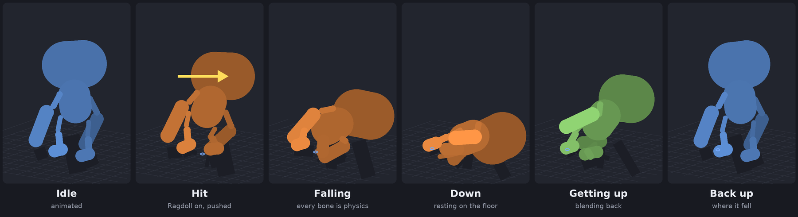

# Ragdolls

A **Ragdoll** lets an animated character go limp: its animation stops
and physics takes over every bone, so it falls over, tumbles down steps
and lands however the hit sends it. When you switch it off, the character
stands up where it fell and blends back into its animation.



The picture shows the bodies the robot in Robot Plaza
(`examples/oberon/robot_plaza`) is made of, from a real run. Blue is
animated, orange is limp and green is blending back. Walk into **Wobbly**
there to knock it over.

## Adding one

Select a character with an animated model (a **Mesh Renderer** showing a
rigged glTF, and an **Animation**), then **Component → Ragdoll**:

| Row | What it does |
|---|---|
| **Start Limp** | Begin the game limp (a body on the floor). Usually off: scripts switch it on |
| **Mass (kg)** | The whole body's weight, shared out between the parts by size. Heavier bodies are harder to push |
| **Stiffness** | How hard the joints hold the pose it was in when it went limp: 0 is a floppy rag doll, 1 holds on (a stunned fighter rather than a knocked-out one). Takes effect while limp too |
| **Blend Time (s)** | How long the animation takes to take over again after you switch it off |

You don't set up any bodies or joints. Oberon works them out from the
model's skeleton the first time it goes limp:

- A **capsule** for each main bone: hips, spine, chest, head, upper and
  lower arms and legs, and feet. It's sized from the mesh around it, and
  its weight comes from that size. Fingers, toes and small bones ride along
  with their parent.
- **Hinges** for knees and elbows, which only bend the way they should.
  **Ball joints** everywhere else, each with limits like a person's (a head
  can't spin round).
- **Spring bones** (hair, ponytails, skirts) stay with their springs.

Any rigged humanoid works, with bones named the usual ways (`Hips`,
`Thigh_L`, `UpperLeg.R`, `mixamorig:LeftArm`, ...). The parts don't collide
with each other, but they hit everything else: floors, walls, steps, props
and other characters.

## From scripts

```python
def update(entity, ctx):
    rag = entity.ragdoll
    if hit_by_something:
        rag.on(push=(0, 50, -300))       # go limp, shoved backwards
    elif rag.resting:
        rag.off()                        # stand up and carry on
```

| `entity.ragdoll` | |
|---|---|
| `on(push=None, bone=None)` | Go limp from the next physics step, keeping the motion it had. `push` is an impulse `(x, y, z)` in kg·m/s: on `bone` if you name one (`"Head"`), otherwise shared over the whole body |
| `off()` | Get back to the animation: the entity moves to where the hips came down and the animation blends in over **Blend Time** |
| `push(impulse, bone=None)` | Shove it while it's limp (more hits, an explosion). Pushes while it isn't limp do nothing |
| `limp` | Physics has the skeleton right now |
| `resting` | It's limp and has stopped moving: a good time for `off()` |
| `blending`, `weight` | Whether the animation is taking over again, and how much of the pose is still the ragdoll's (1 limp, down to 0) |
| `hips` | Where the hips are while it's limp or blending, else `None`. Point a camera here |
| `active` | Switched on or off. Setting it is the same as `on()` / `off()` |
| `mass`, `stiffness`, `blend_time` | Read, or set to change |

`entity.ragdoll` is `None` without a Ragdoll component, so add one to
every character that can fall over (it costs nothing until it goes limp).

An impulse is mass times speed change. 70 kg pushed with 210 kg·m/s moves
off at about 3 m/s, a solid shove. 30 to 60 kg·m/s on the `Head` tips
someone over. 1000 and up is an explosion.

Robot Plaza's `scripts/wobbly.py` knocks the robot over when you walk into
it, waits until it has lain still for a moment, then stands it back up:

```python
    if rag.limp:
        if rag.resting:
            entity.state["down"] += ctx.time.delta
        if entity.state["down"] > LIE_STILL:
            rag.off()
        return
    ...
    if math.dist(player.transform.position, entity.transform.position) < BUMP:
        rag.on(push=push_from(player, entity))
```

## What happens to the rest of the entity

While it's limp:

- The ragdoll's pose replaces the **animation**'s, and Feet On Ground and
  root motion are off. Things attached to its bones (a hat, a sword) follow
  the limp bones.
- A **Character Controller** stops moving it, and its capsule collider is
  switched off so it doesn't shove the parts apart. Scripts that set
  `character_velocity` do nothing until it's back up.
- **Ray casts** and **collisions** hit the parts and report the entity, so
  `ctx.physics.raycast` still tells you which character you hit.

When it gets up, the entity is placed on the ground under the hips, as
high above the ground as it stood when it went limp. A character whose
origin is at its middle (like the robot) stands back up just as tall.

## In Python

```python
import automata as at

bot = (
    at.Entity("Bot")
    .add(at.MeshRenderer.model("models/robot.glb"))
    .add(at.Animation("Idle"))
    .add(at.Ragdoll(mass=70.0, stiffness=0.0, blend_time=0.5))
)
```

`at.Ragdoll(active=False, mass=70.0, stiffness=0.0, blend_time=0.5)` is saved
in scene files. See the [API reference](../api-reference.md#ragdoll).

## Tips

- **Wait for `resting` before `off()`.** Getting up mid-tumble looks like
  a puppet being yanked up.
- **A little stiffness** (0.2 to 0.4) makes a hit look like a stagger
  rather than a collapse. Switch it off again before it reaches the floor
  if you want a stumble.
- **Push the part that was hit.** A shot to the `Head` spins the body
  differently from the same push spread over the whole of it.
- **No get-up animation yet.** The character blends from how it lay
  straight into its current clip. Playing a short "stand up" clip as you
  call `off()` hides the blend well.
