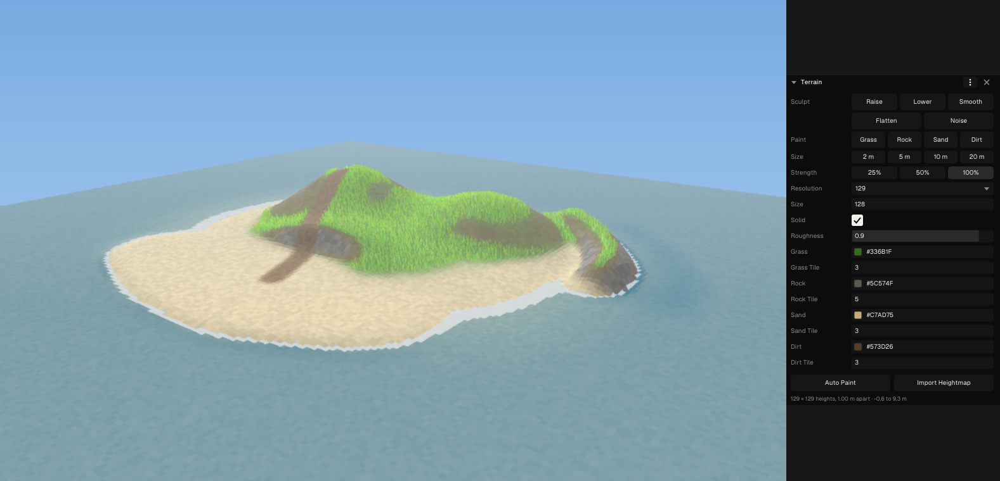

# Terrain

A **Terrain** is ground you sculpt: hills, valleys, beaches and cliffs
over a square of heights, painted with four blended layers (grass, rock,
sand and dirt to start with). It's solid, so characters walk on it and
bodies land on it. Grass and scattered models painted over it stand on its
surface.



The Island example (`examples/oberon/island`) was made this way, with the
brushes on this page only.

## Making one

**Create → Terrain** adds a flat 64 × 64 m terrain at the origin. Select it
and the Inspector shows a **Terrain** section:

| Row | Meaning |
|---|---|
| Sculpt | **Raise**, **Lower**, **Smooth**, **Flatten**, **Noise**: brushes that change the shape |
| Paint | **Grass**, **Rock**, **Sand**, **Dirt**: brushes that paint a layer |
| Size | The brush: 2, 5, 10 or 20 m across |
| Strength | 25 %, 50 % or 100 % |
| Resolution | Heights along each side: 33 up to 1025. Changing it keeps the shape |
| Size | The terrain's width and depth, metres |
| Solid | Whether it's ground for physics and ray casts (on) |
| Roughness | How shiny the ground is: 1 is matte |
| Grass, Rock, Sand, Dirt | Each layer's colour |
| … Tile | Metres one repeat of the layer's texture covers |

The note at the bottom gives the grid, the gap between heights and the
lowest and highest point.

## Sculpting

Click a Sculpt brush, then drag over the terrain in the scene view. A ring
shows where it lands. The move gizmo steps aside while a brush is on.
Click the brush again to turn it off.

| Brush | What a drag does |
|---|---|
| **Raise** | Lifts the ground under the ring, most at the centre. Keep dragging to go higher |
| **Lower** | Digs down the same way |
| **Smooth** | Evens out bumps and softens edges |
| **Flatten** | Levels the ground to the height where the drag **began**. Start on a beach and drag across to make a flat shelf at that height |
| **Noise** | Adds rough bumps so the ground doesn't look moulded |

A bigger brush moves more ground per drag. Each drag is **one undo step**
(Ctrl+Z). The brushes work in the entity's own space, so a stretched or
moved terrain sculpts the same way.

Tips:

- Rough out big shapes first with the 20 m brush, then **Smooth**, then
  add details with smaller brushes.
- For a **cliff**, raise hard with a small brush along the top, then
  **Lower** along the foot. Steep ground there turns to rock when you
  Auto Paint.
- For a **beach**, start a **Flatten** drag on ground just above the
  water and sweep along the shore.

## Painting

Click a Paint brush (**Grass**, **Rock**, **Sand** or **Dirt**) and drag.
Layers blend into each other at the ring's soft edge. Lower strengths
blend in part of a layer.

**Auto Paint** repaints the whole terrain by its shape:

- sand along the water's edge (it reads the height of the first
  **Water** in the scene) and on the sea bed;
- rock on slopes steeper than about 38°;
- dirt on the slopes just below that;
- grass everywhere else.

Auto Paint first, then touch up by hand. Paths, patches and extra
rock go on top with the Paint brushes.

Each layer's colour tints its texture. To give a layer a texture, set it
from Python (`at.TerrainLayer(color, texture="textures/rock.png", tile=5)`)
or in the scene file. With no texture, the layer is its plain colour with
a little variation.

## Heightmaps

**Import Heightmap** loads a greyscale PNG or JPEG: black is the lowest
point, white the highest (a quarter of the terrain's size above it). The
image is stretched over the terrain, and the paint is kept.

## Grass and scattered models on it

Grass and Scatter painted over a terrain stand on its surface, and follow
it when you sculpt more. Paint them as usual (see
[Grass & foliage](foliage.md)): the brush lands on the terrain under the
cursor. In Python, `follow_terrain=False` keeps a field on its entity's
own flat plane instead.

## Water

Put a **Water** over the terrain for a sea or a lake. Its shoreline foam
and depth colour follow where the ground meets it, and **Auto Paint**
puts the beach there. Bodies on the terrain that roll into the water
float as usual.

## Physics

A Solid terrain is a Rapier heightfield: fixed ground for rigid bodies,
characters and ray casts. It's rebuilt when you sculpt and moved with its
entity, so Play right after sculpting.

## From Python

```python
island = at.Terrain(size=96, resolution=129)
island = island.sculpt("raise", (0, 0), radius=30, amount=12)
island = island.sculpt("noise", (0, 0), radius=40, amount=2)
island = island.auto_paint(water_level=0.0)
scene.add(at.Entity("island").add(at.Transform(position=(0, -2, 0))).add(island))
```

Every method returns a changed copy. The whole list is in the
[API reference](../api-reference.md#terrain).

## Saving

The heights and paint are saved in the scene file as two small PNG images
(base64 text), so a 129 × 129 terrain adds about 35 KB.
