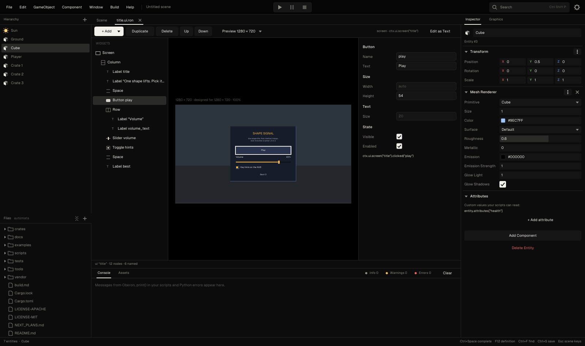
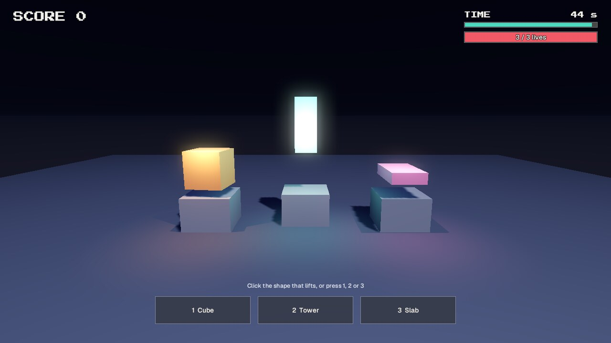

# The UI editor

Game menus and HUDs can be laid out in Oberon instead of in code. Each
screen is a **UI document**, a `ui/<name>.ui.ron` file in the project. You
compose it on a canvas from columns, rows, buttons, labels, toggles,
sliders, progress bars and images, and give it a theme. Scripts don't draw
it. They fill it in and react to it by the names you gave its widgets:

```python
def update(entity, ctx):
    hud = ctx.ui.screen("hud")              # ui/hud.ui.ron
    hud.set("score", f"SCORE {score}")      # a label's text
    hud.set("health", player_health)        # a progress bar's value
    if ctx.ui.screen("title").clicked("play"):
        ctx.ui.screens.hide("title")
```

The documents draw the same way in Play, under `run_scene` and in exported
games (an export copies the whole project, `ui/` included). The [script
side](scripting.md#ui-documents) is in Scripting.



## Making one

**File → New UI Screen…** (or **New UI Screen…** in the Files panel's `+`
menu) asks for a name and creates `ui/<name>.ui.ron` from a template:

- a name ending in `hud` gets a HUD: a score label and a health bar in
  the top-left corner;
- any other name gets a menu screen: a centred panel with a title and Play
  and Quit buttons.

The screen's name is its path under `ui/` without `.ui.ron`:
`ui/hud.ui.ron` is `"hud"`, and `ui/menus/pause.ui.ron` is `"menus/pause"`.
Documents anywhere else aren't found by scripts.

Double-click a `.ui.ron` file in the Files panel to open it. UI documents
open as tabs next to your scripts, in the editor instead of as text.

## The editor

| Part | What it does |
|---|---|
| **Toolbar** | **+ Add** a widget, **Duplicate**, **Delete**, move **Up** / **Down** among its siblings, the **Preview** screen size, and **Edit as Text** |
| **Widgets** (left) | The tree: **Screen** (the document itself), then every node. Click one to select it. Hidden ones are dimmed |
| **Canvas** (middle) | The screen as the game draws it, on the preview size: themes, anchors and scaling included. Click a widget to select it. Drag a top-level one to move it |
| **Properties** (right) | The selected node's properties, or the screen's and its theme's when **Screen** is selected. Click a field, type, and press Enter (or click away). Under them is the line a script uses to reach the widget, like `ctx.ui.screen("title").clicked("play")` |
| **Status line** | The screen's name, how many nodes and names it has, unsaved changes, and names used twice |

**+ Add** puts the new widget inside the selected column, row or stack,
after the selected widget otherwise, or (with **Screen** selected) at the
top level, centred. A pasted or duplicated widget whose name is taken gets
a fresh one (`score_2`), since scripts need names to be unique.

**Preview** lays the screen out on 1280×720, 1920×1080, 800×600 or a
720×1280 portrait phone, so you can check it scales. The document's
**design size** (1280×720 unless you change it) is what it's laid out for.
Like [`ctx.ui.design_size`](scripting.md#scaling-to-any-screen), it scales
to fit any window.

### Keys

Click the canvas or the tree first.

| Keys | Action |
|---|---|
| Delete / Backspace | Delete the selected widget |
| Ctrl+D | Duplicate it |
| Ctrl+C / Ctrl+X / Ctrl+V | Copy / cut / paste widgets |
| ← → ↑ ↓ (Shift: by 10) | Move a top-level widget by its margin |
| Alt+↑ / Alt+↓ | Move it up / down among its siblings |
| Tab / Shift+Tab | Select the next / previous widget in the tree |
| Esc | Select the screen |
| Ctrl+Z / Ctrl+Y | Undo / redo |
| Ctrl+S | Save |

Every change is one undo step. The file is the document, so the unsaved
dot, **Save All**, reloading after an outside change, and *save before
Play* work as they do for scripts. **Edit as Text** shows the file in the
code editor. **Back to the Editor** returns. If the text stops being a
valid document, the editor says why, with a **Fix it as Text** button.

## Nodes

| Kind | Is | A script's `set(name, value)` gives it |
|---|---|---|
| **Column** | Children top to bottom | (`set_visible` hides it with its children) |
| **Row** | Children side by side; **Columns** makes them equal | |
| **Stack** | Children on top of each other | |
| **Label** | Text. **Align**, **Colour**, **Font** | Its text |
| **Button** | `clicked(name)` is True after a click | Its text |
| **Toggle** | A check box with text | On or off (`get` reads it) |
| **Slider** | **Min**, **Max**, **Step** | Its value (`get` reads it) |
| **Progress** | A bar filled to value / max. Its **Text** can use `{value}`, `{max}` and `{percent}` | Its value |
| **Image** | An image file, stretched over its box | Its file |
| **Space** | Room between widgets | |

Every node has a **Name** (what scripts use), **Width** and **Height**
(empty means automatic, the same as leaving them out of a `ctx.ui` call),
**Visible**, and for buttons, toggles and sliders, **Enabled**.

Top-level nodes are placed on the screen with an **Anchor** (one of nine:
`top_left`, `top`, …, `center`, …, `bottom_right`) and a **Margin** from
it. With no anchor, **X** and **Y** are the top-left corner. Nodes inside a
layout go where the layout puts them. Columns and rows have a **Gap**
between children and **Padding** inside their edge. With **Panel** on they
draw a panel behind themselves, with an optional **Title**.

## Screens, HUDs and themes

Select **Screen** in the tree for the document's own settings:

| Setting | What it does |
|---|---|
| **HUD** | Shown from the start, under every screen, until a script sets `ctx.ui.screen("hud").visible = False`. Without it the document is a screen, shown with `ctx.ui.screens.show(name)` |
| **Modal** | As a screen, it takes the input; what's under it doesn't react |
| **Pause** | As a screen, `ctx.ui.screens.paused` is True while it's shown |
| **Escape** | As a screen, Escape (or a gamepad's B) closes it |
| **Design W / H** | The size it's laid out for |
| **Theme** | Text size, font, and the eleven [theme colours](scripting.md#game-ui). Empty means the default; type `#rrggbb` (or `#rrggbbaa`) to change one |

`ctx.ui.screens.show(name)` uses the document's Modal, Pause and Escape
unless the call passes its own. Each document draws with its own theme and
design size, so a HUD and a menu can look different. Keyboard and gamepad
focus work on documents as on any [screen](scripting.md#keyboard-and-gamepad-focus).

## The file

A document is plain RON. Oberon writes the screen's settings, then only
the theme colours and node fields that differ from the defaults, so the
files stay short and diff well:

```ron
// A UI screen made in Oberon's UI editor. Scripts reach its widgets by
// name: ctx.ui.screen("hud").set("score", 10)
(
    design_size: (1280.0, 720.0),
    hud: true,
    modal: false,
    pause: false,
    escape: true,
    theme: (accent: Some((0.3, 0.85, 0.75, 1.0))),
    nodes: [
        (
            kind: Column,
            anchor: "top_left",
            x: 28.0,
            y: 24.0,
            children: [
                (kind: Label, name: "score", text: "SCORE 0", size: Some(22.0)),
                (kind: Progress, name: "lives", text: "{value} / {max} lives", value: 3.0, max: 3.0),
            ],
        ),
    ],
)
```

The game reads the files directly and checks them for changes every half
second, so saving in Oberon updates a game in Play straight away. A
document with a mistake (`kind: Buton`) is reported once in the Console,
with a suggestion, and the other documents keep drawing.

## Example

`examples/oberon/shape_signal` is a small game made this way. One of three
shapes lifts, and you pick it with the HUD's buttons (or 1, 2, 3) before it
drops. Its title screen, HUD and results screen are documents in its
`ui/` folder, each themed in the editor. `scripts/game.py` doesn't draw
anything: it only calls `set`, `clicked` and `changed` by name.


