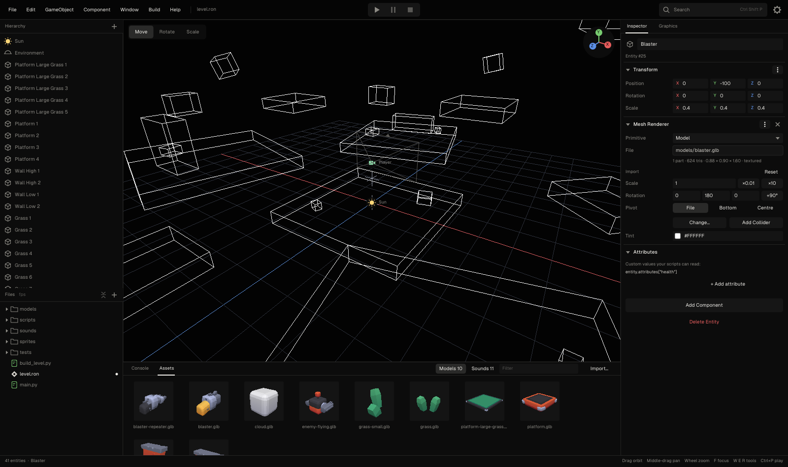

# Tutorial: a first-person shooter

**Time:** 40 minutes · **You'll need:** the [first scene](first-scene.md) and
[coin collector](coin-collector.md) tutorials, or some time in Oberon

You'll build *Blaster Arena*, a small first-person shooter on floating grass
platforms, using Kenney's free (CC0) Starter Kit FPS models and sounds. You
look around with the mouse and walk with WASD. You can double-jump, shoot
two kinds of blaster, and fight four drones that shoot back.



Along the way you'll use:
- the **Assets tab** and per-model **import settings**,
- **Audio Sources** and one-shot sounds,
- mouse look with a captured cursor,
- **ray casts** for shooting and line of sight,
- a **HUD** drawn from a script,
- headless tests, and exporting to Windows and Linux.

The finished project is in
[`examples/oberon/fps/`](../../../examples/oberon/fps). Open it any time to
compare:

```console
cargo run -p oberon --release examples/oberon/fps/level.ron
```

## 1. The assets

Make a project folder and copy in Kenney's files, keeping the folders:

```text
blaster-arena/
├── models/              platform.glb, wall-low.glb, enemy-flying.glb, blaster.glb, …
│   └── Textures/colormap.png
├── sounds/              blaster.ogg, enemy_hurt.ogg, jump_a.ogg, walking.ogg, …
└── sprites/             crosshair.png, crosshair-repeater.png, hit.png
```

You can take them from `examples/oberon/fps/` or from
[Kenney's Starter Kit FPS](https://github.com/KenneyNL/Starter-Kit-FPS). All
the models share one texture atlas, `colormap.png`.

Open Oberon in the folder, then choose **Window → Assets**. The Assets tab
next to the Console shows every model as a thumbnail. Click **Sounds** to see
the sound effects as waveforms, and double-click one to hear it.

### Fix the facing once

glTF models face +Z, but AUTOMATA's forward is −Z. That's the way a camera
looks and the way scripts aim. Kenney's blasters and drone point at +Z, so
held as-is they'd point back at you.

You could rotate every entity 180°, but scripts set these rotations every
frame. It's simpler to fix the files themselves:

1. Drag `blaster.glb` from the Assets tab into the scene and select it.
2. In the Inspector, find the **Import** block under the Mesh Renderer.
3. Press **+90°** next to **Rotation** twice, so it reads `0, 180, 0`.

Do the same for `blaster-repeater.glb` and `enemy-flying.glb`. Each file now
has a `*.glb.import.ron` next to it. Every entity that uses the model is
turned, in Play, under `run_scene` and in exported games alike. Delete the
test blaster afterwards. See [Models → Import settings](../oberon/models.md#import-settings)
for scale and pivot.

## 2. The level

Drag platforms and walls from the Assets tab onto the scene. The example uses
Kenney's layout: five `platform-large-grass` tiles at different heights,
four small `platform`s, two `wall-high` and two `wall-low`, plus grass tufts
and clouds for decoration. Positions are in `build_level.py` if you'd like to
match them exactly.

For each platform and wall, press **Add Collider** in the Mesh Renderer.
Oberon fits a box to the model and raises it to sit on the model's base.
Leave out the rigid body: a collider with no rigid body is static scenery
that never moves.

Add a **Sun** and an **Environment** from **GameObject**. In the
**Graphics** tab, set **Background** and **Fog Color** to the same blue-grey,
`(0.36, 0.39, 0.46)`, and turn **Fog** on with a density of about `0.015`, so
the far clouds fade into the sky.

## 3. The player

Create an empty entity named exactly **Player** at `(0, 1, 0)`. The drones
look for that name. Give it:

| Component | Settings |
|---|---|
| Rigidbody | Body Type **Kinematic (position)** |
| Collider | **Capsule**, Radius `0.3`, Half Height `0.5` |
| Character Controller | Defaults (the script does the moving) |
| Camera | Field of View `80` |
| Audio Source | Clip `sounds/walking.ogg`, Volume `0.35`, **Loop** on, Play On Start off |
| Attributes | `health` (Int) = `100` |

Then add the two weapons as plain entities named **Blaster** and **Blaster
Repeater**, using their models with Scale `0.4`. Don't give them colliders,
or your own shots would hit them. The player script carries them around.

Attach `scripts/player.py` to the Player (**Add Component → Script…**, then
type the new name). The rest of this section walks through it. The finished
file is in the example folder.

### Mouse look

`start` captures the cursor, and `update` turns the mouse movement into yaw
(left/right) and pitch (up/down). Esc gives the cursor back, and a click
captures it again:

```python
# scripts/player.py
    # Mouse capture: Esc frees the cursor, a click takes it back.
    clicked_to_capture = False
    if inp.just_pressed("escape"):
        inp.lock_mouse(False)
    elif not inp.mouse_locked and inp.mouse_just_pressed("left"):
        inp.lock_mouse()
        clicked_to_capture = True

    # Mouse look.
    dx, dy = inp.mouse_delta
    s["yaw"] -= dx * SENSITIVITY
    s["pitch"] = max(-1.5, min(1.5, s["pitch"] - dy * SENSITIVITY))
    yaw, pitch = s["yaw"], s["pitch"]
```

The camera then rides at eye height and looks along the view direction:

```python
# scripts/player.py
    cam = entity.camera
    if cam is not None:
        cam.position = eye
        cam.target = tuple(e + f for e, f in zip(eye, forward))
```

### Walking, jumping and footsteps

WASD (or the arrows) moves relative to where you face. Speed eases in rather
than snapping, and gravity pulls the controller down unless it's grounded:

```python
# scripts/player.py
    grounded = ctx.physics.grounded(entity)
    vy = s["vy"]
    if grounded and vy <= 0.0:
        if s["air"] > 0.35:
            ctx.audio.play("sounds/land.ogg", volume=VOLUME)
        s["air"] = 0.0
        s["jumps"] = JUMPS
        vy = -2.0  # keeps the controller pressed onto slopes
    else:
        s["air"] += dt
        vy -= GRAVITY * dt
    if inp.just_pressed("space") and s["jumps"] > 0:
        vy = JUMP
        s["jumps"] -= 1
        ctx.audio.play(random.choice(JUMP_SOUNDS), volume=VOLUME)
```

`JUMPS = 2` gives one jump from the ground and one in the air. Each jump
plays one of three jump sounds at random, so repeats don't sound mechanical.

Footsteps use the Player's own Audio Source. It's a loop, so the script
starts it when you begin walking and stops it when you stop:

```python
# scripts/player.py
    walking = grounded and math.hypot(vx, vz) > 1.0
    if walking != s["walking"]:
        s["walking"] = walking
        if walking:
            entity.audio.play()
        else:
            entity.audio.stop()
```

### Shooting

A shot is a ray cast from the eye. Whatever it hits first, if that entity
has a `health` attribute, loses some. The Blaster fires three slightly
spread rays (a small shotgun). The Repeater fires one ray, but faster:

```python
# scripts/player.py
    for _ in range(weapon["shots"]):
        jitter = (random.uniform(-spread, spread), random.uniform(-spread, spread))
        direction = normalized(offset(forward, (right, up), jitter))
        hit = ctx.physics.raycast(eye, direction, RANGE, ignore=entity)
        if hit is None or hit.entity is None:
            continue
        health = hit.entity.attributes.get("health")
        if health is not None and hit.entity.name != entity.name:
            hit.entity.attributes["health"] = health - weapon["damage"]
            s["marker"] = 0.15
```

`ignore=entity` keeps the ray from hitting your own capsule. The `WEAPONS`
list at the top of the file holds each blaster's cooldown, damage, spread,
sound and crosshair. Press E to switch between them. Try changing the
numbers while the game runs; scripts hot-reload when you save.

The held blaster is just an entity that the script moves in front of the
camera every frame, offset right, down and forward along the view axes. The
other blaster is parked far below the level.

### The HUD

`ctx.hud` draws over the game for one frame, so the script redraws it every
frame. Positions are screen pixels, and shapes are placed by their centre:

```python
# scripts/player.py
    hud.image(weapon["crosshair"], cx, cy, size=(44, 44))
    if s["marker"] > 0.0:
        hud.image("sprites/hit.png", cx, cy, size=(64, 64), color=(1.0, 1.0, 1.0, 0.9))
        s["marker"] -= dt
```

The rest of `draw_hud` adds a health bar at the bottom left, a red flash
when you're hit, and a pip for each drone still flying at the top right.
Text uses the built-in font. `size` is the line height in pixels,
`shadow=True` adds a soft drop shadow, and `align` says where `x` sits:

```python
    hud.text(f"{health:.0f}%", left + width + 20, bottom, size=26, shadow=True)
```

Once the last drone falls, an outlined "ARENA CLEAR" fades out at the top
of the screen, drawn with `align="center"`.

## 4. The drones

Drag four `enemy-flying.glb` drones into the air around the level and name
them **Enemy 1** to **Enemy 4**. Give each one:

- a **Ball** collider, radius `0.6`, offset `(0, 0.45, 0)`, so your shots
  have something to hit. Use no rigid body, because the script moves it;
- a `health` (Int) attribute of `100`;
- the script `scripts/enemy.py`.

Each frame a drone bobs, turns to face the player, and checks its health.
A lower number than last frame means a shot landed:

```python
# scripts/enemy.py
    health = entity.attributes.get("health", 100)
    position = entity.transform.position
    if health < s["health"]:
        if health <= 0:
            ctx.audio.play("sounds/enemy_destroy.ogg", volume=VOLUME, position=position)
            entity.despawn()
            return
        ctx.audio.play("sounds/enemy_hurt.ogg", volume=VOLUME, position=position)
    s["health"] = health
```

Passing `position=` makes a one-shot sound fade with distance, so a drone
blowing up across the map is quieter than one next to you.

Four times a second, a drone casts its own ray at you. It only fires if
you're within 6 m and the first thing the ray hits is the Player, so
ducking behind a wall works:

```python
# scripts/enemy.py
    direction = tuple(c / distance for c in d)
    hit = ctx.physics.raycast(center, direction, RANGE, ignore=entity)
    if hit is not None and hit.entity is not None and hit.entity.name == "Player":
        ctx.audio.play("sounds/enemy_attack.ogg", volume=VOLUME, position=center)
        player.attributes["health"] = player.attributes.get("health", 100) - DAMAGE
```

The player script notices its own `health` dropping, flashes the screen, and
respawns you at full health when it reaches zero or when you fall off the
world. The two scripts never call each other; they only share attributes.

## 5. Play

Press **Play** (Ctrl+P) and click the view to capture the mouse. Clear all
four drones, and the Console prints *All drones down. Nice shooting!*

Press Esc to free the mouse, then Stop. Everything goes back to how it was:
despawned drones return, and health resets.

## 6. Test it headless

`examples/oberon/fps/tests/test_fps.py` has two kinds of test. Some run the real
scene with `run_scene(headless=True)`: the player lands on the platform,
drones bob and turn, a close drone shoots, and falling off respawns you.
Others drive one script with a fake `ctx` to check shooting, switching
weapons and jumping without a mouse.

Gameplay over time needs a paced run, otherwise `ctx.time.delta` is close to
zero:

```python
at.run_scene("level.ron", headless=True, max_frames=90, target_fps=60)
```

Run them with:

```console
pytest examples/oberon/fps/tests
```

## 7. Export it

The example includes a `build.ron` that sets the start scene to `level.ron`
and leaves out `tests/` and `build_level.py`. In Oberon, choose **Build →
Build Game** (Ctrl+Shift+B), or from a terminal:

```console
automata-export build examples/oberon/fps --target all
```

You get `build/linux/Blaster Arena/Blaster Arena` and
`build/windows/Blaster Arena/Blaster Arena.exe`, plus a `.tar.gz` and a
`.zip` to share. The models, their import settings, the sounds and the
sprites are all included. See [Exporting your game](../oberon/exporting.md).

## Where next

- Add a third weapon: one more entry in `WEAPONS` and one more entity.
- Give drones a patrol path: store waypoints in attributes and move `home`
  towards them.
- Add health pickups: an entity whose script checks its distance to the
  Player, adds to the Player's `health` attribute, plays a sound and
  despawns.

Credits: models, sounds and sprites by [Kenney](https://kenney.nl) (CC0).
The level layout and tuning follow his MIT-licensed Starter Kit FPS. See
[`CREDITS.md`](../../../examples/oberon/fps/CREDITS.md).
