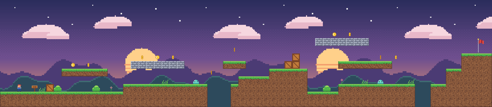

# Tutorial: a 2D platformer

**Time:** 35 minutes · **You'll need:** the [first scene](first-scene.md) and
[coin collector](coin-collector.md) tutorials, or some time in Oberon

You'll build *Pixel Peaks*: a side-on platformer with a painted, solid
tilemap, an animated hero, coins, slimes to stomp and a flag at the end.



Along the way you'll use:
- **tilemaps**, the tile brush and an **auto-tile**,
- **sprite sheets** and their **clips**,
- a **Camera 2D** that follows the player and stays inside the level,
- **2D physics**: solid tiles and a character controller,
- a jump that feels good: acceleration, coyote time, a jump buffer and a
  variable height,
- headless tests.

The [2D games](../oberon/2d.md) page describes every field used here. The
finished project is in
[`examples/oberon/platformer/`](../../../examples/oberon/platformer):

```console
cargo run -p oberon --release examples/oberon/platformer/level.ron
```

## 1. The art

Make a project with `oberon new pixel-peaks --template empty` and copy the
example's `sprites/` folder into it. The example draws all its art in
`build_art.py`, so you can also run that and change colours in code:

| Image | What's in it |
|---|---|
| `tiles.png` | 8 × 4 tiles of 16 px. Tiles 0–15 are the ground auto-tile, then a brick, a crate, a bush, a flower, tall grass and a sign |
| `hero.png` | 4 × 2 frames: idle 0–1, run 2–5, jump 6, fall 7 |
| `coin.png`, `slime.png`, `flag.png` | Small animations of 4, 2 and 2 frames |
| `sky.png` | The backdrop |

Delete the sun and the camera the template made: a 2D scene needs neither.

## 2. Paint the level

**+ Create → Tilemap** and name it **Ground**. Move it to (0, 0, 0): the
grid grows right and up from there. In the Inspector:

1. Set **Tileset** to `sprites/tiles.png` and **Tiles** to 8 × 4.
2. Set **Grid** to 64 × 14.
3. Click **+ Auto-tile**, name it `Ground` and leave **First** at 0. Its 16
   tiles are the ground with grass, edges and corners in every combination.
4. Click **Clear All** to remove the starter floor.

The viewport switches to the 2D view (press **2** to toggle it). Pick the
`Ground` auto-tile in the palette and drag in the viewport to paint. Paint a
floor two cells deep, with gaps for pits, and some steps and ledges. The
grass and edges sort themselves out as you paint. Pick **Tile 16** (the
brick) and **Tile 17** (the crate) for blocks.

A jump goes about 3 cells up and 6 across, so keep every climb 2 cells or
less and every gap under 5.

**Solid** is on, so every painted cell is ground. Make a second tilemap the
same size called **Scenery**, with **Solid** off and **Layer** -1, for the
bushes, flowers, grass and sign (tiles 18–21). It draws behind and nothing
collides with it.

## 3. The hero

**+ Create → 2D Player** makes an entity called **Player** with a Sprite, a
Collider 2D and a character controller. Put it on the floor, near the left
edge. In its Sprite:

1. Set **Image** to `sprites/hero.png` and **Sheet** to 4 × 2.
2. Turn **Pixel Art** on and set **Layer** to 2, in front of everything.
3. Add four clips, as below, and set **Plays First** to idle:

| Clip | First | Last | FPS |
|---|---|---|---|
| idle | 0 | 1 | 2 |
| run | 2 | 5 | 12 |
| jump | 6 | 6 | 10 |
| fall | 7 | 7 | 10 |

Make the **Collider 2D** box 0.6 × 0.9 with an **Offset** of (0, -0.05). A
box a little narrower than the art doesn't snag on ledge corners, and its
bottom meets the hero's feet. The character controller snaps to the ground
below it, so the hero stays on the floor when running down steps.

## 4. The camera

**+ Create → Camera 2D**, named **Camera**. Its **Camera Follow 2D**
already targets "Player". Set:
- **Half Height** to 5, so the view is 10 cells tall,
- **Offset** to (0, 1), to see a little more above the hero than below,
- **Smoothing** to 0.12 and **Dead Zone** to (1, 0.75),
- **Bounds** to (0, 0, 64, 14), the level's edges, so the view never shows
  past them.

Press **Play**. The 2D Player runs and jumps with its built-in controls, and
the camera follows it.

## 5. The player script

Now give the Player its own script, `scripts/player.py`. The tuning goes at
the top:

```python
# scripts/player.py
SPEED = 7.0  # cells per second
ACCEL = 60.0  # how fast it gets up to speed (cells/s per second)
JUMP = 13.5  # take-off speed: about 3 cells high
GRAVITY = 28.0
FALL_MAX = 18.0
CUT = 0.45  # letting go of jump early keeps this much of the upward speed
COYOTE = 0.1  # seconds after leaving a ledge a jump still counts
BUFFER = 0.12  # seconds before landing a jump press is remembered
```

### Running

Instead of jumping straight to full speed, the hero eases toward it. It
turns round twice as fast as it starts, which feels responsive without
being twitchy:

```python
# scripts/player.py
    # Running: ease toward the wanted speed (quicker to turn than to start).
    target = x_in * SPEED
    turning = s["vx"] * target < 0
    s["vx"] = approach(s["vx"], target, ACCEL * dt * (2.0 if turning else 1.0))
```

### Jumping

Three small tricks make a jump feel fair:
- **Coyote time:** a jump still works for 0.1 s after running off a ledge.
- **Jump buffer:** a press up to 0.12 s before landing counts.
- **Variable height:** letting go of the button early cuts the jump short.

`since_ground` and `since_press` count the seconds since each:

```python
# scripts/player.py
    grounded = entity.grounded
    s["since_ground"] = 0.0 if grounded else s["since_ground"] + dt
    s["since_press"] = 0.0 if jump_pressed(keys) and not s["won"] else s["since_press"] + dt
    vy = s["vy"]
    if s["since_press"] <= BUFFER and s["since_ground"] <= COYOTE and vy <= 0.0:
        vy = JUMP
        s["since_press"] = s["since_ground"] = 99.0
        s["jumped"] = True
    elif grounded and vy <= 0.0:
        vy = -2.0  # keep in touch with the ground
        s["jumped"] = False
    else:
        if vy > 0.0 and s["jumped"] and not jump_held(keys):
            vy *= CUT ** (dt * 60.0) if vy > JUMP * 0.3 else 1.0
        vy = max(vy - GRAVITY * dt, -FALL_MAX)
    s["vy"] = vy
    entity.character_velocity = (s["vx"], vy, 0.0)
```

The character controller moves the body by `character_velocity` and stops
it at walls and floors. `entity.grounded` reports whether it's standing on
something.

### The animation

The sprite faces the way the hero runs, and the clip follows what the body
is doing. `play` does nothing when that clip is already playing, so you can
call it every frame:

```python
# scripts/player.py
    sprite = entity.sprite
    if sprite is not None:
        if abs(x_in) > 0.01:
            sprite.flip_x = x_in < 0
        if not grounded and s["since_ground"] > COYOTE:
            sprite.play("jump" if vy > 0 else "fall")
        elif abs(s["vx"]) > 0.5:
            sprite.play("run")
        else:
            sprite.play("idle")
```

## 6. Coins, slimes and the flag

Make a coin: **+ Create → Sprite**, named **Coin 1**, with `sprites/coin.png`,
**Sheet** 4 × 1, **Size** 0.75 × 0.75 and a looping `spin` clip of frames
0–3. Duplicate it (**Ctrl+D**) along the level. Every coin's name starts
with "Coin".

Make a slime the same way: `sprites/slime.png`, **Sheet** 2 × 1 and a `hop`
clip. Give it `scripts/slime.py` and a Float attribute `range` of 2. It
patrols back and forth, and turns to face the way it goes:

```python
# scripts/slime.py
    x += d * SPEED * ctx.time.delta
    if abs(x - hx) >= reach:
        x = hx + math.copysign(reach, x - hx)
        entity.state["dir"] = -d
    entity.transform.position = (x, hy, hz)
```

The player script decides what touching things does. A coin within 0.7
cells is collected. Landing on a slime while falling squashes it and
bounces the hero up. Touching one any other way sends the hero back to the
start:

```python
# scripts/player.py
        elif name.startswith("Slime"):
            sx, sy, _ = e.transform.position
            if abs(sx - px) < TOUCH[0] and abs(sy - py) < TOUCH[1]:
                if vy < 0 and py > sy + 0.3:
                    e.despawn()  # landed on it
                    s["vy"] = STOMP_BOUNCE
                    s["jumped"] = False
                else:
                    respawn(entity, s)
                    return
```

Respawning just moves the Transform back to where the hero started. The
character controller picks up the new position on the next step:

```python
# scripts/player.py
def respawn(entity: Entity, s: dict) -> None:
    entity.transform.position = s["spawn"]
    s["vx"] = s["vy"] = 0.0
```

Add a **Flag** sprite (`sprites/flag.png`, **Size** 1 × 2) at the end. When
the hero reaches it, the script sets `won`, stops the controls and shows
"You made it!" on the HUD with the coin count.

## 7. The sky

Add a **Sky** sprite with `sprites/sky.png`, **Size** 32 × 18 and **Layer**
-10, in the middle of the level. A backdrop that moves a little slower than
the level looks far away. `scripts/sky.py` keeps 85% of the camera's
movement:

```python
# scripts/sky.py
    hx, hy, hz = entity.state["home"]
    cx, cy, _ = camera.transform.position
    entity.transform.position = (
        hx + (cx - hx) * FOLLOW,
        hy + (cy - hy) * FOLLOW,
        hz,
    )
```

## 8. Test it headless

Tests play the real scene with no window. Moving the player from the
`update` callback stands in for running and jumping there:

```python
def test_touching_a_coin_collects_it():
    seen = play(15, teleport(10, "Coin 1"))
    assert seen[-1]["attrs"]["coins"] == 1
```

The example's `tests/test_platformer.py` also checks stomping, dying,
falling into a pit, reaching the flag, the camera's bounds and that the
saved level and art match `build_level.py` and `build_art.py`:

```console
pytest examples/oberon/platformer/tests
```

## Where next

- Export it with **Build → Build**, as in the [shooter](fps.md#7-export-it).
- Change the layout in code: `build_level.py` writes the whole scene from an
  ASCII map, one character per cell.
- Read about everything else on the [2D games](../oberon/2d.md) page:
  auto-tile masks, `ctx.physics2d`, triggers and the limits.
