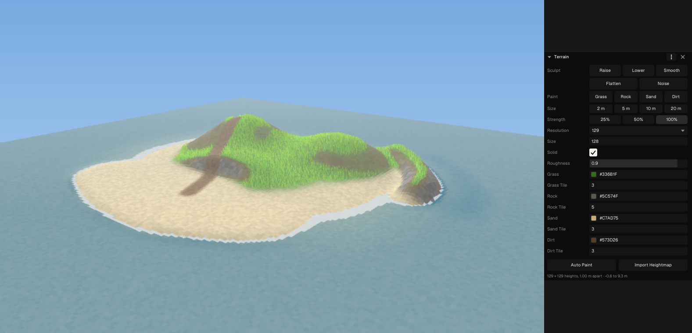

# Island

A small island sculpted and painted entirely with Oberon's Terrain brushes:
a sandy beach and a cove on the south, two grassy hills, a dirt path from
the beach up between them, and sea cliffs on the north-east headland.



| What | How |
| --- | --- |
| **Island** | A `Terrain` 128 × 128 m (129 × 129 heights, one a metre). Raised with big soft Raise strokes, then Smooth; the hills raised on top. The headland is raised hard with a small brush and the sea side lowered, so it stands sheer. The beach is Flattened to just above the water |
| **Paint** | **Auto Paint**: sand along the Sea's edge, rock on the cliffs, dirt on the steep slopes, grass elsewhere. The path is painted on with the Dirt brush |
| **Sea** | An endless `Water` at y = 1.5. Auto Paint reads its height |
| **Meadow** | A `Grass` field painted over the hills with the Paint brush. It stands on the terrain wherever it's painted, and is erased off the beach, the cliffs and the path |
| **Player** | A Character Controller standing on the beach. The terrain is solid (a heightfield collider), so press Play and walk up the hills |

```bash
cargo run -p oberon --release examples/oberon/island/level.ron
```

How it was made: `crates/oberon/tests/island.rs` replays the strokes
through the same calls Oberon's Inspector and brush make (nothing is set on
the terrain directly) and checks the result is still an island with
beaches, cliffs and grassy hills, and that `level.ron` matches it. To
rewrite `level.ron` after changing the strokes or the brushes:

```bash
OBERON_WRITE_ISLAND=1 cargo test -p oberon --no-default-features --test island
```

Things to try in Oberon:

- Select **Island**, click **Raise** under Terrain and drag on the sea to
  grow another islet. **Lower** digs, **Smooth** softens, **Flatten**
  levels to the height where the stroke began, **Noise** roughens.
  Ctrl+Z undoes a whole stroke.
- Pick **Sand**, **Rock**, **Grass** or **Dirt** under Paint and paint by
  hand, or move the Sea up a metre and press **Auto Paint**.
- **Import Heightmap** loads a greyscale PNG (black = low, white = high).
- Raise the **Resolution** to 257 for finer detail (the shape is kept).
