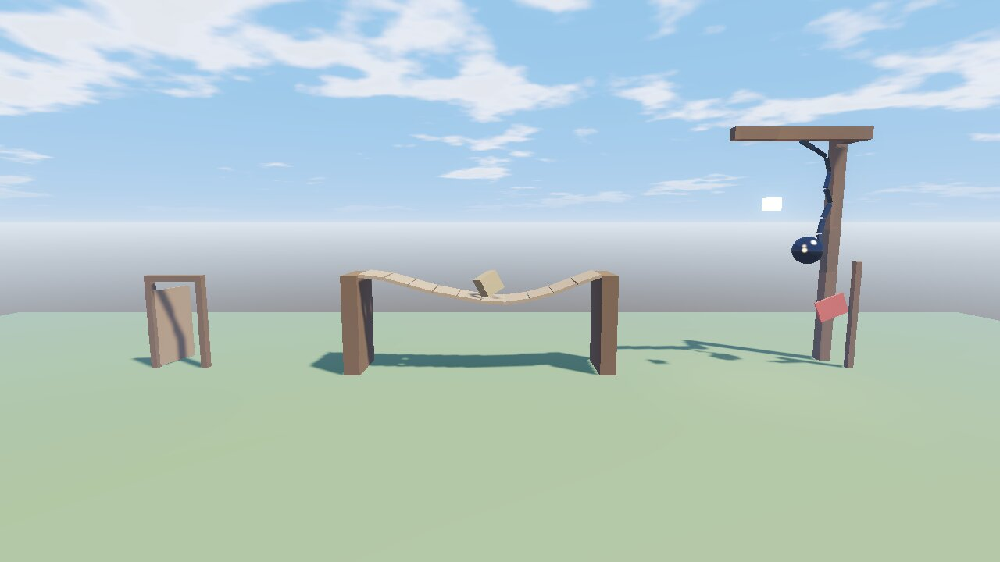

# Joint Yard



Physics joints, three ways. Everything that moves is held by a **Joint**
component, and nothing needs code except the door's motor and the sign's
"crash!":

| Thing | Joint | What it shows |
|---|---|---|
| **Door** | Hinge to *Door Frame*, limits ±97°, motor with a target | `scripts/door.py` flips `entity.joint.motor_target` every 3 s (or on **E**) |
| **Rope bridge** | Ten planks, each hinged to the last; the right post holds the end | Sags under a dropped crate |
| **Chain** | Eight links on Ball joints from the beam, a heavy ball on the end | Starts sideways, swings down |
| **Sign** | Fixed to its post, `break_force` 120 N | The ball snaps it off; `scripts/sign.py` gets `on_joint_broken` |
| **Lantern** | Spring to the beam | Bobs |

```sh
python examples/oberon/joint_yard/build_level.py      # writes level.ron
cargo run -p oberon --release examples/oberon/joint_yard/level.ron
pytest examples/oberon/joint_yard/tests
```

Select any of them in Oberon to see its Joint section in the Inspector:
the type, **Connected To** (a menu of the scene's entities), the anchor,
and only the settings that type uses. See the
[Physics guide](../../../docs/wiki/guides/physics.md#joints).
