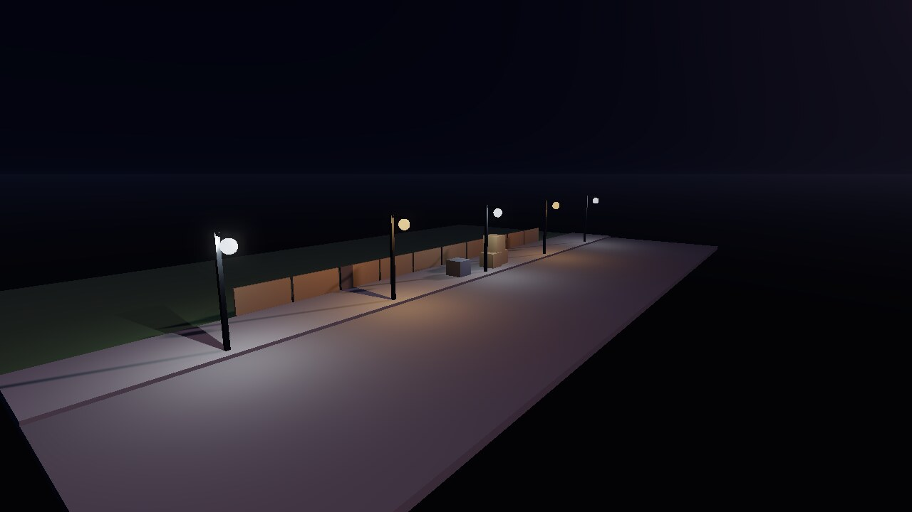

# Lamplight Lane



A street built from [prefabs](../../../docs/wiki/oberon/prefabs-and-attributes.md).
Every lamp, fence panel and crate is a linked instance of a file in
`prefabs/`.

```console
cargo run -p oberon --release examples/oberon/lamplight_lane/level.ron
```

| Prefab | Instances | Shows |
|---|---|---|
| `lamp_post` | three cool lamps | a prefab of four entities (post, arm, glowing globe, Point Light) |
| `lamp_post_warm` | two amber lamps | a **variant**: it stores only its amber globe and light, and takes the rest from `lamp_post` |
| `fence` | ten panels | one panel laid out along a line, as Edit ▸ Duplicate Along… does |
| `crate` | four crates | the *Heavy Crate* **overrides** its colour and its `hp` attribute |

Things to try in Oberon:

- Select the Heavy Crate. The Inspector's Prefab block lists its two
  overrides, each with a Revert button. **Apply** writes them into
  `crate.prefab`, and every crate turns grey.
- Open `prefabs/lamp_post.prefab` in the code editor and change the post's
  colour. Save, and all five lamps follow, the amber ones too.
- Ctrl+click two lamps' globes in the Hierarchy and change the colour once.
  Both change, and one Ctrl+Z undoes both.
- Select Fence 10, press **Ctrl+Shift+D**, and add five more panels.
- Turn on **Snap** in the scene toolbar and drag a crate: it lands on the
  half-metre grid.
- Open **Window ▸ Profiler** and press Play.

`build_level.py` writes the prefabs, the variant and the scene from
Python, with the instances linked:

```console
python examples/oberon/lamplight_lane/build_level.py
pytest examples/oberon/lamplight_lane/tests
```
