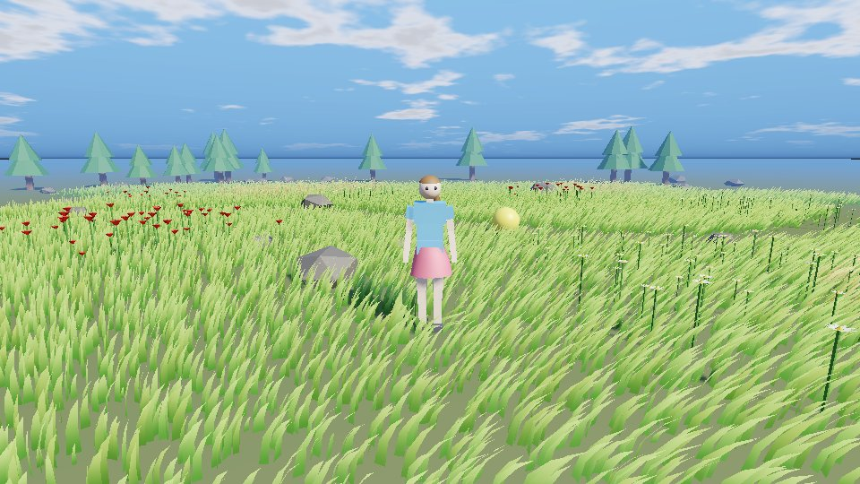

# Meadow

A windy meadow to walk through: the grass and foliage example.



| What | How |
| --- | --- |
| **Meadow** | A `Grass` field 30 × 30 m. A footpath is cut through it with erase strokes, and patches past its edge are painted on |
| **Wildflowers** | Tall golden grass, painted in soft patches |
| **Rocks, Poppies, Daisies, Trees** | `Scatter`: each entity's model (from `make_foliage.py`) drawn at many spots instead of once |
| **Runner** (you) | Has a Character Controller, so the blades round her feet bend away from her. Her ponytail and skirt are spring bones: they blow in the same wind as the grass |
| **Ball** | A dynamic body: kick it (walk into it, or press K) and it leaves a wake through the grass |
| **Environment** | `wind=0.55` blowing toward 30°: the grass sways, gusts roll across the field |

| Key | Action |
| --- | --- |
| W A S D / arrows | Walk |
| Shift | Run |
| K | Kick the ball (when you're next to it) |
| Q / E | Orbit the camera |

```bash
python examples/oberon/meadow/make_foliage.py   # rewrites models/rock, poppy, daisy, tree.glb
python examples/oberon/meadow/build_level.py    # rewrites level.ron
cargo run -p oberon --release examples/oberon/meadow/level.ron
pytest examples/oberon/meadow/tests
```

Things to try in Oberon:

- Select **Meadow** and click **Erase** under Grass in the Inspector. Pick
  the 1.5 m brush and drag a new path across the field. Ctrl+Z undoes a
  whole stroke.
- Select **Poppies**, click **Paint** and add a bed under the trees.
- Raise the Environment's **Wind** to 1, then press Play and run through
  the field.
- Set the Meadow's **Draw Distance** to 20 and watch the far field thin
  out.

See [Grass & Foliage](../../../docs/wiki/guides/grass-and-foliage.md) and
[Oberon → Grass & foliage](../../../docs/wiki/oberon/foliage.md).
