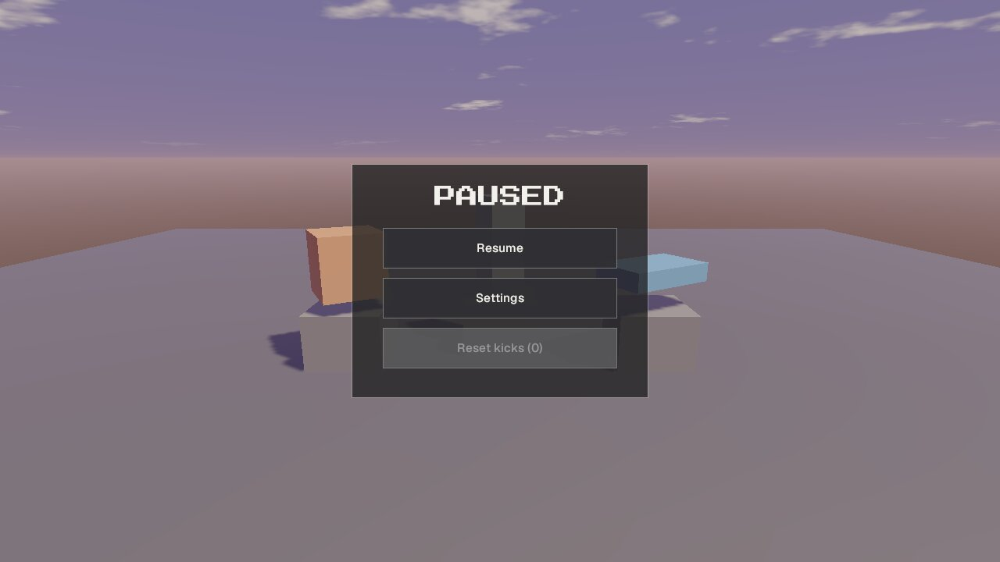
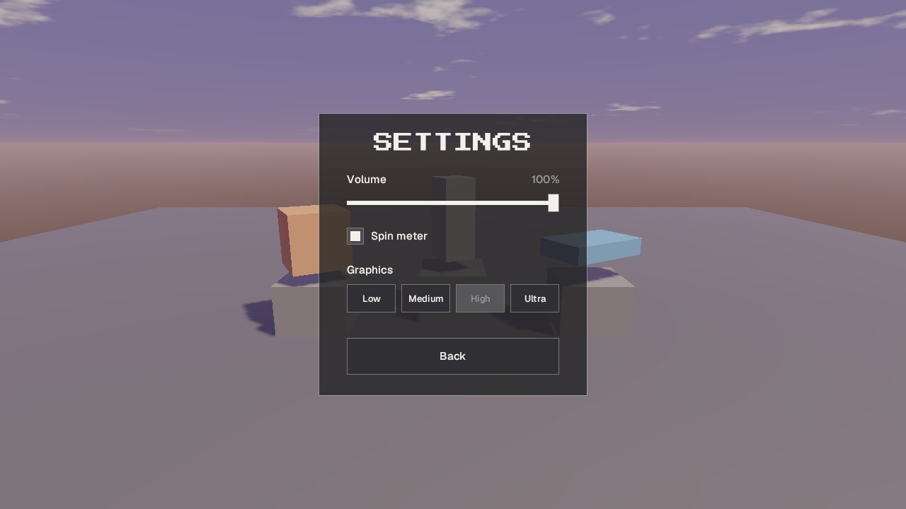
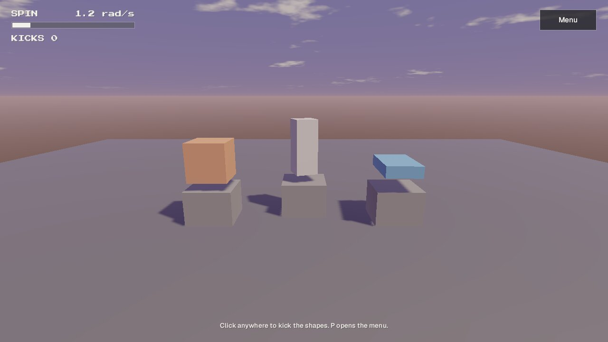

# Pause Menu



Game UI drawn by a script with `ctx.ui`. The **Menu** entity's
`scripts/menu.py` draws all of it, one call per widget, every frame:

| Screen | Widgets | What it shows |
|---|---|---|
| **Paused** (the start) | Panel, label, three buttons | Resume plays. *Reset kicks* is `enabled=False` until there are kicks, and keeps its `id=` while its text changes |
| **Settings** | Slider, toggle, a row of buttons, Back | Volume and the graphics preset go to `ctx.settings`, and so does a "Spin meter" setting of the demo's own. All three last between runs |
| **Playing** | Labels, progress bar, a Menu button | The cube's spin and the kick count. **P** opens and closes the menu too |



While playing, a click anywhere in the game gives the shapes a kick
(`scripts/spin.py` reads `ctx.input.mouse_just_pressed("left")`). Clicks
on the Menu button, or on any menu, never kick: a press that starts on the
UI is the UI's.

The titles and the HUD's numbers are drawn in Press Start 2P, a pixel font
in `fonts/` (`font="fonts/PressStart2P-Regular.ttf"`, under the SIL Open
Font License in `fonts/PressStart2P-OFL.txt`). The buttons keep the
built-in font.



```sh
python examples/oberon/pause_menu/build_level.py      # writes level.ron
cargo run -p oberon --release examples/oberon/pause_menu/level.ron
pytest examples/oberon/pause_menu/tests
```

See [Game UI](../../../docs/wiki/oberon/scripting.md#game-ui) in the
scripting guide.
