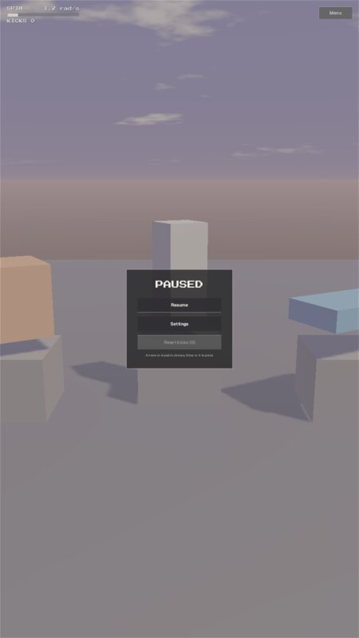

# Pause Menu


Game UI drawn by a script with `ctx.ui`. The **Menu** entity's
`scripts/menu.py` draws all of it every frame, one call per widget, with
no coordinates. Columns and rows anchored to the screen place everything:

| Screen | Built from | What it shows |
|---|---|---|
| **menu** (the start) | A centred `ui.column(panel=True)` with three buttons | Resume plays. *Reset kicks* is `enabled=False` until there are kicks, and keeps its `id=` while its text changes |
| **settings** | A column with `ui.row(columns=n)` button rows | Volume, the graphics preset and the UI size go to `ctx.settings`, and so does a "Spin meter" setting of the demo's own. All of them last between runs |
| Playing (no screen) | A column at the `top_left`, a button at `ui.place("top_right", ...)` | The cube's spin and the kick count, plus a Menu button |

The menus are `ctx.ui.screens`: `screens.show("menu", pause=True)` opens
one, and Settings opens over it. Both are modal, so the HUD under them
doesn't react. `screens.paused` stops the shapes (`scripts/spin.py`).
**Escape**, or **B** on a gamepad, closes the top screen. **P**, **Escape**
or **Start** opens the menu while playing (`settings.bind("pause", "p",
"escape", "pad_start")`).

**Keys and gamepads:** the arrow keys or the d-pad move the yellow focus
ring between widgets, **Enter** or **A** presses, and left and right move a
focused slider. The mouse works too.


**Any window size:** `ctx.ui.design_size = (1280, 720)` lays the UI out
for 1280×720 and scales it to fit. The player's **UI size** setting
(`ctx.settings.ui_scale`) multiplies the scale. On a phone held upright,
the same menu fits the width:



While playing, a click anywhere in the game gives the shapes a kick
(`scripts/spin.py` reads `ctx.input.mouse_just_pressed("left")`). Clicks
on the Menu button, or on any menu, never kick: a press that starts on the
UI is the UI's.

The titles and the HUD's numbers are drawn in Press Start 2P, a pixel font
in `fonts/` (`font="fonts/PressStart2P-Regular.ttf"`, under the SIL Open
Font License in `fonts/PressStart2P-OFL.txt`). The buttons keep the
built-in font.


```sh
python examples/oberon/pause_menu/build_level.py      # writes level.ron
cargo run -p oberon --release examples/oberon/pause_menu/level.ron
pytest examples/oberon/pause_menu/tests
```

See [Game UI](../../../docs/wiki/oberon/scripting.md#game-ui) in the
scripting guide.
