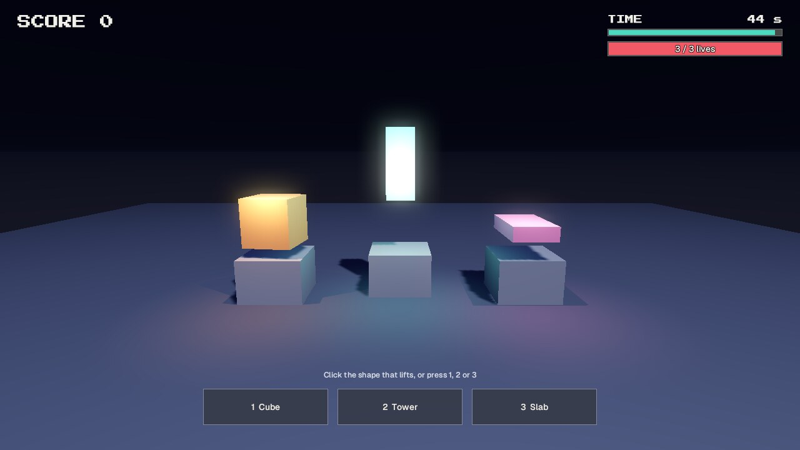
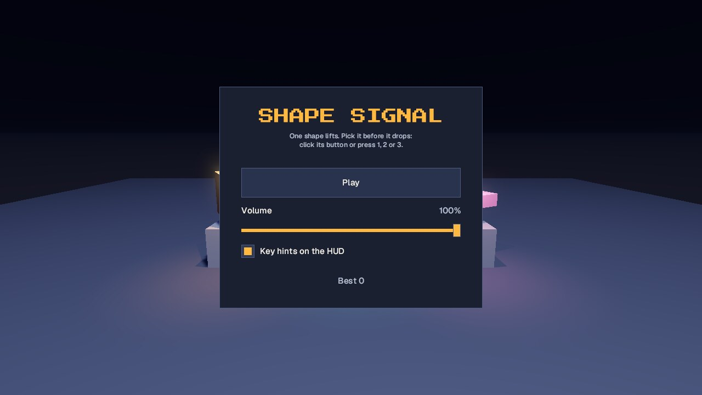

# Shape Signal



A small game whose screens were made in Oberon's [UI editor](../../../docs/wiki/oberon/ui-editor.md).
One of three shapes lifts. Pick it with the HUD's buttons (or **1**, **2**,
**3**) before it drops. Quick picks and streaks score more. A wrong or slow
pick costs one of three lives. A round lasts 45 seconds.

```console
cargo run -p oberon --release examples/oberon/shape_signal/level.ron
```

Open the files in `ui/` in Oberon to see and change the screens:

| Document | Screen | Its widgets |
|---|---|---|
| `ui/title.ui.ron` | **title**: modal, pauses the game | `play`, a `volume` slider and its `volume_text`, a `hints` toggle, the `best` score |
| `ui/hud.ui.ron` | **hud**: a HUD, under every screen | `score`, `streak`, the `time` bar and its `clock`, the `lives` bar (`"{value} / {max} lives"`), the `picks` row of `pick_1`…`pick_3`, `verdict`, the `keys` hint |
| `ui/results.ui.ron` | **results**: modal, pauses the game | `heading`, `final`, `detail`, `best`, `again`, `title` |

Each document has its own theme: amber and navy menus with a pixel-font
title, and a teal HUD. They're laid out for 1280×720 and scale to any
window.

`scripts/game.py` doesn't draw anything. It runs the rules and talks to
the documents by name:

```python
hud = ctx.ui.screen("hud")
hud.set("score", f"SCORE {s['score']}")      # a label
hud.set("lives", s["lives"])                 # a progress bar
if hud.clicked("pick_1") or ctx.input.just_pressed("1"): ...
title = ctx.ui.screen("title")
if title.changed("volume"):
    ctx.settings.volume = title.get("volume")
ctx.ui.screens.show("results")               # modal and pausing, as the document says
```

So you can move, restyle or reword anything in the editor, and the game
keeps working as long as the names stay. `tests/test_shape_signal.py`
checks the names the script needs are there. The volume, the hint toggle
and the best score are kept in `ctx.settings` between runs.
`scripts/shape.py` lifts the shape the Game entity's `lit` attribute
names, and holds still while a pausing screen is up.



```console
python examples/oberon/shape_signal/build_level.py   # rewrite level.ron
pytest examples/oberon/shape_signal/tests
```

The pixel font is Press Start 2P by CodeMan38, under the SIL Open Font
License (`fonts/PressStart2P-OFL.txt`).
