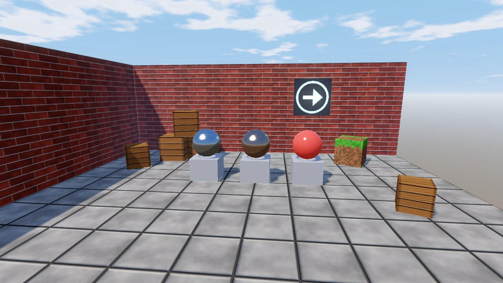

# Material Workshop



A room dressed only with shared [material files](../../../docs/wiki/oberon/materials.md).
Every surface names a `materials/*.mat.ron` file instead of carrying its
own colour.

```console
cargo run -p oberon --release examples/oberon/workshop/level.ron
```

| Material | Used by | Shows |
|---|---|---|
| `brick` | Back Wall, Side Wall | base colour, normal and roughness maps, tiling 8 × 5 |
| `floor_tiles` | Floor | the same three maps, tiling 6 × 5 |
| `crate` | all five crates | one file, five objects: edit it and they all follow |
| `brushed_steel`, `copper` | the turning balls | metal with a streaked roughness map |
| `glossy_paint` | Paint Ball | a material without textures |
| `neon` | Neon Sign | an emission map that also lights the wall |
| `grass_block` | Grass Block | a 16 × 16 texture kept crisp with **Pixelated** |

The plinths keep their own grey colour, to show that objects without a
material still work beside them.

Open a material in Oberon (double-click it in the Files panel) and drag a
slider: every object using it changes before you save. Drag a material from
the Files panel onto an object to dress it.

`textures.py` draws the textures with the Python standard library, and
`build_level.py` writes the materials and the scene:

```console
python examples/oberon/workshop/build_level.py
pytest examples/oberon/workshop/tests
```
